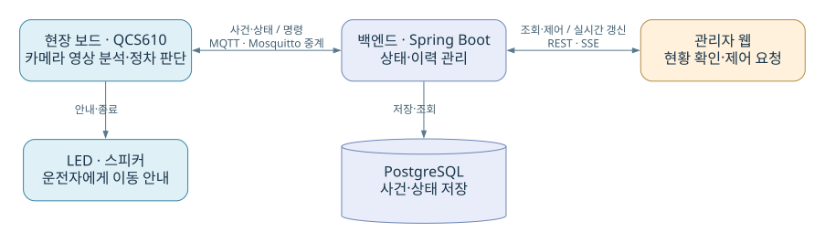

# 엣지 AI 주정차 안내 시스템

**현장에서 차량의 정차를 감지하고 이동을 안내하며, 관리자는 웹에서 상태와 이력을 확인합니다.**

지정 구역을 계속 지켜봐야 하는 관리 부담을 줄이기 위한 캡스톤 프로젝트입니다. 카메라 영상을 분석하는 엣지 보드가 LED·스피커를 제어하고, 서버가 사건 기록과 관리자 화면을 연결합니다.



*목표 구조입니다. 임의로 구성한 구역에서 실차로 검증하며, 법적 단속·과태료 부과는 수행하지 않습니다.*

## 개발 현황

| 현재 | 다음 구현 |
|---|---|
| 백엔드 기동·접근 제한 테스트·빌드 통과 | 가상 장치 → MQTT 수신 → DB 저장 → API 조회 |

차량 인식·현장 안내·관리자 화면을 포함한 제품 기능은 아직 미구현입니다. [진행 상황](docs/status.md) · [첫 구현 작업표](docs/first-slice.md)

## 시작하기

**Git · JDK 17 · 저장소 접근 권한**이 필요합니다. 첫 빌드에는 인터넷 연결이 필요하며, 현재 백엔드 기동에는 DB·브로커가 필요하지 않습니다.

```sh
git clone https://github.com/yh4752/parking-system.git
cd parking-system/backend
./gradlew test bootJar
./gradlew bootRun
```

<http://127.0.0.1:8080/actuator/health> → `{"status":"UP"}`이면 기동 성공입니다. 종료는 `Ctrl+C`. Windows에서는 `./gradlew` 대신 `.\gradlew.bat`를 사용합니다.

## 개발 문서

| 필요한 내용 | 문서 |
|---|---|
| 전체 구조·역할 분담 | [아키텍처](docs/architecture.md) |
| 서버·장치 통신 계약 | [백엔드 구조](docs/backend.md) · [메시지·API 정의](docs/contracts.md) |
| 담당별 시작점 | [AI](reference/v1.43/tasks/vision.md) · [데이터](reference/v1.43/tasks/data.md) · [프론트엔드](frontend/README.md) |
| 환경 설정·협업 규칙 | [개발 참여 안내](CONTRIBUTING.md) · [DB·브로커 실행](infra/README.md) |
| AI 코딩 도구용 지침 | [AGENTS.md](AGENTS.md) — 작업 전 읽고 시작 |
