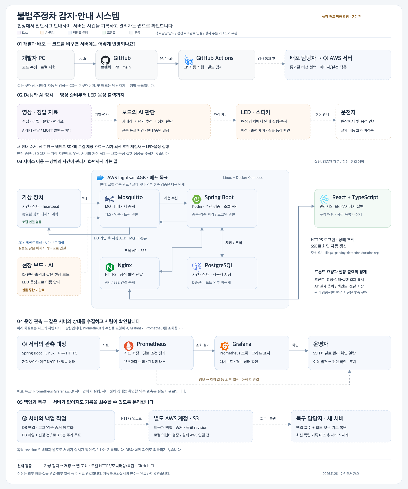

# 엣지 AI 기반 불법주정차 감지·안내 시스템

**지정 구역의 지속 정차를 감지해 현장에서 이동을 안내하고, 관리자가 차량 상태와 안내 이력을 확인하도록 만드는 캡스톤 프로젝트입니다.**

여러 사람이 이용하는 출입구·통행로의 불편을 줄이는 것을 목표로 합니다. 현장 보드가 차량의 정차를 판단하고 LED·음성 안내를 담당하며, 서버는 결과를 저장해 관리자 웹 화면에 제공합니다. 법적 위반 확정이나 과태료 부과는 수행하지 않습니다. 실제 통행 개선·업무 부담 감소 효과는 아직 검증하지 않았습니다.

[빠른 실행](#로컬에서-실행하기) · [아키텍처](#전체-흐름) · [담당별 시작점](#담당별-시작점) · [배포 상태](#팀-통합용-배포) · [상세 구현 상태](docs/status.md)

## 지금 사용할 수 있는 것

**가상 장치 → 사건 저장 → 관리자 화면까지 로컬에서 연결·검증했습니다. 실제 보드 통합과 외부 배포는 아직 완료하지 않았습니다.**

| 영역 | 구현·검증 완료 | 남은 작업 |
|---|---|---|
| 사건 수신·저장 | MQTT 메시지 검증, 중복·역순 처리, DB 저장 후 완료 응답 | 실제 보드와 연결 검증 |
| 관리자 웹 | 로그인·구역별 권한, 구역 상태, 사건 목록·상세, 실시간 갱신 | 팀원 PC 인수, 화면 개선, 관리 명령·정책 변경·사진 |
| 장치 연결 | 가상 장치의 로컬 저장·재전송·저장 응답 처리 | 실제 보드용 SDK 구현·결합, AI 판단·LED·스피커 연동 |
| 운영 | 로컬 HTTPS·모니터링·암호화 백업·복원, 외부 저장 연결 코드의 로컬 시험 | 실제 AWS 설정·부하·복구 검증, 외부 관측·알림 |

현재 공개 웹 주소는 없습니다. 아래 화면은 **실제 API에 연결된 가상 사건 화면**이며, 실물 AI의 판단 결과나 현장 안내 효과를 보여주는 것은 아닙니다.

<details>
<summary>관리자 화면 보기</summary>


</details>

## 로컬에서 실행하기

Git, Python 3.10 이상, 실행 중인 Docker와 Compose v2가 필요합니다. Windows에서는 WSL2를 사용합니다. 이 경로는 로컬 HTTP 인계 환경이며 클라우드 자원을 생성하지 않습니다.

**1. 저장소를 클론하고 실행합니다.**

```sh
git clone https://github.com/yh4752/illegal-parking-detection.git
cd illegal-parking-detection
python3 tools/handoff.py prepare
```

**2. <http://127.0.0.1:18081>에서 로그인합니다.**

- 아이디: `handoff-viewer`
- 비밀번호: 실행한 PC의 `.local-state/handoff/web-password` 파일에 생성

**3. 가상 사건을 보내고 화면 갱신을 확인합니다.** 같은 저장소 폴더에서 실행합니다.

```sh
python3 tools/handoff.py simulate
```

실습을 마치면 다음 명령으로 인계 환경을 중지합니다. 데이터는 보존합니다.

```sh
python3 tools/handoff.py stop
```

설치·실행 오류와 화면 개발은 [인계 설명서](docs/frontend-handoff.md)를 참고하세요. 프론트 코드를 직접 수정할 때는 Node.js 24.13.0을 사용합니다. HTTPS 실습은 별도의 [로컬 HTTPS 안내](docs/local-https.md)를 따릅니다. 기존 클론·데이터가 있다면 삭제하거나 초기화하지 말고 [협업 안내](CONTRIBUTING.md)를 먼저 확인하세요.

## 전체 흐름

| 흐름 | 연결과 역할 |
|---|---|
| 개발·배포 | 개발 PC → GitHub → Actions의 자동 시험·빌드 → 담당자가 검증한 버전 배포. **자동 배포 CD는 미구현** |
| Data·현장 안내 | Data의 영상·정답 → AI의 탐지·정차 판단 → 현장 LED·스피커 출력. 실물 통합은 미완료 |
| 사건 전달 | 장치 → Mosquitto 메시지 중계 → Spring Boot 검증 → PostgreSQL 저장 → 장치에 저장 완료 응답 |
| 화면 조회 | 팀원 브라우저의 React → Nginx → Spring Boot API. SSE로 저장된 상태 변경을 화면에 반영 |
| 운영 관측 | Prometheus가 앱·Linux·내부 HTTPS 지표 수집 → Grafana에서 운영자가 조회. 외부 알림은 미연결 |
| 백업·복구 | 암호화 백업 → 별도 AWS 계정의 S3 → 회수·복원. 실제 AWS 연결과 전체 서버 복구는 미검증 |

보드는 웹페이지에 데이터를 올리는 대신 **MQTT over TLS**로 연결합니다. 웹 브라우저는 **HTTPS**를 사용합니다. MQTT 중계기의 수신 확인과 DB 저장 완료 응답은 서로 다릅니다.



그림의 AWS Lightsail 4GB는 확정한 **배포 목표**입니다. 실선은 검증한 경로, 점선은 아직 연결·검증하지 않은 경로이며, 서비스 경로의 검증은 로컬 환경 기준입니다. Prometheus·Grafana는 같은 서버에 두고, 백업 저장소는 별도 AWS 계정에 둡니다.

[확대용 PDF](docs/diagrams/presentation-overview.pdf) · [벡터 SVG](docs/diagrams/presentation-overview.svg) · [그림 원본과 읽는 순서](docs/architecture-figure.md) · [상세 구조](docs/architecture.md)

## 담당별 시작점

그림의 **보라색 Data · 주황색 AI·장치 · 파란색 백엔드·운영 · 초록색 프론트**는 개발 담당을 나타냅니다. 회색은 공동 개발 도구입니다. 색상은 완료 여부가 아니며, 실제 실행 위치와도 구분합니다. 배포·운영을 세분화한 그림이므로 상자 수나 면적을 담당별 작업량·난도·기여도로 해석하지 않습니다.

**LED·음성 출력은 AI·장치 담당입니다.** 현장 보드에서 안내 조건을 판단하고 배선·출력 제어·중단·실물 동작을 확인합니다. 백엔드는 보드에서 사용하는 저장·통신 SDK를 작성하고, AI 담당이 이를 실제 보드에 결합합니다. 프론트는 관리자 화면의 요청·상태·실행 결과를 표시합니다. 관리 명령 기능은 아직 후속 범위입니다.

새 안내는 **AI 판단 → SDK의 로컬 저장 완료 → AI의 최신 조건 재검사 → LED·음성 실행** 순서로 설계합니다. 안전 중단·LED 끄기는 저장 지연에도 우선합니다. 서버의 DB 저장 응답(ACK)은 물리 출력 성공을 뜻하지 않습니다. [역할 기준](reference/v1.43/spec/roles/B1.md) · [출력 책임 규칙](reference/v1.43/spec/roles/B3.md)


| 담당·목적 | 먼저 읽을 자료 | 맡을 범위 |
|---|---|---|
| 프론트 | [팀 인계](docs/team-handoff.md) · [프론트 README](frontend/README.md) | 본인 PC 실행 확인, 화면·사용성 개선, 필요한 API 협의 |
| 백엔드 | [백엔드 구조](docs/backend.md) · [통신·API 계약](docs/contracts.md) | 수신·저장·권한·API, 보드용 저장·통신 SDK |
| AI·보드 | [SDK 연결 경계](edge-sdk/README.md) · [AI 담당 작업](reference/v1.43/tasks/vision.md) | 보드 환경 제공, 차량 판단, 카메라·LED·스피커, SDK 결합 |
| Data | [Data 담당 작업](reference/v1.43/tasks/data.md) | 영상·라벨·정답·평가 자료를 AI 담당에게 전달 |
| 배포·운영 | [외부 저장·배포 준비](docs/external-storage-preparation.md) · [서버 설치 절차](infra/server/README.md) | AWS 설정, 보안 접속, 실제 부하·백업·복구 검증 |

`reference/v1.43`은 보존된 역할·계약 기준입니다. 실제 구현 완료 여부는 [현재 상태](docs/status.md)를 따릅니다. 팀원에게 제공할 [AI 코딩 도구용 프론트 인계 컨텍스트](docs/frontend-handoff-context.json)도 있습니다.

## 팀 통합용 배포

2026-11-26 기준 **AWS Lightsail 4GB로 팀 통합용 배포를 진행하는 방향**입니다. 서버 생성·주소 등록·외부 접속 인수는 아직 수행하지 않았습니다.

- 운영 계획: 총 5만 원 목표, 2026년 12월 11일까지 사용. 비용·실행 조건은 [배포 준비](docs/deployment-readiness.md)를 확인합니다.
- 주소 후보: `illegal-parking-detection.duckdns.org` — 미등록이며 현재 접속 주소가 아닙니다.
- 웹 접속과 보드 접속은 별도로 검증합니다. DB·관리 포트는 외부에 직접 공개하지 않습니다.
- 팀 개방 전 실제 로그인·사건 저장·응답·화면 갱신과 백업·복구를 확인합니다. 보드 연결 규격은 [팀 연결 안내](docs/team-integration-preparation.md)를 따릅니다.

배포 작업은 [후속 이슈 #6](https://github.com/yh4752/illegal-parking-detection/issues/6)에서 추적합니다. 로컬 시험·CI 통과가 실제 서버 인수를 대신하지는 않습니다.

## 검증 근거와 협업

[GitHub Actions](.github/workflows/verify.yml)는 PR과 main 변경 시 문서·계약·백엔드·DB·프론트·통합 환경을 검사합니다. 실행 결과는 [Actions](https://github.com/yh4752/illegal-parking-detection/actions)에서 확인합니다.

- [현재 구현·검증 범위](docs/status.md): 완료한 기능, 실행 조건, 남은 작업
- [30분 연속 로컬 실행 기록](validation/preflight-4gb-continuous-2026-11-18/README.md): 요청·사건·백업 중 상태 관측
- [외부 저장 통합 시험 기록](validation/external-integration-2026-11-19/README.md): 모의 S3와 실제 제품 DB의 복원·재개 시험
- [학습·블로그 근거](docs/operations-learning-evidence.md): 결정 이유·로그·캡처·측정값
- [학습 순서](docs/learning-map.md) · [운영 기초와 이해 질문](docs/production-basics.md)

개발은 최신 `main`에서 작업 브랜치를 만들고 PR로 합칩니다. 검사 명령·협업 절차는 [CONTRIBUTING.md](CONTRIBUTING.md), 코딩 도구의 작업 규칙은 [AGENTS.md](AGENTS.md)를 따릅니다. 비밀번호·개인키·실차 원본 영상은 커밋하지 않습니다.
