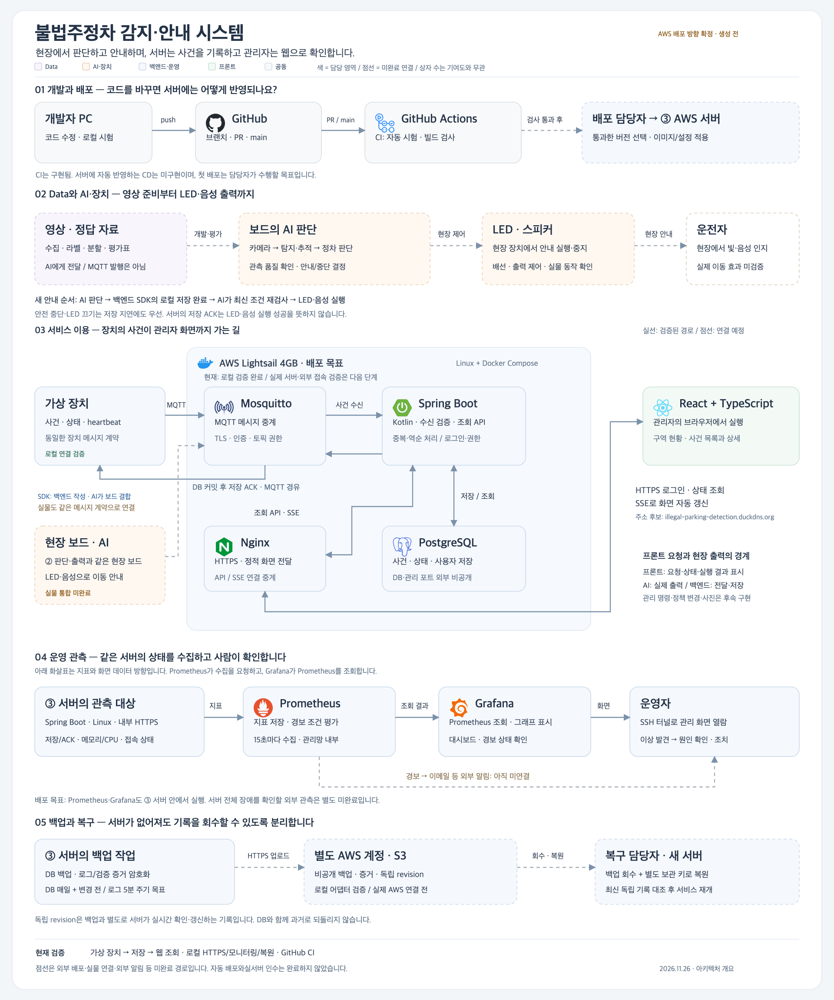
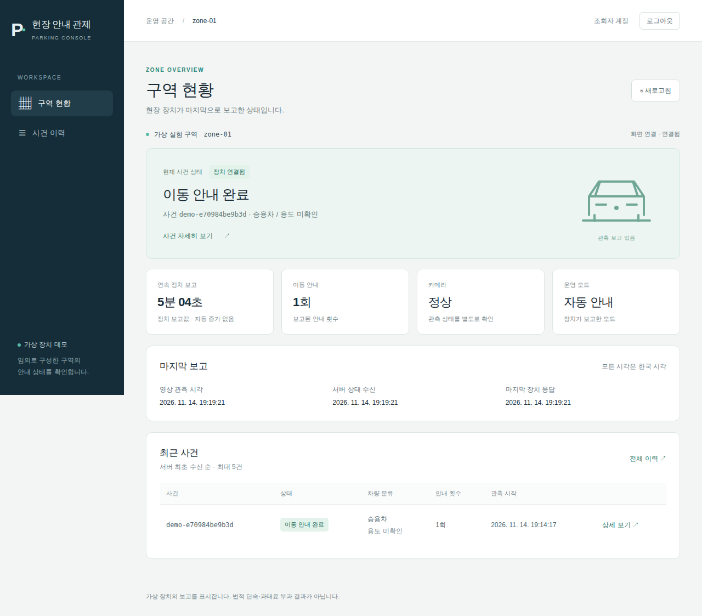

# 엣지 AI 기반 불법주정차 감지·안내 시스템

**현장에서 차량의 지속 정차를 감지해 LED·음성으로 이동을 안내하고, 관리자가 웹에서 상태와 이력을 확인하도록 만드는 캡스톤 프로젝트입니다.**

출입구·통행로 등 지정 구역의 차량 확인과 반복 안내 업무를 보조하는 것이 목표입니다. 현장 보드가 판단·안내를 맡고, 서버는 장치가 보고한 사건과 상태를 저장해 관리자 화면에 제공합니다. 법적 위반 확정이나 과태료 부과를 수행하는 시스템은 아닙니다.

[시스템 아키텍처](#시스템-아키텍처) · [주요 기능과 구현 상태](#주요-기능과-구현-상태) · [기술 구성](#기술-구성) · [문서](#문서)

## 시스템 아키텍처

그림을 클릭하면 확대할 수 있습니다. **실선은 로컬에서 검증한 연결, 점선은 연결·검증 예정인 경로**입니다. AWS는 배포 목표이며 현재 공개 서비스는 아닙니다.

## 주요 기능과 구현 상태

2026-11-26 기준, **가상 장치 → 사건 저장 → 관리자 웹 조회**를 로컬 환경에서 검증했습니다.

| 기능 | 내용 | 현재 상태 |
|---|---|---|
| 현장 감지·안내 | 카메라 기반 정차 판단, LED·음성 안내 | 실제 보드·AI·출력 통합 검증 예정 |
| 사건 수신·저장 | MQTT 메시지 검증, 중복·역순 처리, DB 저장 후 응답 | 가상 장치로 구현·검증 |
| 관리자 화면 | 로그인·구역별 권한, 구역 상태, 사건 목록·상세, 실시간 갱신 | 실제 API와 연결·검증 |
| 운영·복구 | HTTPS, 지표 수집·조회, 암호화 백업·복원 | 로컬 검증 완료, 실제 클라우드 검증 예정 |

실물 AI의 탐지 성능, 안내에 따른 차량 이동 효과, 관리 업무 부담 감소는 아직 검증하지 않았습니다. 관리 명령·정책 변경·사건 사진은 후속 개발 범위입니다.

관리자 화면 — 가상 사건 데이터

실제 API에 연결한 화면이며, 실차·실물 AI의 검증 결과를 뜻하지 않습니다.

## 기술 구성

| 영역 | 기술과 역할 |
|---|---|
| 웹 | React · TypeScript — 관리자 화면, SSE 기반 상태 갱신 |
| 서버 | Kotlin · Spring Boot — 메시지 검증, 인증·권한, 조회 API |
| 통신·저장 | Mosquitto(MQTT) · PostgreSQL — 장치 메시지 중계, 사건·상태 저장 |
| 실행·운영 | Docker Compose · Nginx — 서비스 실행과 HTTPS 연결 |
| 관측·검증 | Prometheus · Grafana · GitHub Actions — 지표 수집·조회, 자동 시험·빌드 |

## 문서

- [상세 아키텍처](docs/architecture.md) · [통신·API 계약](docs/contracts.md) · [그림 원본](docs/architecture-figure.md)
- [구현·검증 기록](docs/status.md) · [연속 실행 측정](validation/preflight-4gb-continuous-2026-11-18/README.md) · [백업·복원 통합 시험](validation/external-integration-2026-11-19/README.md)
- [로컬 실행·팀 개발 안내](docs/team-development-guide.md) · [기여 방법](CONTRIBUTING.md)
