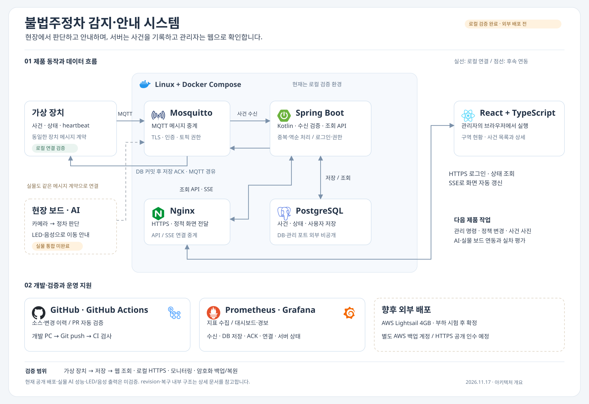

# 발표·블로그용 아키텍처 그림

2026-11-17 · 현재 로컬 연결과 후속 계획을 구분한 설명용 그림



## 사용할 파일

- [PNG](diagrams/presentation-overview.png): README·블로그·슬라이드에 바로 삽입하는 1920 × 1320 이미지.
- [SVG](diagrams/presentation-overview.svg): 확대해도 선명한 벡터 파일. 텍스트·도형을 편집할 수 있으며 저장소의 수정 기준은 아래 생성 원본이다.
- [PDF](diagrams/presentation-overview.pdf): 한 페이지 공유·인쇄본.

실선은 로컬에서 연결·검증한 경로, 점선은 실물 장치 연동·외부 배포 계획이다. 가상 장치의 사건은 MQTT → Spring Boot → PostgreSQL로 저장되며, DB 커밋 후 ACK는 MQTT를 거쳐 장치로 돌아간다. React는 관리자 브라우저에서 실행되고 Nginx가 정적 파일과 API·SSE 연결을 제공한다.

화면·배포의 모든 세부를 담은 그림은 아니다. revision·격리 복원·네트워크 상세는 [아키텍처 설명](architecture.md), [운영 배포](deployment-operations.md), [로컬 백업](local-backup.md)을 따른다. 실물 AI·LED/음성 출력·공개 배포 완료나 성능 측정의 증거로 사용하지 않는다. 캡처·실행 수치의 근거는 [증거 모음](operations-learning-evidence.md)에서 확인한다.

## 수정 가능한 원본

| 파일 | 수정·보존 내용 |
|---|---|
| [build-overview.py](../tools/docs/build-overview.py) | 문구·카드 좌표·색·아이콘·화살표. Python 표준 라이브러리로 SVG 생성 |
| [아이콘 출처와 목록](../tools/docs/assets/simple-icons/README.md) | 실제 사용한 로컬 SVG 아이콘과 CC0 라이선스. 재생성 중 다운로드하지 않음 |
| [build.mjs](../tools/docs/build.mjs) | 기존 C4·문서 생성과 함께 개요 SVG 생성 |
| [export-overview.mjs](../tools/docs/export-overview.mjs) | 같은 SVG를 Chromium에서 PNG·PDF로 출력 |

그림의 선·라벨을 바꿀 때는 SVG 생성물을 직접 수정하지 않고 `build-overview.py`를 수정한다. 기존 C4 DOT 그림도 그대로 유지한다. 이 그림 추가로 통신 계약이나 시스템 책임을 변경하지 않았다.

## 재생성과 내보내기

저장소 루트에서 실행한다. 일반 문서 생성에는 Node.js 24와 Python 3만 필요하며, 문서 의존성을 설치한 후에는 네트워크 없이 실행할 수 있다.

```sh
npm --prefix tools/docs ci
npm --prefix tools/docs run build
```

그림을 변경했다면 PNG·PDF도 다시 출력한다. 아래 설치는 처음 한 번 필요하며, 이미 프론트 브라우저 검증 환경이 있으면 재설치하지 않아도 된다.

```sh
npm --prefix frontend ci
cd frontend
npx playwright install chromium
cd ..
node tools/docs/export-overview.mjs
python3 tools/check_structure.py
```

SVG·PNG·PDF와 변경한 원본을 함께 커밋한다. 기본 문서 생성은 SVG·HTML만 갱신하므로 PNG·PDF를 빠뜨리지 않는다. PNG·PDF는 실행 환경의 글꼴에 따라 모양이 달라질 수 있다. 승인 시안은 macOS의 Apple SD Gothic Neo를 사용했으며 다른 환경에서는 Noto Sans KR 등 한국어 글꼴을 준비한 뒤 글자 잘림·겹침과 한 페이지 출력을 확인한다. 글꼴 파일 자체는 저장소에 포함하지 않는다.

## 출처와 확인 범위

구조의 근거는 [현재 구현 상태](status.md), [팀 아키텍처](architecture.md), [로컬 HTTPS Compose](../infra/deploy/compose.yaml)다. 첨부받은 참고 이미지의 밝은 배경·카드·기술 아이콘 표현을 참고해 프로젝트 구성에 맞게 작성했다. 참고 이미지 파일 자체는 저장소에 넣지 않는다.

브랜드 아이콘은 [Simple Icons](https://github.com/simple-icons/simple-icons)의 CC0 배포본이다. 아이콘 저작권 라이선스와 각 브랜드의 상표 사용 조건은 구분한다. 상세 파일 목록·해시는 [아이콘 안내](../tools/docs/assets/simple-icons/README.md)에 보존한다. 문서 그림을 추가한 작업이며 계정 생성·구매·외부 배포는 수행하지 않았다.
