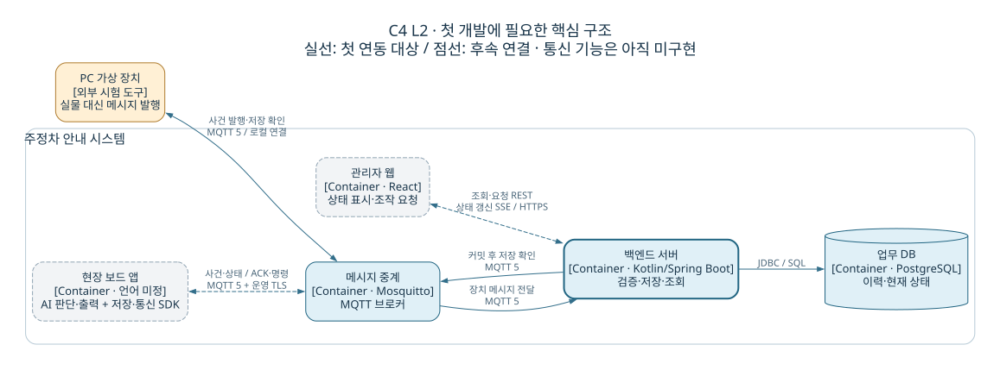

# 팀이 먼저 알아야 할 구조

제품 기준 v1.43 · 시작 자료 v0.2 · 2026-11-11

## 1. 무엇을 만들고, 지금 어디까지 하나요?

현장 보드가 차량의 정차를 판단해 LED·음성으로 안내하고, 관리자는 웹에서 상태와 이력을 확인하는 시스템입니다. 한 모의 구역·한 차량으로 시작하며 법적 단속·과태료 부과는 하지 않습니다.

**지금의 목표는 실제 보드 대신 PC가 보낸 차량 상태를 서버에서 받아 저장하고 조회하는 것입니다.** DB 초기 마이그레이션과 정식 사건 검증·등록 조회 테스트, 로컬 브로커 수신을 확인했습니다. 추가 의미 검사와 사건 저장·중복/역순 처리·커밋 후 ACK 코드 및 PostgreSQL 자동 시험을 마쳤습니다. 정상 1건의 실제 MQTT 왕복과 동일 메시지 재전송의 DUPLICATE 수신도 확인했습니다. 정식 로그인·구역 권한·상태/이력 조회도 [구현했습니다](authenticated-read.md). 다음은 heartbeat·SSE와 React입니다. 기능별 실제 진행 상황은 [현재 상태](status.md)를 봅니다.

## 2. 각 부분은 어떻게 연결되나요?

브로커는 메시지를 중계하는 프로그램입니다. 보드는 현장 판단을, 서버는 받은 정보의 저장·조회를 맡습니다. 프론트는 서버 API를 사용하며 보드에 직접 연결하지 않습니다. 그림의 실선도 구현 완료를 뜻하지 않습니다.

| 담당 | 맡을 일 | 다른 담당에게 전달할 것 |
|---|---|---|
| Data | 영상·정답·평가 입력 준비 | AI에게 영상과 정답 파일 |
| AI | 차량 판단·실물 보드·출력 | 보드 환경 정보, SDK에 전달할 상태 |
| 백엔드 | 장치 SDK·가상 장치·서버·저장 | AI에게 SDK, 프론트에게 API·상태 |
| 프론트 | 관리자 화면 | API 요청, 상태·결과를 구분하는 화면 |

C4의 컨테이너는 앱 또는 저장소를 뜻하며 Docker 컨테이너와는 다릅니다. 사진 저장·장치 로컬 저장 같은 후속 세부는 이 그림에서 생략했습니다. 필요할 때 [사용자 관계 그림](diagrams/01-context.svg)이나 [서버 내부 설명](backend.md)을 확인합니다.

## 3. 메시지 한 건은 어떻게 처리되나요?

| 순서 | 처리 |
|---|---|
| 1 | 가상 장치가 기존 계약 형식으로 사건 메시지를 발행합니다. |
| 2 | MQTT 브로커가 구독 중인 백엔드로 전달합니다. |
| 3 | 백엔드가 메시지를 검증하고, 중복·순서를 확인해 DB에 저장합니다. |
| 4 | **DB 커밋 후** 장치에 저장 결과를 회신합니다. 브로커의 수신 확인과는 다릅니다. |
| 5 | 조회 API로 해당 구역의 상태를 확인합니다. 화면 자동 갱신은 이후에 붙입니다. |

같은 메시지가 두 번 와도 이력을 중복 생성하지 않고, 오래된 메시지가 뒤늦게 와도 현재 상태를 되돌리지 않아야 합니다. 구현 순서와 시험은 [첫 기능 작업표](first-slice.md)에 있습니다.

## 4. 지금 유지할 결정은 무엇인가요?

- **백엔드는 Kotlin + Spring Boot 서버 하나로 만듭니다.** 수신·업무 처리·저장·조회는 코드 안에서 책임을 나눕니다.
- **실물과 가상 장치는 같은 계약을 사용합니다.** 필드·API를 새로 축약하지 않고 [기존 계약](contracts.md)을 따릅니다.
- **서버가 정차 여부를 다시 판단하지 않습니다.** AI의 판단과 장치 제어는 현장 보드가 담당합니다.
- **문서와 코드를 한 GitHub 저장소에서 관리하는 것을 기본안으로 합니다.** 변경은 브랜치와 PR로 확인합니다. 개인 비공개 [parking-system](https://github.com/yh4752/parking-system)에서 관리합니다.

## 5. 각자 어디서 시작하고, 무엇이 남았나요?

| 담당 | 바로 할 일 | 아직 확인할 것 |
|---|---|---|
| 백엔드 | heartbeat·SSE → React 연결 | 통합 장애·배포·운영 복구 |
| AI | 보드 환경 조사·샘플 영상 추론 | 실제 OS·런타임·SDK 언어와 결합 방식 |
| Data | 소량 영상과 정답 작성 | 촬영 장소·카메라·자료 확보 조건 |
| 프론트 | 기존 응답 예제로 상태 화면 | 로그인·REST 연결 가능, SSE는 후속 |

보드 미결정 사항 때문에 서버·모의 화면 개발을 기다릴 필요는 없습니다. 사고·가림·재진입 등 정밀 동작은 [v1.43](../reference/v1.43/START_HERE.md)에 남겨 두고 해당 기능을 구현할 때 확인합니다.
