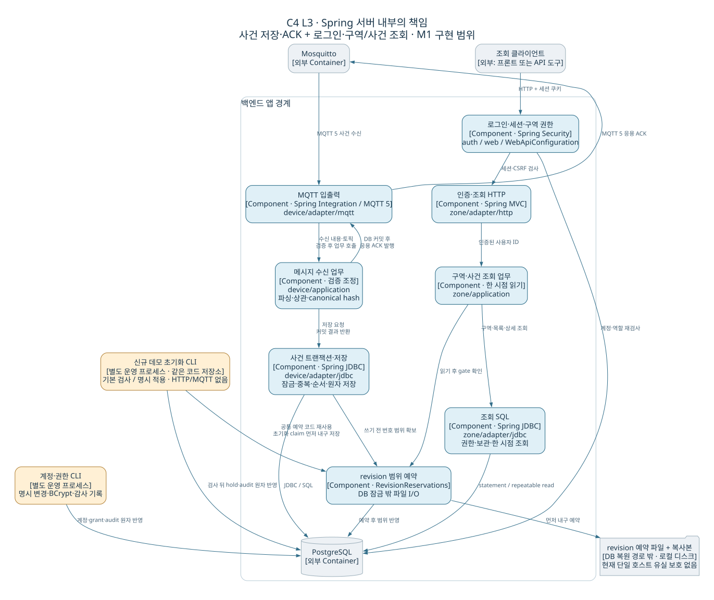

# M1 — 로그인해서 상태와 사건 읽기

2026-11-14 · 구현 및 실행 안내

현재 개발 브랜치는 `feat/authenticated-read-api`, 공유 위치는 [초안 PR #2](https://github.com/yh4752/parking-system/pull/2)입니다. 새로 클론한 경우 이 브랜치로 전환한 뒤 아래 명령을 실행합니다. 아직 기본 브랜치에 병합하지 않았습니다.

**저장된 사건을 로그인한 사용자에게 보여주는 API를 구현했습니다.** 사용자에게 허용된 구역만 읽을 수 있습니다. MQTT 메시지와 성공 응답 DTO는 v1.43을 유지하며, 웹 오류 응답은 [REST 유효 계약](contracts.md)을 사용합니다.



## 사용할 수 있는 기능

| 요청 | 결과 |
|---|---|
| GET /api/csrf | 세션과 CSRF 토큰 발급 |
| POST /api/auth/login | JSON 아이디·비밀번호 인증, 세션 ID와 CSRF 교체 |
| POST /api/auth/logout | 세션 종료, 204 |
| GET /api/auth/me | 로그인한 user_id와 role |
| GET /api/zones/{id}/status | 현재 상태·revision·최근 명령 20개·사진 메타데이터 10개 |
| GET /api/events?zone_id=… | 사건 목록, 시간·상태 필터, 다음 페이지 cursor |
| GET /api/events/{id} | 사건 요약·수신 원문·검토 기록·사진 메타데이터 |

사진 파일 제공·명령 실행·검토 작성은 아직 없습니다. 해당 데이터가 DB에 있다면 조회하되, `confirmation_token`은 OPERATOR에게도 null로 반환합니다. heartbeat 수신 전에는 연결 상태가 OFFLINE인 것이 정상입니다. 사건 수신만으로 ONLINE으로 바꾸지 않습니다.

## 실행 순서

**새 데모 DB 초기화 → 웹 계정 생성 → 서버 실행** 순서입니다. 계정 관리도 감사 기록을 남기므로 신규 초기화보다 먼저 실행하지 않습니다. 기존 실습 데이터가 있는 DB에 신규 초기화를 적용하거나 `recovery_hold`를 SQL로 해제하지 않습니다. 기존 상태를 인수하는 운영 절차는 M5에 남아 있습니다.

먼저 [M0 초기화 안내](demo-foundation.md)를 따라 별도 데모 DB에 V1~V4·구역·장치·정책을 준비하고 명시 초기화를 완료합니다. 이후 명령은 `backend/`에서 실행합니다. `PARKING_DB_URL`, `PARKING_DB_USERNAME`, `POSTGRES_PASSWORD`, 두 revision manifest 경로는 해당 데모 환경을 계속 사용합니다.

### 계정 생성

기본 웹 계정이나 공통 비밀번호는 없습니다. 다음 명령으로 본인만 읽을 수 있는 임시 파일에 비밀번호를 입력합니다. 비밀번호는 12자 이상, UTF-8 72바이트 이하입니다. 이 명령은 화면·셸 기록에 비밀번호를 출력하지 않습니다.

```sh
export PARKING_WEB_PASSWORD_FILE="$(python3 - <<'PY'
import getpass, os, tempfile
first = getpass.getpass('새 비밀번호: ')
if first != getpass.getpass('한 번 더: '):
    raise SystemExit('비밀번호가 일치하지 않습니다.')
fd, path = tempfile.mkstemp(prefix='parking-account-')
with os.fdopen(fd, 'w') as out:
    out.write(first)
print(path)
PY
)"
./gradlew manageWebAccount --args='create-user --username=team-viewer --role=VIEWER --zone-id=zone-01'
```

성공하면 `APPLIED`와 `user_id`가 나옵니다. 임시 비밀번호 파일을 지우고 변수도 해제합니다. 실패했을 때도 파일 정리는 동일합니다.

```sh
rm -- "$PARKING_WEB_PASSWORD_FILE"
unset PARKING_WEB_PASSWORD_FILE
```

권한 변경에는 비밀번호 파일이 필요 없습니다. 아래 `USER_ID`는 생성 결과의 실제 값으로 바꿉니다. OPERATOR도 구역 권한을 따로 받아야 합니다.

```sh
./gradlew manageWebAccount --args='grant-zone --user-id=USER_ID --zone-id=zone-02'
./gradlew manageWebAccount --args='revoke-zone --user-id=USER_ID --zone-id=zone-01'
./gradlew manageWebAccount --args='disable-user --user-id=USER_ID'
```

다음 HTTP 요청부터 변경을 적용합니다. 이 도구는 웹·MQTT 서버를 기동하지 않고 계정·권한·감사 기록을 한 트랜잭션에서 변경합니다. 사용자명 중복·없는 구역·미마이그레이션 DB는 실패하며 일부만 저장하지 않습니다.

### 서버 실행

목록 cursor에 서명할 서버 전용 키가 필요합니다. 아래는 로컬 시험용 생성입니다. 재시작마다 키를 바꾸면 기존 cursor는 400이므로 첫 페이지부터 다시 조회합니다. 운영에서는 같은 키를 서버 secret으로 유지합니다.

```sh
export PARKING_CURSOR_HMAC_KEY="$(openssl rand -base64 32)"
./gradlew bootRun --args='--spring.profiles.active=app-local'
```

`app-local`은 127.0.0.1에 바인딩하고 로컬 HTTP용으로 Secure 쿠키만 해제합니다. 기본 `web-api` 프로필은 Secure 쿠키를 요구합니다. 배포 HTTPS·프록시 설정은 M5에서 검증합니다.

MQTT 수신까지 함께 실행하려면 브로커를 준비하고 같은 앱에서 `--spring.profiles.active=app-local,mqtt-ingest-local`을 사용합니다. 같은 revision 파일을 쓰는 별도 수신 서버를 동시에 실행하지 않습니다. `mqtt-learning`·`mqtt-validation-local`과 제품 프로필을 섞지 않습니다.

## 프론트에서 연결할 순서

| 순서 | 처리 |
|---|---|
| 1 | GET /api/csrf. 응답 token을 메모리에 보관하고 세션 쿠키를 유지 |
| 2 | POST /api/auth/login. application/json의 username/password와 X-CSRF-TOKEN 헤더 전송 |
| 3 | 로그인 성공 후 GET /api/csrf를 다시 호출. 로그인 전 토큰은 폐기 |
| 4 | GET /api/auth/me, 상태·사건 조회. 같은 출처의 쿠키 인증 사용 |
| 5 | 로그아웃은 새 CSRF 토큰으로 POST. 성공 후 화면의 사용자·구역 자료 제거 |

세션 쿠키는 HttpOnly이므로 JavaScript로 읽지 않습니다. 401은 다시 로그인, 403은 구역 권한 부족, 404는 없는 대상, 410은 보관기한이 지난 사건, 429는 Retry-After 이후 재시도, 503은 저장소·복구 상태 확인이 필요하다는 뜻입니다. 오류 본문은 공통 RestError 형식입니다.

## 조회에서 보장하는 것

- 구역 상태는 권한·snapshot·revision·명령·사진을 한 SQL 시점에서 읽습니다. 목록과 상세는 REPEATABLE READ 트랜잭션으로 읽습니다.
- 목록은 **서버 최초 수신 시각 내림차순, event_id 내림차순**입니다. from 포함·to 제외이며 UTC `Z` 형식을 받습니다. 기본 20개, 최대 100개입니다.
- cursor는 같은 구역·시간·상태 필터에만 사용할 수 있습니다. 페이지 사이 상태 변화까지 고정하지 않으므로 새로고침은 첫 페이지부터 시작합니다.
- 원문과 리뷰는 30일 기한이 지나면 정리 배치 전에도 제외합니다. 종료 사건 요약의 만료·tombstone은 상세 410, 목록 제외입니다. 오래된 snapshot을 빈 구역으로 바꾸지 않습니다.
- 세션은 비활성 30분 또는 로그인 8시간에 만료됩니다. 비활성 계정·회수된 권한은 다음 요청에서 차단합니다.
- DB hold, revision 파일 유실·불일치, DB 조회 실패는 성공 상태로 포장하지 않습니다.

## 시험과 다음 구현

[시험 기록](../validation/authenticated-read-2026-11-14.json)에 실제 실행 결과를 남깁니다. PostgreSQL 시험은 독립 `it_...` 스키마를 사용하며 기존 사용자의 사건 데이터를 바꾸지 않습니다. 실제 HTTP 시험은 쿠키 속성·세션 교체 확인까지이며 공개 HTTPS 배포 시험이 아닙니다.

다음은 M2 heartbeat·연결 최신성·SSE입니다. 이어서 React 화면, 가상 장치 통합 시험, 배포·프론트 인계를 진행합니다. 구현 파일의 책임과 선택 근거는 [ADR-007](adr/007-authenticated-read-api.md)을 봅니다.
