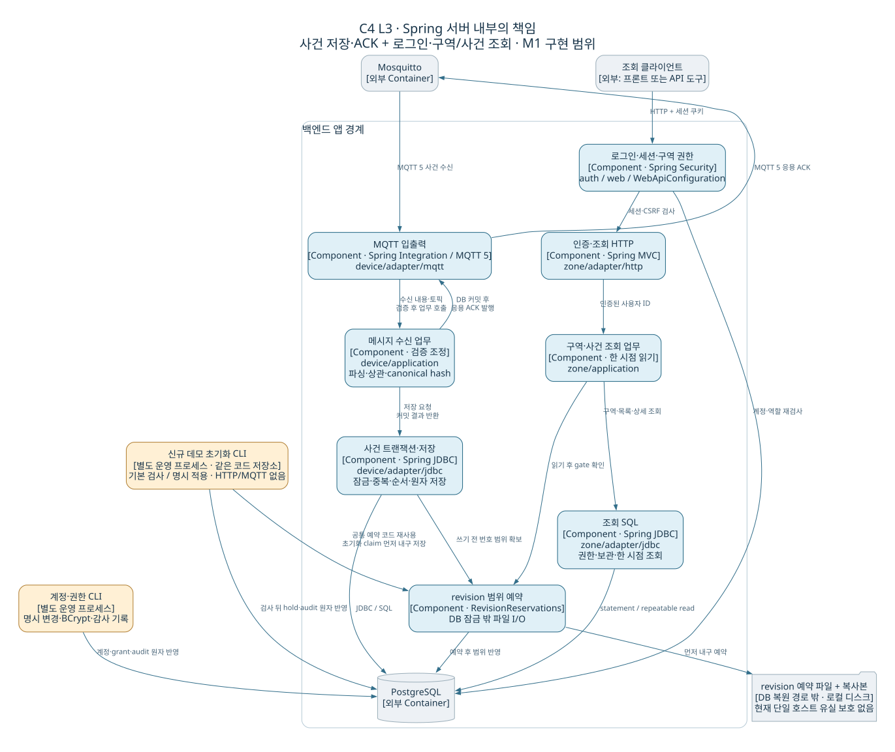

# 백엔드 담당이 볼 구조

팀 공통 설명은 [전체 구조](architecture.md), 실제 다음 작업은 [첫 기능](first-slice.md)에 있습니다. 여기서는 서버 내부의 책임과 코드 위치만 설명합니다.

현재 사건 검증·저장·응용 ACK 코드와 실제 PostgreSQL 시험까지 완료했습니다. [저장 실습](event-storage.md)에서 정상 1건의 실제 MQTT 저장·ACK 수신을 확인했습니다. 동일 메시지의 DUPLICATE 수신도 확인했으며, SQL 직접 조회로 원문 1건을 확인했습니다. 그림의 조회 부분은 아직 미구현입니다. 예약 파일은 DB와 별도이며, 각 내부 상자는 별도 서버가 아닙니다.

| 책임 | 코드 위치 또는 계획 | 맡을 일 |
|---|---|---|
| MQTT 입출력 | `device/adapter/mqtt` | MQTT 5 수신·토픽 확인·응용 ACK 발행 |
| 수신 업무 | `device/application` | 검증·중복·순서·트랜잭션 처리 조정 |
| 동일성·순서 | EventCanonicalizer·EventTransactionStore | 원문 동일성·DB의 기존 상태 비교. 빈 domain 패키지는 없음 |
| 저장 접근 | `device/adapter/jdbc` | 기존 SQL·제약·행 잠금·이력·현재 상태 저장, revision 예약 |
| 상태 조회 | `zone/application` | 동일 시점의 ZoneView 읽기 |
| HTTP 입출력 | `zone/adapter/http` | 정식 조회 API·접근 제어 경계 |
| 조립·설정 | `configuration` | Spring Bean·연결·보안 설정 |

HTTP/MQTT 어댑터가 업무 서비스를 호출하고, SQL은 JDBC 어댑터에 둡니다. 도메인 규칙은 Spring에 의존하지 않게 작성합니다. 저장 포트 등의 인터페이스는 실제 사용처가 생길 때 추가하며 빈 계층을 미리 만들지 않습니다.

## 첫 기능에서 놓치면 안 되는 경계

- 메시지 원본·사건 이력·현재 snapshot·view_revision의 관계는 기존 C1/C2/D5를 따릅니다. 과거 이력 저장과 현재 상태 갱신은 다릅니다.
- 성공 ACK는 DB 커밋 뒤에 보냅니다. 네트워크 I/O를 DB 행 잠금 안에 넣지 않습니다.
- 조회 결과는 기존 OpenAPI의 ZoneView를 사용합니다. `null`·키 생략·0·false를 임의로 바꾸지 않습니다.
- 현재 제품 API는 차단돼 있습니다. 첫 조회 시험에 필요한 개발 인증을 명시적으로 추가하고 운영 세션·CSRF·권한 계약과 구분합니다.

## 필요할 때 볼 자료

| 확인할 내용 | 위치 |
|---|---|
| JDK·Gradle·서버 실행 | [backend/README.md](../backend/README.md) |
| DB·브로커 실행·포트 | [infra/README.md](../infra/README.md) |
| 정식 메시지·API·SQL | [계약 안내](contracts.md) |
| 기술 선택 이유 | [ADR-001](adr/001-start-small.md) |
| 완료 조건·시험 | [첫 기능 작업표](first-slice.md) |
| 실제 실행 결과 | [현재 상태](status.md) |
