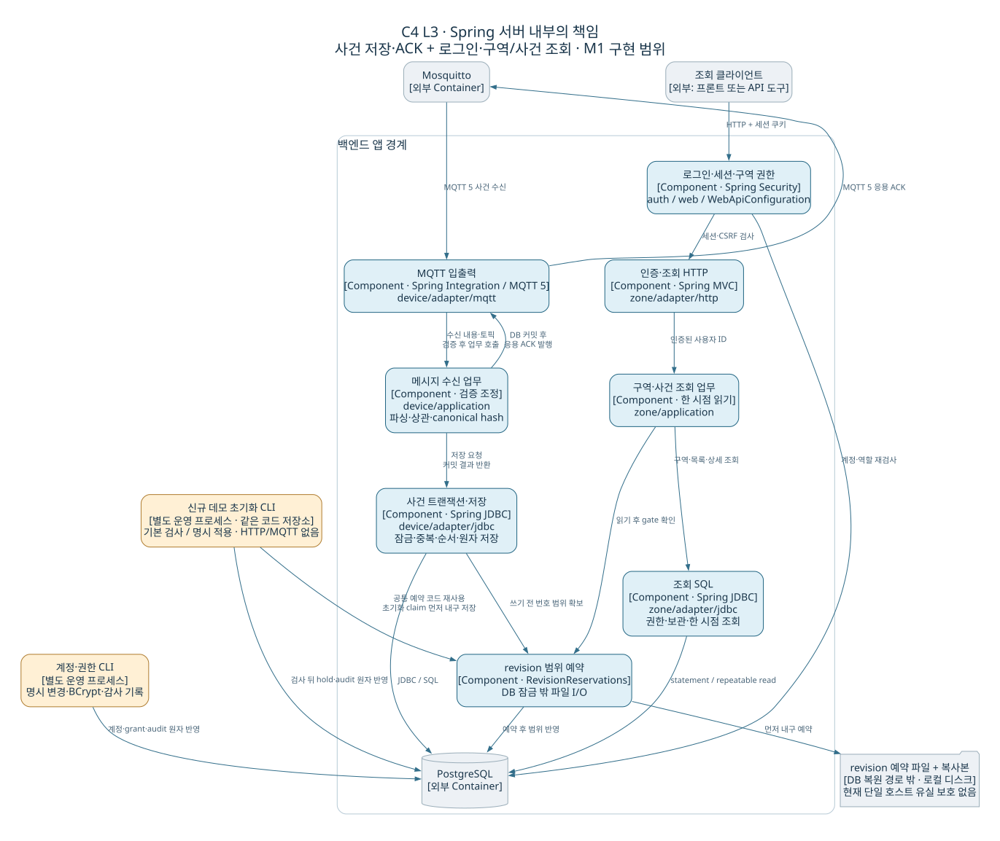

# M0 — 로그인과 조회를 붙이기 위한 준비

2026-11-14 · 첫 공개 조회 데모의 기반 작업

**이번 단계는 계약·DB·새 데모 초기화까지입니다.** 웹 로그인이나 화면은 아직 없습니다. 학습 실습을 기다리지 않고 구현·자동 시험을 먼저 진행하는 방식으로 작업합니다.

| 항목 | 추가한 내용 | 다음 기능에서 사용하는 곳 |
|---|---|---|
| 웹 계약 | 기존 원본 + REST 오류 보완 → 유효 계약 생성 | M1 응답 검증, M3 프론트 타입 |
| 구역 권한 | V3 user_zone_access, 기본 권한 없음 | M1 로그인 사용자의 구역 접근 검사 |
| 장치 측정값 | V4 fps·pending_message_count·storage_ok | M2 heartbeat 수신과 운영 지표 |
| 신규 초기화 | 기본은 검사, 명시 적용 시에만 hold 해제 | 별도의 빈 데모 DB 준비 |



## 계약과 DB

[유효 계약 안내](../contracts/README.md)를 따릅니다. MQTT 수신 원본과 웹 계약을 다른 classpath 경로로 패키징합니다. 웹에 오류 코드를 추가했다고 보드가 새 ACK 코드를 처리할 필요는 없습니다.

V1/V2는 수정하지 않습니다. 기존 `database` 프로필로 기동하면 Flyway가 V3/V4를 적용하며, 기존 사건·현재 상태·receipt는 유지합니다. 새 권한은 자동 생성하지 않고 측정값은 null로 시작합니다. DB 마이그레이션은 신규 초기화와 별개의 단계입니다.

## 신규 데모 초기화 도구

**현재 Mac에서 실습한 사건 데이터가 들어 있는 DB에는 이 도구를 적용하지 않습니다.** 공개용 가상 데모는 별도 DB를 준비합니다. 도구는 자료가 있는 DB를 거부하며 삭제하거나 덮어쓰는 옵션을 제공하지 않습니다.

선행 조건은 별도 데모 DB에 V1~V4 적용, 구역/장치 한 개 등록, 정책 등록입니다. 가상 장치 정책 예제는 `infra/sql/register-local-device.sql`, `infra/sql/register-local-policy.sql`입니다. 실물 장치에 배포할 정책은 아닙니다.

백엔드 폴더에서 실행하며 DB 주소·계정·암호는 기존 `database` 프로필의 환경변수를 사용합니다. 비밀번호는 명령행 인자로 넣지 않습니다.

```sh
./gradlew initializeDemoZone --args='--zone-id=zone-01 --device-id=edge-01 --policy-version=3 --reason=새_가상_데모_DB'
```

`DB_PREFLIGHT_PASSED`는 DB 검사 통과입니다. DB·파일을 바꾸지 않고 manifest 검증은 아직 하지 않습니다. 이 도구는 Flyway 적용도 자동으로 하지 않으므로 미적용 마이그레이션이 있으면 먼저 중단합니다.

명시 적용에는 사용할 두 manifest 경로가 필요합니다. 다음 경로는 데모 DB 전용 예시이며, 사건 수신 서버에도 **같은 경로**를 설정해야 합니다. 서버와 CLI는 동시에 실행하지 않습니다.

```sh
export PARKING_REVISION_PRIMARY="$PWD/../.local-state/demo/revisions/manifest.json"
export PARKING_REVISION_BACKUP="$PWD/../.local-state/demo/revisions-copy/manifest.json"

./gradlew initializeDemoZone --args='--zone-id=zone-01 --device-id=edge-01 --policy-version=3 --reason=새_가상_데모_DB --apply'
```

성공은 `INITIALIZED`입니다. snapshot은 null, 연결 상태는 OFFLINE, 장치 순번은 -1 그대로입니다. 서버가 관측을 만들어내지 않습니다. 웹 계정도 자동 생성하지 않습니다. 같은 디스크 두 폴더는 호스트 유실 보호가 아닙니다.

| 결과/오류 | 의미와 대응 |
|---|---|
| DB_PREFLIGHT_PASSED | DB만 검사. 적용 전 manifest 조건은 별도로 검증 |
| INITIALIZED | 예약/claim 저장 후 hold 해제와 audit 커밋 |
| existing_history / zone_is_not_fresh | 기존 자료가 있음. 새 데모 DB를 사용하고 기존 DB는 보존 |
| zone_already_open | 이미 개방된 구역. 초기화 재실행 대상 아님 |
| latest_policy_mismatch / policy_hash_mismatch | 설정/정책을 확인. 기존 정책을 덮어쓰지 않음 |
| initialization_already_claimed_review_required | 초기화 적용 또는 중단 흔적 있음. claim을 지우지 말고 운영 복구로 검토 |
| manifest 불일치/유실·파일 잠금 실패 | 중단. 운영 서버와 경로·복사본 상태 확인 |

## 검증과 다음 단계

[GitHub CI](https://github.com/yh4752/parking-system/actions/runs/43568432860)의 전체 테스트·DB 시험·bootJar가 통과했습니다. 별도 프로세스의 초기화 명령 5개 사례도 PostgreSQL 17.11에서 통과했습니다. [검증 기록](../validation/demo-foundation-2026-11-14.json)에 근거와 한계를 기록했습니다.

저장소 루트에서 계약·문서를 검사하고 백엔드에서 코드·DB 시험을 실행합니다. DB 시험은 매번 새 `it_...` 스키마를 만들고 자신이 만든 스키마만 제거합니다.

```sh
python3 tools/build_contracts.py --check
python3 -m unittest discover -s tools/tests -v
npm --prefix tools/docs run build
python3 tools/check_structure.py

cd backend
./gradlew test databaseTest bootJar
```

다음은 **M1 로그인·세션·CSRF·구역 권한·조회 API**입니다. 기존 데이터의 운영 인수와 과거 DB 복원은 신규 초기화 CLI로 대신하지 않고 별도 복구 절차로 구현합니다.

이 브랜치는 `6c6c172`에서 시작했습니다. 이전 Mac 로컬 설계 브랜치 `docs/public-demo-plan`의 `052fa95`는 아직 원격에 없어 문서 병합이 남아 있습니다. [ADR-006](adr/006-public-demo-foundation.md)에 근거와 경계를 기록했습니다.
