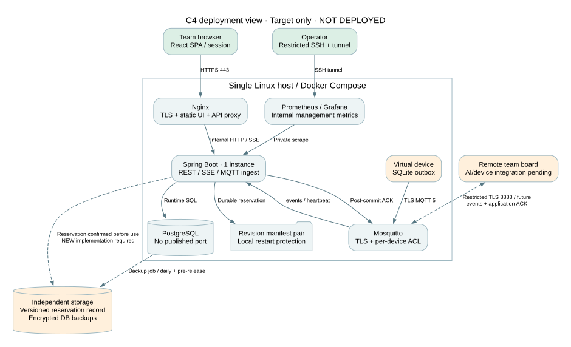

# 배포·운영 설계 — 팀이 먼저 읽을 내용

2026-11-16 · 제품 v1.43 유지 · O1~O4 로컬 인수 통과 · O5 준비 문서 작성 · 외부 배포 전

## 어떤 형태로 공개하나요?

**Linux 서버 한 대에서 실행하고, 팀원은 같은 HTTPS 주소로 로그인합니다.** React 정적 파일은 Nginx가 제공하고, API와 실시간 SSE는 Spring Boot로 전달합니다. PostgreSQL과 MQTT 브로커는 외부에 직접 공개하지 않습니다. 첫 공개는 가상 장치 기반이며 실물 보드는 나중에 연결합니다.

| 결정 | 이번 기준 |
|---|---|
| 실행 방식 | 기존 Docker Compose·Nginx·Spring Boot·PostgreSQL·Mosquitto 유지. 백엔드 인스턴스 1개 |
| 서버 | Linux x86_64, 2 vCPU·RAM 4 GiB·SSD 40 GiB를 초기 시험 크기로 사용. 성능 보장·구매 확정이 아니며 모니터링 포함 부하를 측정해 조정 |
| 첫 공개 | 팀원 로그인·구역 현황·이력 조회. 가상 장치 실행 중임을 표시 |
| 공개 포트 | HTTPS 443. 인증서 발급/갱신·리다이렉트용 80. SSH 22는 관리자 접속망 제한 |
| MQTT | 서버 내부에서도 TLS와 계정·토픽 권한 사용. 외부 8883은 실제 보드 연동 때 별도 개방 |
| 운영 관찰 | Spring Actuator/Micrometer → Prometheus → Grafana. 관리 화면은 SSH 터널로 접속 |
| 배포 방식 | 검증된 커밋의 이미지 사용, 수동 배포. main push가 곧 운영 자동 배포가 되지는 않음 |
| 복구 | DB 백업과 별도로 최신 revision 예약 기록을 호스트 밖에 보관. 복원 뒤 대조·인수 전에는 서비스 차단 |

초기 서버 크기는 한 구역·소수 팀원을 위한 설계 가정이다. [O5 배포 준비](deployment-readiness.md)에 기존 학교 서버와 Lightsail 4GB/8GB, 월 6만/10만 원 예산 후보를 비교했다. 추천값이며 실제 업체·예산은 미정이고 자원을 생성하지 않았다. 단일 서버이므로 서버 장애 동안 서비스가 중단될 수 있다.

## 지금 무엇이 부족한가요?

| 실제 코드에서 확인한 상태 | 다음 구현 |
|---|---|
| 공통 `mqtt-ingest`와 TLS·계정·ACL, HTTPS Compose·파일 secrets 구현 | 실제 서버·도메인·공인 인증서와 외부 인수 |
| migrator/runtime/operator/backup SQL과 별도 migration CLI 구현 | 실제 운영 DB 생성·최초 인수와 계정 발급 |
| O3에서 내부 관리 포트·업무 지표·대시보드·경보 구현 | 외부 관측·알림 전달은 O5 |
| 로컬 두 파일 외에 O4 HTTP/SQLite 원장 참조 어댑터 인수 | 실제 호스트 밖 저장소 어댑터·권한·최신성·재해 복구 검증 |
| 신규 초기화와 불일치 중단은 있음 | 로컬 인수 완료; 외부 저장소·키 복구와 실제 서버 인수 |

현재 인계 Compose의 포트를 외부로 열어 운영판으로 사용하지 않는다. O1의 설정·권한·시험 명령은 [운영 설정 안내](../infra/deploy/README.md)에 있다. O2 Compose·Nginx는 로컬 시험 CA로 로그인·실시간 갱신·장애 복구까지 검증했다. 먼저 [로컬 HTTPS 실습](local-https.md)을 따라 요청 경로를 이해한다. O3 관찰 지표는 [로컬 모니터링 실습](local-monitoring.md)에 구현했다. O4 독립 revision·복원은 [로컬 백업 실습](local-backup.md)에서 인수했다. 실제 외부 저장소·서버 공개는 남아 있다.

## 어떤 순서로 구현하나요?

| 순서 | 산출물 | 완료 판단 |
|---|---|---|
| O1 | 운영 프로필·DB 권한·MQTT TLS/ACL | 잘못된 인증서·계정·타 장치 토픽 거부, 기존 수신 회귀 통과 |
| O2 | 배포 Compose·Nginx·비밀값 주입 | 로컬 시험 HTTPS에서 로그인·SSE·로그아웃, 내부 포트 비공개 |
| O3 | 로컬 모니터링 | 실제 연결·DB·ACK 장애와 지표/경보, 디스크 경보 규칙 시험 |
| O4 | 백업·기존 상태 인수·복원 | 오래된 DB·파일 유실·중간 종료에 대한 격리 복원 시험 통과 |
| O5 | 준비 추천·입력표 작성 완료. 외부 구현·배포·팀원 인수는 대기 | 외부 저장소/키 복구 후 외부 PC에서 HTTPS 로그인·상태 갱신·계정 회수 확인 |

O1~O4는 AI 담당자 회신 없이 진행했고 로컬 인수를 마쳤다. O5의 서버·외부 저장소·키 보관 추천과 비용표도 작성했다. 실제 입력을 확정한 뒤 외부 어댑터·복구·관측을 구현하고 검증해야 한다. 입력표 작성 자체가 자원 구매나 외부 공개를 실행하지는 않는다.

## 용현님에게 필요한 입력

[O5 준비 안내](deployment-readiness.md)를 읽고 [입력 양식](../infra/deploy/inputs.example.json)에 비밀값 없이 다음을 기록한다.

- 사용할 수 있는 서버와 권한, 월/첫 달 비용 상한·납부자·운영 기간
- 사용할 도메인과 DNS 변경 권한, 갱신 담당자·비용
- 서버와 별개로 백업·revision 기록을 보관할 계정·저장소·보존 정책
- 복호화 키의 개인 금고·추가 사본 위치 참조. 본인 단독 관리, 보조 담당자 없음. 주 기기 없이 계정·키를 회수하는 시험 필요
- 운영 알림 경로·담당자, 예상 접속 수와 감수할 손실·복구 시간

서버·계정 비밀번호나 토큰은 양식에 적지 않는다. 알려지지 않은 값은 `null`로 남기며, 양식이 채워져도 실제 자원 생성이나 외부 공개가 자동 실행되지는 않는다.

세부 권한·지표·복구 순서는 [운영 구현 명세](design/deployment-operations-plan.md), 구현 AI의 작업 순서는 [작업 JSON](design/deployment-operations-workplan.json)을 따른다.
