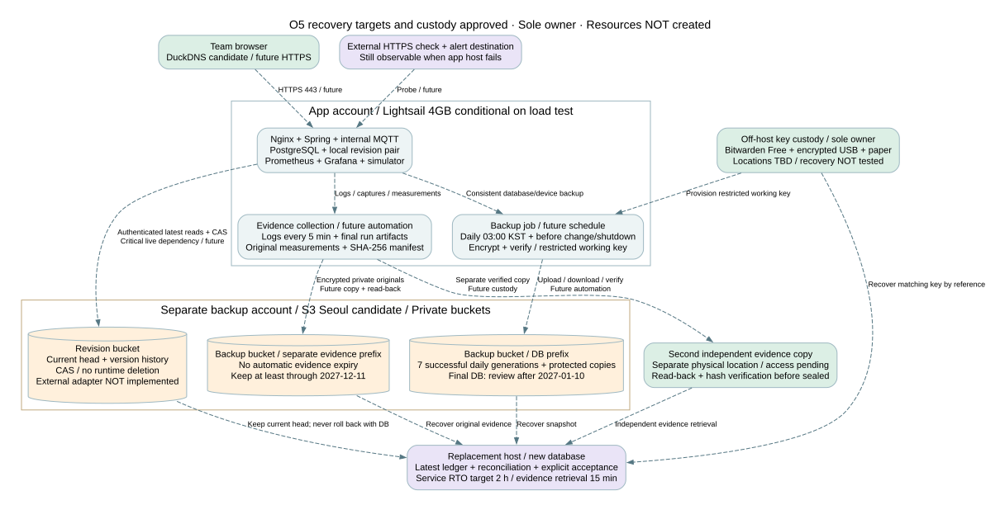

# O5 배포 준비 — 서버·비용·도메인·백업·키를 정하는 방법

2026-11-18 · **복구 목표·본인 단독 관리 승인, 실제 자원 선택 일부 미정. 구매·외부 배포·외부 인수 미수행**

O1~O4는 로컬에서 검증했다. 이번 O5 작업은 사용할 자원과 운영 책임을 결정할 수 있게 준비하는 단계다. 아래 추천을 채택해도 곧바로 배포할 수 있는 것은 아니다. 실제 외부 저장소 어댑터와 운영 백업 자동화 등 남은 구현은 마지막 표에 따로 적었다.

## 현재 정한 방향과 남은 결정

**Lightsail 4GB를 팀 통합용으로 조기 배포하는 방향이며, 사전 시험과 실서버 인수 후 서버 크기를 확정한다. 총 예산 목표는 5만 원이다.** 백업 주기·증거 보존·복구 목표와 본인 단독 관리는 승인했다. 운영/백업 AWS 계정 분리와 Bitwarden 무료 개인 금고·암호화 USB·종이 복구 안내서 구성을 승인했다. 실제 자원 생성·보관 장소·구현·시험은 남아 있다.

| 정할 것 | 상태·선택 | 남은 확인 |
|---|---|---|
| 서버 | 사용 가능한 기존 서버 없음. Lightsail 4GB 조건부 선택 | 실제 부하 시험, 계정·지역·이미지·생성/종료 시각 |
| 기간·예산 | 준비 완료 후 조기 배포하여 12월 11일 발표까지 운영, 전체 50,000원 목표 | 납부자, 정확한 사용 시간, 발표 후 증거 보관을 포함한 실제 견적. 월 예산과 자동 결제 차단 한도가 아님 |
| 무료 주소 | `illegal-parking-detection.duckdns.org` 미등록 후보 | 사용 가능 여부·주소 관리 권한. 등록·DNS 설정 미수행 |
| 백업·복구 | DB 매일 03:00 KST + 변경/종료 전, 증거는 시험마다 보존. 세부 목표 승인 | [승인 정책](backup-recovery-policy.md)의 자동화·원래 서버 없는 회수/복원 시험 |
| 독립 저장소 | 운영/백업 AWS 계정 분리 확정. 비공개 S3 백업/revision 분리안은 준비 단계 | 실제 계정·버킷·권한, 증거의 두 독립 사본 위치 |
| 계정·키 관리 | 본인 단독 관리, 보조 담당자 없음 | Bitwarden 무료 개인 금고·암호화 USB·종이 안내서 구성 승인. 실제 장소·로그인/키 회수 검증 미정 |

2026-11-18 재확인한 Lightsail 공식 월 기본요금은 4GB·2 vCPU·SSD 80GB가 **US$24**, 8GB·2 vCPU·SSD 160GB가 **US$44**다. 여기서는 공인 IPv4 포함 상품을 비교했다. 할인·무료 체험은 예산에 넣지 않았다. [Lightsail 가격](https://aws.amazon.com/lightsail/pricing/)

## 1. 서버: 우리 프로그램이 계속 실행되는 컴퓨터

이 서버에서 Nginx, Spring Boot, PostgreSQL, MQTT, Prometheus, Grafana와 가상 장치를 함께 실행한다. AI 모델 학습이나 영상 추론용 GPU 비용은 이 구성에 포함하지 않는다. 처음에는 가상 장치만 사용한다.

현재 사용 가능한 기존 서버는 없다고 확인했다. 아래 항목은 이전에 학교 서버의 적합성을 검토할 때 사용한 참고 조건이며, 기존 서버 확보를 이번 결정의 선행 조건으로 요구하지 않는다.

- Linux x86_64, Docker/Compose 설치·재시작 권한, 전용 데이터 경로가 있는가?
- 학기 동안 계속 켜 둘 수 있고, 재부팅·점검·반납 일정을 알 수 있는가?
- 외부 HTTPS 443과 인증서용 80, 제한된 관리자 SSH 접속이 가능한가? 학교 방화벽 변경 권한은 누구에게 있는가?
- 다른 팀 작업을 제외한 실제 여유 RAM·디스크가 있는가? 초기 가정은 2 vCPU·4GiB·40GiB 이상이며 사용량 측정으로 확인한다.
- 학교 서버와 다른 장애 범위에 백업·revision·키를 둘 수 있는가?

학교 서버 조건을 충족하지 못하면 Lightsail 후보를 검토한다. OS는 지원 중인 Linux LTS와 `linux/amd64` 이미지를 맞춘다. 서버에서 소스를 빌드하지 않고 검증된 이미지를 내려받는다. 서버에 연결한 고정 IP로 DNS를 유지한다. [Lightsail 고정 IP](https://docs.aws.amazon.com/lightsail/latest/userguide/understanding-static-ip-addresses-in-amazon-lightsail.html)

[2026-11-18 사전 관측](preflight-4gb.md)에서 사용자 재개 후 새 환경의 30분 연속 로컬 시나리오를 완료했다. 다만 공유 Docker VM에서 서비스별 메모리 제한을 적용한 시험이며 실제 4GB·2 vCPU 호스트 적합성은 미확정이다. 공개 전에는 **예상 동시 접속 수의 2배 + 가상 사건 수신 + 모니터링 + 백업 작업**으로 시험한다. OOM·재시작이 없어야 하고, 사용 가능한 메모리 20% 이상과 디스크 여유 30% 이상을 초기 운영 판단 기준으로 제안한다. 부족하면 백업 방식·지표 보관 기간을 점검하거나 8GB로 올린다. CPU 버스트 지속성과 외부 원장 지연도 함께 측정한다. 이 수치는 프로젝트의 제안 기준이며 공급자의 성능 보장이 아니다.

이전 가상 장치 공개안은 80/443만 일반 접근을 허용했다. 조기 팀 통합안은 별도 네트워크의 보드 접속을 위해 MQTT TLS 8883의 제한된 공개를 추가로 준비한다. 실제 공개 설정은 미실행이다. SSH 22는 관리자 IP 대역으로 제한하고, DB 5432·앱 8080·관리 9091·Prometheus 9090·Grafana 3000은 공개하지 않는다. Grafana는 SSH 터널로 본다. 실제 적용은 클라우드 방화벽과 Docker 포트 설정을 함께 검증한다.

## 2. 예산: 과거 월 단위 비교와 현재 단기 계획을 구분한다

다음 표는 **2026-11-16의 월 단위·유료 도메인 가정 비교 기록**이다. 현재 선택은 무료 주소·팀 통합용 조기 배포·총 5만 원이며, 아래 월 6만/10만 원 또는 유료 도메인 값을 현재 승인 예산으로 사용하지 않는다. 실제 운영 기간의 서버 요금과 발표 후 보관 비용은 계정/기간/사용량이 정해진 뒤 다시 산정한다. 환율 1달러=1,500원은 계산용 가정이며 현재 환율 인용이 아니다. 10%는 세금·결제 변동 여유분이지 적용 세율의 단정이 아니다. 도메인 25,000원/년도 실제 견적이 아니다. 결제 전 카드 환율·세금·등록 및 갱신 가격을 다시 확인한다.

| 월 예산 항목 | 4GB 시험안 | 8GB 여유안 |
|---|---:|---:|
| 서버 기본요금 | US$24 | US$44 |
| S3 저장·요청 예산 | US$8 | US$8 |
| 달러 비용 × 1,500원 × 1.10 | 52,800원 | 85,800원 |
| 도메인 연 25,000원의 월 환산 | 약 2,083원 | 약 2,083원 |
| 계획 합계 | **약 54,883원/월** | **약 87,883원/월** |
| 제안하는 월 관리 상한 | **60,000원** | **100,000원** |

도메인은 보통 연 단위로 먼저 결제하므로 첫 달 현금 지출은 이 가정에서 각각 **77,800원 / 110,800원**이다. 3개월간 운영하고 도메인을 새로 1년 등록하면 각각 **183,400원 / 282,400원**이다. 기존 도메인을 쓰면 이 계산에서 25,000원을 뺀다. 월 환산 비용과 실제 결제일의 지출을 따로 관리한다.

S3 서울 Standard의 첫 저장 구간은 US$0.025/GB·월, GET 등 조회는 US$0.00035/1,000건, PUT 등은 US$0.0045/1,000건이다. 총 저장 10GB + 조회 2천만 건 + 쓰기 1만 건을 예시로 잡으면 **US$7.295**여서 US$8을 배정했다. 버전 이력도 저장량에 포함한다. 이 사용량은 실측값이 아니다. [AWS 공식 서울 리전 요금 데이터](https://pricing.us-east-1.amazonaws.com/offers/v1.0/aws/AmazonS3/current/ap-northeast-2/index.json)

**원장 파일이 작다고 비용이 거의 없는 것은 아니다.** 현재 코드의 SSE 확인 주기는 약 1초다. 외부 어댑터가 탭마다 한 번씩 직접 조회한다고 가정하면, 탭 5개를 30일 내내 열어 두는 것만으로 약 1,296만 건·US$4.54가 된다. readiness·사건 처리 등의 조회는 별도다. 어댑터 구현 후 실제 요청 수와 지연을 측정해 예산을 고친다. 비용 절약을 위해 최신성 검사를 생략하거나 검증 없이 캐시로 바꾸지 않는다.

초과 트래픽·대량 복원 다운로드·추가 디스크/스냅샷·유료 관측 도구·유료 비밀금고는 위 표에 별도 배정하지 않았다. 필요해지면 견적을 다시 낸다. 무료 알림·관측 범위도 실제 서비스 선택 때 확인한다. 원장 요청량이나 저장량이 가정을 넘으면 월 상한을 넘을 수 있다.

본인에게 전체 5만 원 목표의 50%·80%·100% 사용 및 예상 초과 알림을 제안한다. 비용 납부자와 실제 알림 설정은 아직 미정이다. 두 AWS 계정의 비용을 합산해야 한다. **예산 알림은 결제를 자동 차단하는 상한이 아니고 집계 지연도 있다.** 80% 도달 시 사용량·종료 일정을 검토하고, 초과 시 추가 증설·유료 기능을 보류한다. 자동으로 DB나 원장을 삭제하지 않는다. [AWS Budgets](https://docs.aws.amazon.com/cost-management/latest/userguide/budgets-managing-costs.html)

프로젝트 종료일과 최종 백업 보관 종료일도 적는다. Lightsail은 인스턴스를 정지해도 요금이 발생하므로, 종료 때 복원 가능한 백업을 확인하고 필요한 자료를 인계한 다음 자원을 정리해야 한다. 이번 작업에서는 정지·삭제·구매를 실행하지 않았다. [Lightsail 정지와 삭제](https://docs.aws.amazon.com/lightsail/latest/userguide/amazon-lightsail-faq-instances.html)

## 3. 도메인: 주소, DNS, HTTPS는 각각 역할이 있다

도메인은 사람이 입력하는 이름, DNS는 그 이름을 서버 IP로 연결하는 설정, HTTPS 인증서는 그 이름의 서버와 암호화해 통신하기 위한 증명이다. 예를 들어 `parking.example.com`은 설명용 주소이며 등록하거나 연결하지 않았다.

현재 후보는 `illegal-parking-detection.duckdns.org`이며 등록 가능 여부·등록·DNS 연결은 확인하거나 실행하지 않았다. 다음 유료 등록/기존 도메인 절차는 일반 참고이고 현재 무료 주소 선택을 대체하지 않는다.

1. 기존 도메인을 쓰는 경우 서브도메인 관리 권한을 확인한다. 도메인을 쓰는 것과 DNS를 바꿀 권한은 다르다.
2. 새로 산다면 후보 두 개, 등록자·결제자·갱신 담당자, 첫해와 다음 해 가격을 기록한다. 학기 종료 후에도 접근 가능한 계정에 MFA를 설정한다.
3. 등록 업체 후보는 Cloudflare Registrar다. 원가 기반 등록·갱신을 제공하지만 Cloudflare 네임서버 사용이 조건이므로 DNS 사업자 선택 자유가 필요한 경우 다른 등록 업체를 택한다. `.kr` 등 원하는 TLD 지원 여부·가격·이름 사용 가능 여부는 별도 확인한다. [Registrar 안내](https://developers.cloudflare.com/registrar/faq/), [등록 조건](https://developers.cloudflare.com/registrar/get-started/register-domain/)
4. 실제 서버가 준비된 뒤 A 레코드를 고정 IPv4로 연결한다. IPv6를 검증하기 전에는 AAAA를 추가하지 않는다. 첫 인수는 DNS 전용으로 단순하게 연결하고 프록시/CDN 사용은 SSE·캐시 영향 시험 뒤 결정한다.
5. Let's Encrypt 공인 인증서의 자동 갱신·Nginx reload·만료 경보를 구현한다. HTTP-01을 쓰면 80번이 필요하다. 로컬 시험 CA를 공인 인증서로 재사용하지 않는다. [Let's Encrypt 시작](https://letsencrypt.org/getting-started/), [인증 방식](https://letsencrypt.org/docs/challenge-types/)

## 4. 독립 저장소: 백업과 revision 기록을 다른 규칙으로 관리한다

**DB 백업은 그 시점의 데이터를 되살리는 자료이고, 독립 revision 기록은 이미 사용·예약한 번호로 되돌아가지 않게 하는 최신 기준이다.** 예를 들어 백업이 revision 100일 때 찍혔고 이후 150까지 예약했다면, DB만 복원해 101부터 다시 쓰면 안 된다. 독립 기록과 최신 장치 보고를 대조하고 안전한 새 범위로 재개해야 한다. 이 기록만으로 백업 이후 사라진 사건 본문을 전부 복구할 수 있는 것은 아니다.

| 보관 자료 | 제안 장소·정책 | 앱 서버에 줄 권한 |
|---|---|---|
| 암호화 DB/가상 장치 백업과 manifest | 백업 계정의 `backup` 전용 버킷. 고유 이름으로 올리고 Versioning 사용. 최근 성공 일별 7세대와 변경 직전·최종본 별도 보호. 최종본은 2027-01-10까지 보관 후 검토 | 백업 작업 전용 자격으로 새 객체 업로드와 검증용 읽기. 삭제·버킷 설정 변경 금지 |
| 최신 revision 예약/초기화 claim과 버전 이력 | 같은 백업 계정의 별도 `revision` 버킷. Versioning + 조건부 갱신. DB 백업과 함께 과거로 되돌리지 않음 | runtime 전용 자격으로 필요한 현재 객체 읽기·조건부 쓰기. 삭제·버전 삭제·보존 설정 변경 금지 |
| 복원 자격 | 담당자의 비공개 금고에서 필요할 때 사용 | 평상시 앱에 배포하지 않음. 승인된 백업·버전 읽기와 새 복원 DB에 필요한 별도 권한 |
| 보존 만료 정리 | 별도 저장소 관리자 책임. 정책 시험 후 예약 실행 | runtime/백업 업로더에는 수동 삭제 권한을 주지 않음 |

버킷 이름은 역할 설명이며 실제 이름은 아직 없다. 모든 버킷은 비공개이고 TLS·인증을 사용한다. 버킷별 자격증명을 나누고 앱 서버에는 백업 계정 관리자 자격을 두지 않는다. 단순히 다른 폴더·Docker 볼륨에 넣는 것은 호스트 장애에 대한 독립성이 없다. 별도 계정도 같은 클라우드·리전의 장애까지 해결하지는 않으므로 그 범위는 받아들일지 기록한다.

S3를 첫 원장 후보로 고른 근거는 강한 읽기 일관성, Versioning, `If-Match`/`If-None-Match` 조건부 쓰기다. **CAS는 “내가 읽은 버전이 여전히 최신일 때만 갱신”하는 규칙**이다. 처음 만들 때와 기존 것을 갱신할 때 조건을 달리하고, 정책으로 무조건 덮어쓰기를 막는다. [S3 일관성](https://docs.aws.amazon.com/AmazonS3/latest/userguide/Welcome.html#ConsistencyModel), [조건부 쓰기](https://docs.aws.amazon.com/AmazonS3/latest/userguide/conditional-writes.html), [정책 강제](https://docs.aws.amazon.com/AmazonS3/latest/userguide/conditional-writes-enforce.html)

Versioning은 과거 내용을 되찾기 위한 이력이며, 더 작은 revision을 새 버전으로 써 버리는 실수까지 막지는 않는다. CAS도 번호 증가 검증을 대신하지 않는다. 실제 어댑터에서 시스템 식별자·단조 증가·현재 head 최신성·동시 예약 충돌·응답 유실 후 재시도를 검사해야 한다. Object Lock도 기존 버전을 보호하지만 새 버전이나 삭제 마커 생성 자체를 막지 않는다. [Object Lock 동작](https://docs.aws.amazon.com/AmazonS3/latest/userguide/object-lock.html)

보존 정책은 두 버킷에 똑같이 적용하지 않는다. 승인된 [백업·증거 정책](backup-recovery-policy.md)에 따라 DB는 성공 일별 7세대와 보호 사본을 관리하고, 증거·최종 revision은 최소 2027-12-11까지 보존한다. 필요한 복원 자료가 더 오래 남으면 최신 기록과 키도 유지한다. 증거 자동 삭제는 없으며, 이전 버전의 실제 용량도 비용에 포함한다. revision의 현재 head와 운영 기록에는 DB용 만료 규칙을 복사하지 않는다. Object Lock은 보존 시험 뒤 별도 결정한다. 켜면 끌 수 없으므로 이번 준비 문서만 보고 활성화하지 않는다. [Object Lock 관리 제한](https://docs.aws.amazon.com/AmazonS3/latest/userguide/object-lock-managing.html)

Cloudflare R2는 암호화 백업의 대안 후보지만 첫 원장에는 권하지 않는다. S3 호환 API에서 `PutBucketVersioning`이 지원되지 않으므로 현재 요구사항에 그대로 대입할 수 없다. R2 자체 잠금 기능의 유무와 S3 Versioning 호환성은 별개다. 초기에는 공급자를 늘리기보다 S3 한 종류를 검증한다. [R2 S3 호환 표](https://developers.cloudflare.com/r2/api/s3/api/)

## 5. 키 보관: 백업 파일을 열 수 있는 열쇠도 복구 대상이다

O4 백업은 Fernet 대칭키로 암호화한다. **같은 키가 암호화와 복호화에 모두 필요하다.** S3의 저장 암호화가 추가되어도 이 키를 잃으면 O4 파일을 열 수 없다. 반대로 파일과 키가 함께 유출되면 이 암호화로 내용을 보호할 수 없다.

추천 보관은 다음 세 역할로 나눈다. 실제 키 생성·외부 복사·공유 초대는 이번에 하지 않았다.

| 사본 | 보관·접근 방법 | 이유 |
|---|---|---|
| 운영 작업용 | 서버의 백업 작업 전용 파일, 소유자만 읽기, 웹/backend에 마운트하지 않음 | 현재 대칭키 방식은 백업할 때도 키가 필요하다. 서버에 키가 전혀 없다고 설명하면 안 된다 |
| 복구용 주 사본 | 본인이 관리하는 서버 밖 개인 비밀금고의 보안 메모, MFA 적용. Bitwarden 무료 개인 금고로 확정, 미생성 | 서버를 잃어도 본인이 회수한다. 보조 담당자는 없으며 본인 부재 위험은 남는다 |
| 복구용 추가 사본 | 다른 물리 장소의 암호화 USB와 USB와 분리한 종이 복구 안내서. 실제 장소 미정. 여는 비밀과 MFA 복구 수단도 독립적으로 회수 가능하게 보관 | 금고 계정 접근 실패에 대비한다. 매체 비밀번호가 잠긴 금고에만 있으면 복구 고리가 끊어진다 |

사용자는 단독 관리를 선택했다. 공유 조직·계정 공유를 필수 조건으로 두지 않으며, 개인 금고와 독립적인 추가 복구 사본을 준비한다. Bitwarden 무료 개인 금고·암호화 USB·종이 안내서 구성은 확정했다. 실제 계정·매체·암호화 도구·보관 장소·인증 방식은 미정이다. [남은 결정과 보관 위험](backup-recovery-policy.md#5-승인한-보관-구성과-남은-결정)을 확인한다. 계정 소유·서버 자동 작업·복구용 접근의 구분은 [담당·권한 안내](backup-recovery-policy.md#4-계정키는-본인이-단독-관리한다)를 따른다.

키 이름은 `backup-key-2026-01`처럼 식별할 수 있게 하고 백업 manifest에는 그 참조만 남긴다. 입력 JSON·Git·채팅에는 **실제 키, 비밀번호, 토큰, MFA 복구 코드**를 적지 않는다. 키를 교체할 때는 새 이름을 사용하며, 옛 키로 만든 백업이 남아 있는 동안 옛 키도 보관한다. 서버 침해 시 작업용 키까지 노출될 수 있는 한계는 남는다. 비대칭 암호화·KMS로 바꾸는 작업은 구현·복원 시험이 필요한 별도 결정이다.

복구 훈련의 완료 조건은 **기존 서버와 그 `.local-state` 없이, 다른 PC에서 저장소 자료와 금고/추가 사본의 키를 회수해 새 DB를 복원하는 것**이다. 본인이 원래 서버·주 로그인 기기 없이 추가 복구 수단으로 이 절차를 수행해야 한다. 본인 부재 시 대신 복구할 사람이 없으므로 전체 2시간 목표의 달성 여부는 대응 가능 시간과 실제 시험으로 판단한다. 아직 외부 저장소·금고를 만들거나 이 시험을 실행하지 않았다.

## 6. 지금 준비할 결정표

이 표는 비밀값 없이 채운다. 코드용 상세 입력은 [입력 예시](../infra/deploy/inputs.example.json), 비용 산식은 [예산 예시](../infra/deploy/budget.example.json)에 있다. 개인 입력은 Git에서 제외된 `.local-state/deploy/inputs.json`에 기록한다. 추천값은 확정값과 분리되어 있으며 `null`은 여전히 미정이다.

| 준비 항목 | 기록할 내용 | 지금 상태 |
|---|---|---|
| 서버 선택 | 공급자/지역/크기·권한 | Lightsail 4GB 조건부 선택, 로컬 연속 시나리오 완료, 실제 호스트 미인수 |
| 비용 책임 | 총 지출 목표·납부자·운영/보관 일정 | 총 5만 원, 팀 통합용 조기 배포. 납부자·실제 견적·정확한 시각 미정 |
| 도메인 | 무료 후보·주소/DNS 관리자 | `illegal-parking-detection.duckdns.org` 미등록 후보. 사용 가능 여부 미확인 |
| 관리자 접속 | SSH 키 관리자, 허용 IP 대역, 복구용 로그인 | 본인 단독 관리. 실제 접근 경로·허용 IP·복구 수단 미정 |
| 독립 저장소 | 계정 분리·지역·버킷·권한·증거 사본 위치 | 본인이 관리. 계정 분리 확정, 실제 계정/저장소 생성·검증 미완료 |
| 암호화 키 | 개인 금고 항목 참조·추가 사본 위치 별칭·회수 시험 | 본인 단독 관리. Bitwarden 무료·암호화 USB·종이 구성 승인. 실제 장소·매체·접근 복구 시험 미완료 |
| 관측·알림 | 비용/장애 알림 수신처, 서버 밖 HTTPS 검사 실행 위치, 대응 시간대 | 미정 |
| 인수 조건 | 동시 팀원 수·복구 목표·외부 확인 담당자 | DB 24시간 손실/2시간 복구, 확정 증거 손실 0/15분 회수, 로그 5분, 발표 전환 5분 승인. 실제 시험·동시 사용자 수 미정 |

## 7. 입력이 모인 뒤 남은 구현과 검증

**O5 준비 문서 완료와 O5 외부 인수 완료를 구분한다.** 지금 어댑터의 `LOCAL_ONLY` 제한을 지우고 URL만 바꾸는 방식으로 배포하지 않는다.

아래 작업은 [후속 이슈 #6](https://github.com/yh4752/illegal-parking-detection/issues/6)의 F1~F6으로 추적한다. F1은 단기 예산·후보·복구 목표와 본인 단독 관리가 일부 확정된 상태다. 실제 계정 생성·납부자·저장소·보관 장소·접근 검증 등이 남아 있으므로 F1 전체는 미완료다. 각 구현·검증의 완료 증거를 별도로 남긴다. 이 문서의 비용 근거는 앞서 명시한 2026-11-16 확인값이며, 후속 이슈 등록일에 새 견적을 확인했다는 뜻은 아니다.

| 순서 | 남은 작업 | 공개 전 증거 |
|---|---|---|
| 1 | 선택값·예산·책임자 확정 후 외부 자원 작업 범위 결정 | 비용표·계정 소유권·종료/보존 조건 |
| 2 | 실제 S3 원장 어댑터와 최소 권한 구현 | 인증/TLS·최신 head·CAS 경쟁·과거 버전/삭제/설정 변경 거부·예약 중단·저장소 장애 시 차단 |
| 3 | 외부 백업 업로드/다운로드 검증·주기·보존·키 회수 구현 | 서버 밖 복사본을 내려받아 복호화·임시 DB 전 테이블 비교, 실패 시 성공 시각 미갱신 |
| 4 | `linux/amd64` release 이미지·registry digest, 실제 호스트와 HTTPS/갱신 준비 | 같은 이미지 인수, 포트 차단, 공인 인증서 갱신·reload, 부하·실제 DB/백업 디스크 관측 |
| 5 | 원본 서버 없는 복원, 서버 밖 가용성 검사·알림 전달 | 수신/API hold → 최신 독립 기록 확보·유지 → 새 DB 복원 → 장치 대조·손실 명시 인수 → 새 범위 재개, 실제 경보 수신 |
| 6 | 외부 공개 범위가 정해진 후 팀원 PC 인수 | 로그인·SSE·가상 사건·계정 회수·재접속 확인 |

현재 백업 도구는 작은 로컬 훈련용으로 128MiB 제한과 메모리 내 처리를 사용하며, 로컬 이미지·새 격리 DB만 허용한다. 운영용 크기·자동 실행·보존·업로드·키 복구는 위 단계에서 구현해야 한다. 가상 사건은 승인한 24시간 손실 목표에 맞춰 일별 백업하며, 발표·블로그 증거는 시험마다 보존하는 별도 주기를 구현한다. 독립 원장은 사건 본문의 연속 백업이 아니다.

O4의 85.65초는 이미 수신을 멈춘 뒤 **복원 시작부터 로컬 HTTPS/모니터링 준비까지**의 소규모 측정이다. 서버 구매·자료 다운로드·키 회수·수신 중단 시간은 포함하지 않았다. 외부 RTO로 약속하지 않는다. [O4 실행 증거](../validation/local-backup-2026-11-16.json), [복원 순서 설명](local-backup.md)

현재 변경은 승인 목표·담당 방식·문서·그림 정리다. 새 클라우드 자원·계정·DNS·키를 만들지 않았고 외부 배포나 외부 복원 시험도 수행하지 않았다. [11월 16일 준비 검증 기록](../validation/deployment-readiness-2026-11-16.json)은 당시 기록이며 이번 목표 달성의 근거가 아니다. [전체 작업표](design/deployment-operations-workplan.json)에서 승인과 구현·인수 상태를 구분한다.

[팀 통합용 조기 배포 준비](team-integration-preparation.md)에서 보드 연결 계약·현재 로컬 구현과 실제 배포의 차이·실행 순서를 확인한다.
