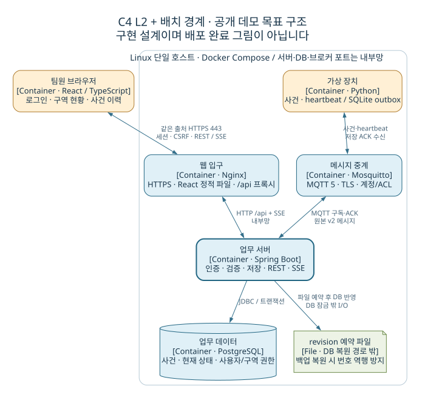
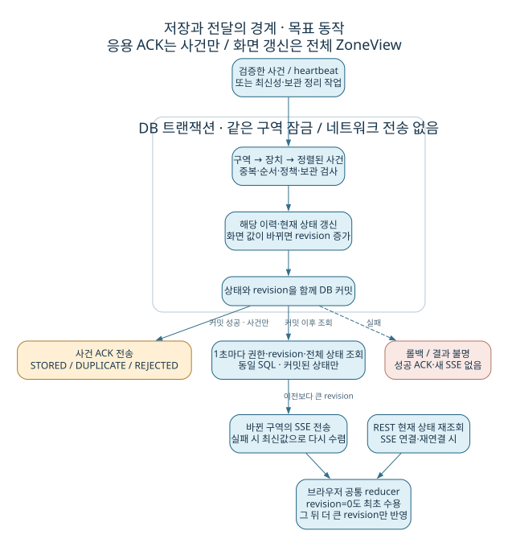

# 공개 데모 구현 설계와 프론트 인계

2026-11-13 · 설계 확정안 · 기능 구현/배포 전

**목표:** 팀원이 HTTPS 주소로 로그인하여 가상 장치의 현재 상태·사건 이력·연결 끊김을 확인하고, 프론트 담당자가 같은 코드와 API를 이어서 개발한다. 먼저 전체 흐름을 구현·검증하고 이후 완성된 코드로 학습한다. 사용자에게 메시지마다 터미널 시험을 요청하는 방식을 기본 개발 절차로 삼지 않는다.

이 문서의 ‘전체 구현’은 아래 **첫 인계판** 전체를 뜻한다. AI 모델·물리 출력·관리 명령·사진 업로드까지 완성한 제품이라는 뜻은 아니다. 실제 업무 명세는 v1.43이며, 빈틈을 메운 결정은 [ADR-005](../adr/005-public-demo-boundary.md)에 분리했다. 기준 코드 커밋은 `6c6c172`다. 이후 실행 결과는 [현재 상태](../status.md)에 남긴다.

## 1. 범위와 완료 모습

| 첫 인계판에 포함 | 후속 범위 |
|---|---|
| 기존 사건 검증·저장·ACK, 자동 회귀 시험 | 실제 보드용 SDK·카메라·AI·LED·스피커 |
| 로그인·로그아웃·세션·CSRF·구역별 조회 권한 | 가입·비밀번호 찾기·사용자 관리 화면 |
| 구역 상태, 사건 목록·상세, 보관 만료 처리 | 관리자 명령·정책 변경·review 작성 |
| heartbeat·STALE/OFFLINE·SSE·재연결 | 사진 업로드·조회·제어 확인 토큰 |
| React 화면 3종과 정상/오류/빈 상태 | 시각 디자인 완성·대규모 다중 구역 운영 |
| 재현 가능한 가상 장치, HTTPS 배포·관찰·복구 준비 | 실제 교통 현장 성능·고가용성·무손실 재해 복구 |
| 프론트 인계 문서·API 계약·E2E 증거 | v1.43의 모든 API 구현 완료 선언 |

첫 인계판은 조회 중심이다. OPERATOR 계정도 아직 없는 제어 기능을 실행할 수 없다. 제어 성공을 흉내 내는 버튼·API·로그를 만들지 않는다. 화면 상단에 ‘가상 장치 데모’를 명시한다. 공개는 **외부 접속 URL + 팀원 로그인**으로 정하며, GitHub 저장소 공개 전환은 포함하지 않는다.

**완료 기준:** 외부 PC에서 로그인 → 가상 상태 변화 확인 → 사건 상세 확인 → 장치 송신 중단 후 STALE/OFFLINE 확인 → 웹 재연결·재로그인 복구 → 다른 개발자가 새 클론으로 같은 화면 실행. 로컬 통과와 외부 배포 통과는 따로 기록한다.

## 2. 배치와 기술 선택

| 영역 | 선택 | 이유와 제약 |
|---|---|---|
| 백엔드 | 기존 Kotlin·Spring Boot·JDBC·PostgreSQL 유지 | 이미 검증한 수신 경계와 DB 일관성을 재사용 |
| 프론트 | React + TypeScript + Vite SPA | 기존 React 관리자 웹을 유지하고 정적 배포. SSR·별도 프론트 서버가 필요한 범위가 아님 |
| 프론트 의존성 | React Router, fetch, native EventSource, CSS Modules | API·SSE 로직을 화면에서 분리. 추가 상태 라이브러리는 실제 필요 시 검토 |
| 웹 입구 | Nginx: 정적 파일 + 동일 출처 /api 프록시 | 기존 C16을 유지. 세션 쿠키와 SSE를 같은 origin에서 사용 |
| 메시지 | MQTT 5·Mosquitto, 웹 갱신 SSE | 브라우저는 MQTT에 연결하지 않음 |
| 배치 | Linux 단일 호스트의 Docker Compose | Nginx·Spring·DB·브로커·선택 실행 simulator. 다중 인스턴스 제외 |
| 버전 | 기존 백엔드 고정값 유지, 프론트 초기화 시 호환 조합을 exact/lockfile로 고정 | 설계 문서의 ‘최신’ 버전으로 설치하지 않음. Node는 기존 문서 도구의 24 계열과 호환 여부 검증 |

프론트 빌드 도구 선택은 프로젝트 판단이다. [React 공식 안내](https://react.dev/learn/build-a-react-app-from-scratch)는 Vite의 react-ts 구성을 소개하면서 라우팅·데이터 조회 등은 별도로 구성해야 함을 설명한다. 이 화면은 기존 Spring API를 사용하는 작은 관리자 SPA이므로 해당 책임을 아래 모듈로 고정한다.

## 3. 구현할 HTTP 계약

경로·필수 필드·null·enum은 [원본 OpenAPI](../../reference/v1.43/개발자료/09_구현설계/contracts/openapi.json)를 유지한다. 서버 일반 장애 코드의 보완만 ADR-005의 REST 전용 overlay를 적용한다. 나머지 미구현 경로는 성공 응답을 만들지 않고 서버에서 차단한다.

| 경로 | 성공 응답 | 이번 책임 |
|---|---|---|
| GET /api/csrf | 200 `{token}` | 로그인 전 세션/토큰 발급, 인증 전 허용 |
| POST /api/auth/login | 200 `{user_id,role}` | JSON username/password, CSRF 검사, 세션 ID 교체 |
| POST /api/auth/logout | 204 | CSRF 검사, 세션 무효화·SSE 종료 |
| GET /api/auth/me | 200 `{user_id,role}` | 현재 세션 확인; 미인증 401 |
| GET /api/zones/{id}/status | 200 ZoneView | 권한 검사 + 일관된 한 시점 읽기 |
| GET /api/events | 200 `{items,next_cursor}` | 필터·cursor·limit·보관 기한 |
| GET /api/events/{id} | 200 EventDetail | 사건 요약·원문·review·사진 참조 전체 구조 |
| GET /api/stream?zone_id=... | 200 text/event-stream | `zone_snapshot`, `id=view_revision`, 전체 ZoneView |

ZoneView는 **8개 필수 키**를 모두 유지한다: `zone_id`, `view_revision`, `received_at`, `last_heartbeat_at`, `connection_state`, `snapshot`, `commands`, `image_refs`. 최초 등록은 snapshot=null이며 미관측을 빈 구역으로 바꾸지 않는다. 현재 화면에 없는 필드도 API에서 삭제하지 않는다.

commands는 최신 20개, image_refs는 최신 10개를 기존 저장소에서 읽는다. 아직 관련 자료가 없는 데모 DB에서는 []다. 구현하지 않았다는 이유로 존재하는 데이터를 무조건 []로 덮는 DTO를 만들지 않는다. 공개 command 결과의 confirmation_token은 키를 유지하고 null로 만든다. EventDetail의 reviews/images도 같은 원칙이며, 상세 messages에는 만료 전 정상 원문만 포함한다. quarantine은 사용자 API로 노출하지 않는다.

### 목록·상세 조회 결정

| 항목 | 구현 기준 |
|---|---|
| 조회 일관성 | ZoneView는 단일 SELECT와 서브쿼리. EventDetail처럼 여러 SELECT를 쓰면 read-only REPEATABLE READ |
| 목록 순서 | `incident.first_received_at DESC, event_id DESC`. C7의 created_at을 ‘서버 최초 수신 시각’으로 구체화; 시작 관측 시각과 구별 |
| 시간 필터 | from 포함/to 제외, 서버 최초 수신 시각에 적용. UI 필터명은 ‘서버 최초 수신 기간’. started_at은 관측 시각 표시용 |
| cursor | v1 + zone/filter fingerprint + 마지막 first_received_at/event_id를 담은 base64url JSON에 HMAC. cursor≤2048자, SQL 파라미터 바인딩. 변경된 필터/서명 불일치 400 INVALID_SCHEMA |
| 페이지 | 기본 20, 최대 100. cursor는 인증을 대체하지 않음. 실시간 상태 필터 변화에 대한 다중 페이지 고정 snapshot까지 보장하지 않으며 새로고침은 첫 페이지부터 |
| 상세 messages 순서 | device_seq ASC, received_at ASC, message_id ASC. 순번 공백 허용. 보관기한이 지난 원문은 삭제 배치 전에도 제외 |
| 만료 | 종료 사건 summary_expires_at 이후 목록 제외, 상세 410 GONE. tombstone이 있으면 410, 처음부터 없으면 404 |
| 권한 | 로그인 확인 → 사건 또는 tombstone의 소속 장치/구역 확인 → user_zone_access 검사 → 본문 또는 410. 미허용 구역 403; 유효 세션 없는 요청 401 |
| 오류 | 기존 RestError 5키 유지. 로그인/연결 제한 429 RATE_LIMITED, 인프라 503 SERVICE_UNAVAILABLE, 예상 못한 500 INTERNAL_ERROR를 REST에만 보완. DB 장애를 STORAGE_FULL로 오표기하지 않음 |

원문 배열을 임의 개수로 잘라서 전체 이력처럼 반환하지 않는다. 첫 범위의 실제 데이터량으로 상세 응답 크기를 측정하고, 페이지가 필요해지면 계약 변경으로 처리한다. cursor 키는 서버 비밀값이며 frontend env에 넣지 않는다.

REST 보완의 정확한 변경은 [overlay](public-demo-rest-overlay.json)에 기록했다. 지금은 설계 파일이며 서버가 읽는 활성 계약이 아니다. M0에서 원본 + overlay로 `contracts/effective/`를 생성하고 백엔드 응답 검증·프론트 타입 생성·CI가 모두 그 결과를 사용하도록 연결한다. MQTT 검증은 기존 원본을 계속 사용한다.

## 4. 로그인과 구역 권한

| 결정 | 구현 내용 |
|---|---|
| 인증 | app_user의 인코딩된 password_hash를 Spring PasswordEncoder로 검사. JSON 로그인 필터·AuthenticationManager·SecurityContextRepository를 사용하고 수동으로 쿠키만 만들지 않음 |
| 세션 | JSESSIONID, HttpOnly, SameSite=Lax, 공개 환경 Secure. 단일 서버 메모리 세션, 재시작 시 재로그인 |
| 유효시간 | SSE를 제외한 인증된 HTTP 요청 기준 idle 30분, 로그인부터 absolute 8시간을 초기값으로 확정. 자동 이력 조회도 HTTP 활동이며 SSE keepalive는 활동 시간을 연장하지 않음 |
| CSRF | HttpSessionCsrfTokenRepository, GET /api/csrf의 token을 X-CSRF-TOKEN으로 전달. 로그인·로그아웃 후 재발급. 토큰/비밀번호를 localStorage에 저장하지 않음 |
| 권한 | user_zone_access(user_id,zone_id) 복합 PK/FK를 V3로 추가. 기본 권한 없음. 조회는 허용 구역의 VIEWER/OPERATOR. 기존 fixture-author는 계속 비활성 |
| 사용자 준비 | 명시적 운영 CLI로 계정 생성·구역 부여. 비밀번호는 마스킹 입력/secret 파일. 자동 기본 계정·공용 비밀번호·비밀번호 명령행 인자 금지 |
| 구역 진입 | 첫 데모는 지정 구역 1개. VITE_DEMO_ZONE_ID는 공개 ID로만 사용. /api/zones 목록 API를 임의 신설하지 않음. 실제 접근은 서버 grant로 결정 |
| 조회 거부 | UI 숨김에 의존하지 않고 REST와 SSE 시작 시 동일 검사. 계정 비활성/권한 회수도 다음 요청·SSE 주기 검사에서 반영 |
| 로그인 제한 | IP당 1req/s·burst 5를 Nginx 초기값으로 사용하고 초과 429 처리. 앱은 계정/IP 쌍별 연속 실패 5회 후 5분 재시도 제한(429 RATE_LIMITED, retryable=true, Retry-After). 수치는 프로젝트 초기 정책이며 실제 부하 결과가 아님 |

세션 만료/로그아웃/권한 회수 시 이미 열린 SSE도 닫는다. 브라우저는 EventSource 오류만으로 401을 단정하지 않고 /auth/me를 조회한다. React 개발 서버는 /api를 로컬 Spring으로 프록시한다. 공개 프로필에서 Secure 쿠키·CSRF를 끄거나 `permitAll`로 우회하지 않는다.

실패 제한 기록은 메모리 최대 10,000개·TTL 10분으로 제한하고 서버 재시작 시 초기화됨을 기록한다. 전달 IP는 신뢰하는 Nginx에서 설정한 값만 사용한다. DB/프록시의 원문 예외나 계정 존재 여부를 응답에 담지 않는다.

Spring Security 6.5의 [CSRF 안내](https://docs.spring.io/spring-security/reference/6.5/servlet/exploits/csrf.html)를 따르며, 구현 때 로그인 시 세션 고정 공격 방어·토큰 재발급·컨텍스트 저장을 통합 시험한다. 프록시 429/502/504 등은 JSON이 아닐 수 있다는 기존 OpenAPI default 처리도 유지한다.

## 5. 장치 최신성과 상태 쓰기 경계

events, heartbeat, timeout, retention 모두 **공통 구역 쓰기 경계**를 사용한다. 파일 번호 예약은 DB 트랜잭션 밖에서, 잠금은 zone_view → device → 사건 ID 정렬 순서로 유지한다. EventTransactionStore의 사건 요약·pause 갱신을 실제로 두 수신 경로에서 재사용할 때 추출한다. 폴더만 늘리는 선행 추상화는 만들지 않는다.

| 입력 | 상태 처리 | 응답/보존 |
|---|---|---|
| events | 기존 receipt·정책·사건 순서·snapshot 검사를 유지 | 커밋 후 응용 ACK, 원문/최소 receipt 유지 |
| heartbeat | 원본 Heartbeat Schema, envelope/snapshot 일치·V04~V12 중 snapshot 규칙·정책/소유권 검사 | QoS 0, retained=false, ACK 없음, durable receipt/원문 누적 없음 |
| 새 heartbeat 순번 | seq > max(last_device_seq,last_heartbeat_seq)인 경우만 최신성 갱신. 지연/같은 순번은 무시 | last_heartbeat_at=실제 서버 수신 시각, snapshot·사건 요약·pause·revision을 같은 커밋에 반영 |
| heartbeat 시각 불신 | clock_synced=false라도 연결 생존은 관측 가능. 과거 신뢰 시각과 null 유지 | ONLINE이 안전한 관측/안내 가능을 뜻하지 않음 |
| availability | 원본 계약·QoS/retain 설정을 준수해 수신. 보고된 boot/connection ID와 수신 시각을 진단에 사용하되 접속의 최신 순서라고 보장하지 않음 | retained ONLINE으로 ONLINE을 만들지 않음. OFFLINE Will만으로 상태를 강등하지 않고 heartbeat 기한으로 판단 |
| 최신성 타이머 | 1초 tick, elapsed>15초 STALE, >30초 OFFLINE. 정확히 15/30초는 이전 구간 | 상태가 바뀔 때만 잠금·revision 증가·커밋 후 SSE. 최대 한 tick 지연을 시험에 반영 |

새 heartbeat의 순번 채택 기준은 오래된 heartbeat로 ONLINE이 복구되는 것을 막는 보수적 구현 결정이다. 사건이 앞질러 도착한 heartbeat도 생존 갱신에서 제외하고 다음 새 heartbeat를 기다린다. device_seq는 모든 메시지에서 공유하므로 장치의 재부팅 때 초기화하지 않는다.

availability는 현재 계약에 순번이 없고 heartbeat에는 connection_id가 없다. 서로 다른 접속의 생성 순서를 서버가 완벽히 추론할 수 없으므로 첫 판의 connection_state는 heartbeat만을 권위로 사용한다. 부정확한 Will 즉시 반영보다 최대 30초 후 판정을 선택한다. wire 필드는 바꾸지 않는다.

V4로 zone_view에 fps(NUMERIC, 유한한 0 이상)·pending_message_count(cap_seq)·storage_ok(BOOLEAN) 최신 측정값 nullable 컬럼을 추가한다. 관측 전은 null이며 지표 수집용이다. ZoneView의 8키에 임의 telemetry 필드를 추가하지 않는다. 첫 화면은 이 지표를 표시하지 않고 운영 지표에서 확인한다.

heartbeat에는 완전한 EventRecord가 없으므로 현재 사건 요약은 기존 snapshot→summary 변환 규칙을 공유한다. 시작/종료 시각을 서버 시각으로 만들어 채우지 않고 기존 신뢰값 또는 null을 유지한다. 종료 사건·tombstone 재생성 금지, 안내 횟수 감소 금지, 정책과 사건 소유권 검사도 사건 수신과 동일하게 적용한다.

## 6. SSE와 React의 일관성

1. 구역 쓰기 트랜잭션에서 상태와 view_revision을 함께 커밋한다. [ADR-008](../adr/008-frontend-handoff-realtime.md)에 따라 첫 인계판은 1초 주기로 권한·revision·전체 ZoneView를 동일 SQL에서 읽는다. 쓰기 트랜잭션 밖에서 완성된 snapshot을 읽어 전송하며 ID와 본문은 같은 조회 결과를 사용한다.
2. 커밋 뒤 ACK와 SSE를 각각 처리한다. SSE 실패가 ACK·DB 커밋을 취소하지 않으며 ACK 실패도 SSE 발행을 생략할 이유가 되지 않는다.
3. SSE는 zone_snapshot, id=revision, data=전체 ZoneView다. 별도 웹용 축약 payload를 만들지 않는다.
4. 브라우저가 SSE open을 확인한 뒤 REST 상태를 조회한다. 연결 전 데이터가 없어도 첫 revision=0을 수용하도록 로컬 revision 초기값은 -1이다.
5. 두 경로는 하나의 reducer에서 **현재 값보다 큰 revision만** 채택한다. 동일/낮은 revision은 무시한다. 구역/세션 전환 시 이전 요청을 abort하고 이전 세대 응답도 버린다.
6. 재연결 open마다 REST 재조회한다. 이벤트 로그 replay를 보장하지 않으며 Last-Event-ID만 믿지 않는다. 화면에 남은 값은 연결 끊김 중 ‘마지막 확인 상태’로 표시한다.

### 전달 상한과 누락 복구

초기 상한은 전체 SSE 50개, 세션당 3개, 연결당 최신 full snapshot 1개 대기다. 더 새 값으로 대체할 수 있으며 SSE를 사건 이력 전달 채널로 쓰지 않는다. executor 4개·전체 대기 100개, 전송 제한 5초를 초기 설정으로 두고 과도한/느린 연결은 종료한다. 수치는 성능 보장이 아닌 시험할 운영 설정이다.

연결 하나에 전송 작업을 중복 예약하지 않는다. 제한 초과는 429 RATE_LIMITED와 Retry-After로 응답한다. Servlet 비차단 출력에서 isReady일 때만 쓰고 출력이 5초 이상 진행되지 않으면 종료한다. 상한은 단위 시험으로 검증하며 실제 TCP/Nginx 대규모 느린 클라이언트 부하는 별도 인수 항목으로 남긴다.

첫 인계판의 전달 경로는 1초마다 열린 연결의 권한과 커밋된 전체 상태를 읽는 작업 하나다. 커밋 callback과 별도 fanout은 두지 않는다. 정기 비교는 revision을 새로 만들지 않는다. 서로 다른 revision의 값과 ID를 조합하지 않는다. 최종 상태 기준으로 수렴하면 되며 중간 상태 전부의 실시간 전달은 보장하지 않는다.

SSE 주석 keepalive 15초·프록시 read timeout 60초는 C16을 유지한다. 전송 직전과 최대 15초마다 계정·권한·세션 유효성을 확인하고, 다음 검사에서 회수/만료를 알면 연결을 닫는다. 이미 전송 중인 바이트를 회수할 수 있다고 보장하지 않는다. 로그아웃은 같은 세션의 SSE를 즉시 종료한다. idle 검사용 시각은 keepalive/권한 점검으로 갱신하지 않는다. [Spring MVC 비동기 처리](https://docs.spring.io/spring-framework/reference/6.2/web/webmvc/mvc-ann-async.html)의 disconnect/timeout 정리와 bounded executor를 사용한다.

사건 목록·상세는 SSE 전체 상태에 포함되지 않는다. zone_snapshot 수신, 창 재활성화, 새로고침에서 조회하고 화면이 열린 동안 10초마다 재확인한다. 낮은 seq의 과거 원문은 view_revision을 바꾸지 않을 수 있으므로 SSE만 기다리지 않는다. 이는 브라우저 이력 조회 보완이며 구역 상태는 SSE로 수신한다. 서버 내부 전달은 위 1초 조회 방식이다.

EventSource 오류에서는 기존 연결을 닫고 auth/me와 구역 status로 원인을 확인한다. 확인용 fetch의 401이면 로그인 화면, 인증 후 403/404이면 자동 재연결 중단과 접근 오류를 표시한다. fetch의 429는 Retry-After를 따르고, 네트워크/503은 1→2→4→8→16→30초·±20% 지연으로 재시도한다. native EventSource는 실패 HTTP 상태·헤더를 노출하지 않으므로 SSE에만 걸린 연결 제한을 정확히 식별한다고 가정하지 않는다. 확인용 API가 정상이어도 SSE 실패는 같은 지연 정책으로 재시도한다.

한 화면당 EventSource는 하나만 유지하고 unmount 시 연결·타이머·요청을 정리한다. 반복 오류를 새 로그인 요청이나 무제한 즉시 재연결로 바꾸지 않는다. 이미 200 헤더를 보낸 SSE에서는 JSON RestError로 상태 코드를 바꿀 수 없으므로 로그를 남기고 연결을 닫는다. HTTP 오류 계약은 SSE 시작 전 검사에 적용한다.

브라우저 API의 범위는 [WHATWG EventSource 명세](https://html.spec.whatwg.org/multipage/server-sent-events.html#the-eventsource-interface)를 기준으로 확인했다. 위 재확인·재시도 지연은 이 프로젝트의 선택이다.

## 7. 최소 프론트와 인계 경계

| 화면 | 구성 | 필수 상태 |
|---|---|---|
| 로그인 | 아이디·비밀번호·오류·재시도 | 잘못된 비밀번호, 제한, 세션 만료. 계정 존재 여부를 오류 문구로 구별하지 않음 |
| 구역 현황 | 구역명/ID, 연결·사건·카메라·안내 횟수·관측 시각·이유 코드 | 최초 미관측, 과거 관측, ONLINE/STALE/OFFLINE, 웹 연결 이상, clock 불신 |
| 사건 이력/상세 | 상태·기간 필터, 다음 페이지, 상세 panel 또는 route | 빈 목록, 로딩, 오류/재시도, 404/410/403. 마지막 성공 데이터와 현재 오류를 함께 구분 |

React route: /login, /zones/:zoneId, /zones/:zoneId/events, /events/:eventId. UI route는 HTTP API 신설과 별개다. 카드·표·상세 패널 중심으로 만들며 카메라 영상·주차 지도·미구현 제어 버튼을 장식용으로 추가하지 않는다. 날짜는 화면에서 한국 시각으로 표시하고 API UTC를 보존한다. 정차시간은 보드가 보고한 값을 표시하며 브라우저 타이머로 법적 위반을 새로 판정하지 않는다.

| 모듈 | 책임 | 프론트 담당의 변경 범위 |
|---|---|---|
| src/api/generated | 유효 OpenAPI에서 생성한 타입 | 생성물 직접 수정 금지; 계약 변경 후 재생성 |
| src/api/client | same-origin fetch·오류 파싱·세션/CSRF | 공통 연결 유지; 새 API 추가 가능 |
| src/features/auth | 인증 상태·로그아웃·route 보호 | UI 개선 가능, 서버 권한을 대체하지 않음 |
| src/features/zones | useZoneStream·revision reducer·상태 표시 | 카드/배치/라벨 개선 가능, 순서 규칙 유지 |
| src/features/events | 필터/cursor·상세·재조회 | 표/필터 UX 개선 가능 |
| src/components, src/styles | UI 요소·CSS Modules | 주된 디자인 개선 영역 |
| tests/fixtures | 미관측·보류·오프라인·만료·권한 사례 | 원본 계약에 맞는 추가 사례 |

시각 디자인과 API/SSE 책임을 분리해 프론트 담당자가 화면을 교체해도 통신 규칙을 다시 작성할 필요가 없게 한다. 키보드 조작·focus·label·텍스트 상태 표시를 기본 검증하며 색만으로 상태를 구분하지 않는다.

## 8. 가상 장치와 자동 시험

PC simulator는 실제 QCS610 SDK와 별개인 계약 시험 도구다. Python + MQTT 5 클라이언트로 만들고 lockfile을 남긴다. 단일 writer SQLite에서 공통 seq와 events outbox를 보존한다. heartbeat는 최신 1개만, 5초마다 새 seq로 생성하며 과거 heartbeat를 재전송하지 않는다. events는 ACK 구독 완료 후 발행하고 STORED/DUPLICATE만 완료 처리, REJECTED는 실패함으로 이동한다. 원래 message_id·본문을 유지하는 재전송 규칙은 D2를 따른다.

| 자동 시나리오 | 검증 |
|---|---|
| 사건 없음 → OBSERVING → STOP_CONFIRMED → GUIDING → GUIDED → CLOSED_EXIT | 원본 enum·정책 시간에 맞는 REST/SSE/화면과 DB 상태 일치 |
| duplicate / conflict / 12→11 | 기존 구현 회귀, 오류 격리·최신 상태 보존 |
| heartbeat 중지 / 복구 / 지연 heartbeat | 경계 15·30초, 오래된 보고로 ONLINE 복구 금지 |
| clock 불신 / 가림 / 최초 설정 없음 | ONLINE과 관측/안내 가능 구별 |
| SSE callback 누락 / 프록시 재연결 / 느린 소비자 | bounded 자원, DB 최신값 수렴, revision 역행 없음 |
| Spring 재시작 / 브로커 단절 / DB 장애 / ACK 누락 | 재로그인·재구독·동일 ID 재전송, 가짜 성공 금지 |
| grant 없음 / 만료 세션 / 잘못된 CSRF | 401/403, SSE 종료, 토큰 유출 없음 |

통합 시험은 별도 Compose 프로젝트·DB·장치 ID·예약 파일을 사용한다. 개발자가 사용하는 public 스키마나 실행 중인 로컬 서버를 시험 과정에서 종료/초기화하지 않는다. 웹 화면에서 테스트용 MQTT 발행 API를 공개하지 않고, simulator는 운영자가 명시 실행한다. 공개 데모에는 독립된 가상 장치/DB만 넣는다.

## 9. 공개 배포와 운영 준비

### 접속·데이터 경계

- 외부 웹은 HTTPS 443만. 인증서 발급 방식에 따라 80을 ACME/redirect 용도로만 열 수 있다. Spring 8080·PostgreSQL 5432·운영 지표는 Compose 내부망에 둔다.
- 첫 simulator는 같은 호스트에서 브로커 내부망으로 연결하므로 MQTT 포트를 외부에 열 필요가 없다. 원격 실보드 연결 단계에서만 8883을 허용 네트워크로 연다. 웹 배포와 실보드 연결 승인을 구분한다.
- 공개 프로필의 MQTT는 TLS·클라이언트 계정·토픽 ACL을 사용하고 호스트 인증서 검증을 끄지 않는다. 기존 익명 mqtt-ingest-local 설정은 배포 파일에서 사용하지 않는다.
- Nginx는 정적 파일·/api만 전달하고 /api/stream에 proxy_buffering off, cache off, HTTP/1.1·read timeout 60초를 적용한다. 502 등의 HTML 오류도 프론트가 처리한다. [공식 proxy 문서](https://nginx.org/en/docs/http/ngx_http_proxy_module.html#proxy_buffering) 참조.
- DB·브로커·simulator SQLite·revision manifest를 영속 볼륨에 둔다. 두 manifest 복사본은 DB 복원 경로 밖에 두고 별도 저장매체 사본을 운영 요건으로 확인한다. 같은 디스크 두 폴더는 호스트 유실 보호가 아니다.

### 운영 프로필과 준비물

| 항목 | 구현할 기본값/산출물 |
|---|---|
| 서버 프로필 | 기존 학습/검증 프로필 유지. 통합 로컬 app-local, 배포 app-prod를 분리하고 공통 사건 처리를 재사용. 이름은 신규 구성 결정 |
| Compose | infra/deploy/compose.yaml, nginx 설정, broker TLS/ACL, secret 입력 목록, healthcheck |
| bind | 호스트 실행은 127.0.0.1. 컨테이너 Spring은 내부 0.0.0.0, host port 매핑 없음 |
| DB 권한 | Flyway 전용 migration 계정과 runtime 계정 분리. runtime은 필요한 DML만, 과거 zone_policy UPDATE/DELETE 불가 |
| 배포 산출물 | commit SHA 태그 이미지, lockfile, 설정 검사, 배포 전 DB 백업, 롤백 가능 이미지 기록 |
| readiness | DB 처리 가능 여부와 revision/복구 gate 반영. broker 단절은 별도 지표로 알리고 조회까지 일괄 차단하지 않음 |
| 로그·지표 | request/device/message/event ID와 결과, 수신→커밋 지연, DB 오류·MQTT 연결, SSE 활성/드롭, JVM·디스크. ID를 메트릭 label로 사용하지 않음 |
| 비밀값 | DB 암호·TLS 키·MQTT 계정·cursor HMAC은 서버 secrets. Git·ZIP·VITE_*·로그에 포함하지 않음 |

### 복구는 공개 전에 확인할 항목

현재 revision 예약은 정상 재시작과 불일치 중단까지만 구현됐다. 첫 API를 열기 전에 정상 초기화와 recovery_hold 해제 경로를 명시적으로 구현해야 한다. 모든 기존 zone_view의 hold를 서버 시작 때 false로 바꾸면 안 된다.

신규 demo 초기화 CLI는 새 DB/구역·정책 등록·manifest 예약·빈 snapshot을 검증한 경우에만 초기 수신과 조회를 연다. 기존 데이터는 별도 상태 점검/인수 CLI를 사용한다. hold 중에는 외부 조회/SSE가 503 SERVICE_UNAVAILABLE이며 상태 비교용 수신만 허용한다.

과거 백업 복원 도구는 호스트 gate를 먼저 닫고 세션/SSE를 종료한다. manifest의 최신 상한을 확인하고 **그 다음 범위**를 예약하며, 파일 예약 후 DB 반영 전 종료도 현재 파일 상한 다음 범위로 건너뛴다. 정책·사건·heartbeat 대조 보고 후 운영자가 명시 인수해야 조회를 연다. 첫 판에는 명령 발행이 없지만 자동 desired/명령 재발행 금지도 유지한다. manifest가 유실되거나 최신성을 입증하지 못하면 중단한다. 같은 범위의 과거 DB 복원은 자동 탐지하지 못하므로 수동 DB 덮어쓰기를 운영 절차로 허용하지 않는다. 공개 배포 전 격리 복원 시험에서 이를 검증한다.

### 실제 환경에서만 결정할 입력

| 미확정 입력 | 필요한 시점 | 없을 때 가능한 작업 |
|---|---|---|
| 사용할 Linux 서버/계정·예산 | 외부 배포 전 | 전체 코드·Compose·로컬 HTTPS/E2E·인계 자료 준비 가능 |
| 도메인/DNS 권한·인증서 발급 방식 | 외부 HTTPS 설정 전 | localhost 테스트 인증서로 동작 확인 가능; 외부 배포 성공으로 세지 않음 |
| 팀원 GitHub ID·웹 계정 전달 대상 | 인계 전 | 계정 생성/권한 CLI·전달 양식 작성 가능 |
| DB 복원 밖 manifest 사본 경로·백업 보관 위치 | 공개 운영 전 | 별도 디렉터리에서 장애 시험 가능; 재해 복구 완료 주장은 금지 |

이 항목은 추측해서 정하지 않는다. 별도 클라우드 구매·유료 자원 생성은 아직 수행하지 않는다. 실험 장소·카메라·실물 보드 OS는 첫 인계판 구현을 막지 않는다.

## 10. 작업 순서와 완료 조건

| 단계 | 선행 | 구현 결과 | 통과해야 할 검사 |
|---|---|---|---|
| M0 계약·DB·gate | 현재 코드 | REST 오류 overlay, 타입 생성 기준, V3/V4, 구역 권한·초기화/복구 설계 구체화 | 원본 127개 보존, overlay 적용·Schema 검증, fresh/migrated DB |
| M1 인증·조회 | M0 | 세션/CSRF, 권한 검사, 8개 경로 중 auth와 REST 7개 | grant 없는 두 구역, cursor/만료/null·토큰 마스킹·일관된 조회 |
| M2 생존·실시간 | M0/M1 | heartbeat·timeout·availability 진단, commit snapshot·SSE | 시계 주입 15/30초 경계, 오래된 heartbeat, 역순 REST/SSE, 권한 회수 |
| M3 최소 프론트 | M1, M2 연동은 후속 결합 | 실제 API 연결 3종 화면·모듈 경계 | TypeScript·화면 상태·권한/재로그인·접근성·새 클론 실행 |
| M4 simulator·통합 | M1/M2/M3 | 자동 사건·heartbeat·재전송과 E2E | 정상/중복/충돌/역순/장애의 브라우저+DB 증거 |
| M5 배포·운영·복구 | M4 | 이미지·HTTPS·TLS/ACL·계정·백업/복원·지표 | 실제 프록시 SSE, 비공개 포트, gate·재시작·복원, 비밀값 미노출 |
| M6 외부 공개·인계 | M5 + 외부 환경 입력 | 외부 URL·팀원 접속·인계 패키지 | 외부 PC login, 재연결, 계정 회수, 팀원 새 클론 실행, 미구현 목록 |

M3의 화면 상태와 M4의 simulator 준비는 계약 고정 후 독립 진행할 수 있다. 구현 순서는 작업 의존관계이지 사용자에게 매번 실습을 요구하는 순서가 아니다. 자동 검증 실패는 구현 중 해결하고 완료 단계별로 짧게 보고한다. [작업·인수 조건 JSON](public-demo-workplan.json)에 선행 단계·산출물·시험 ID를 함께 두며 모든 기능 시험은 아직 planned 상태다.

기능 단위로 커밋하고 GitHub 공유 상태를 명시한다. PR은 문제·바뀐 동작·실행 검증·미수행 범위를 적고 기존 코드 CI와 프론트·계약·E2E 검사를 추가한다. main 병합이나 공개 URL 발행을 로컬 테스트 성공과 동일하게 취급하지 않는다.

## 11. 인계·나중 학습용 산출물

| 파일/자료 | 내용 |
|---|---|
| frontend/README.md + AGENTS.md | 설치·실행·환경변수·폴더 책임·계약 수정 절차 |
| docs/frontend-handoff.md | 배포 URL, 담당 범위, 화면별 API, SSE/오류 규칙, 미구현 기능 |
| 유효 OpenAPI·JSON Schema·생성 TS 타입 | v1.43 + 명시 overlay; 서로 다른 수기 DTO를 원본으로 만들지 않음 |
| simulator 실행 명령·시나리오 | 장치 없이 같은 상태 재현, 실제 SDK와 다른 범위 명시 |
| 테스트/배포 증거 | commit SHA·명령·환경·결과·스크린샷·외부 접속 확인. 비밀번호 포함 금지 |
| docs/learning-map.md | 한 메시지의 전송→검증→트랜잭션→ACK→REST/SSE→React 흐름과 실제 파일 링크 |

계정은 별도 안전한 경로로 전달하고 문서에는 발급/회수 방법만 적는다. 프론트 인계 시 완료/미구현을 구분한 체크리스트를 제공한다. 학습은 실제 동작을 관찰한 뒤 MQTT, 저장 일관성, 웹 실시간, 배포 순서로 진행하며 지금의 설계 파일을 학습 완료 기록으로 취급하지 않는다.

## 12. 검토 결과와 출처

[설계 검토서](public-demo-review.md)의 항목을 반영했다. 권한 매핑, 목록 시각, 세션 종료 후 SSE, 늦은 과거 이력, 보관 만료, 초기 recovery_hold, 일반 서버 오류를 특히 점검했다. 같은 에이전트의 자체 검토이며 외부/독립 심사로 표시하지 않는다.

내부 근거: [C1](../../reference/v1.43/spec/protocol/C1.md), [C7](../../reference/v1.43/spec/protocol/C7.md), [C8](../../reference/v1.43/spec/protocol/C8.md), [C14](../../reference/v1.43/spec/protocol/C14.md), [C15](../../reference/v1.43/spec/protocol/C15.md), [C16](../../reference/v1.43/spec/protocol/C16.md), [C17](../../reference/v1.43/spec/protocol/C17.md), [D5](../../reference/v1.43/spec/storage/D5.md), [D6](../../reference/v1.43/spec/storage/D6.md), [D8](../../reference/v1.43/spec/storage/D8.md), [트랜잭션 기준](../../reference/v1.43/개발자료/09_구현설계/db/transactions.txt). 외부 공식 문서는 2026-11-13 확인했으며 개념·동작의 근거다. 모든 내부 임계값·라이브러리 채택·작업 순서는 이 프로젝트의 결정이다.
