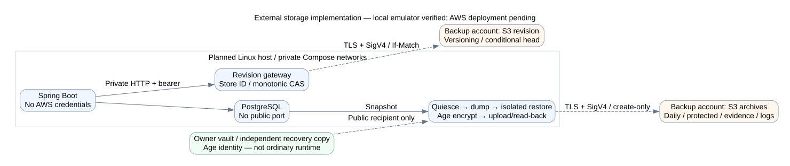

# 외부 저장·서버 배포 준비 구현

2026-11-19 · 코드와 로컬 검증 · 실제 AWS 계정/버킷/서버·DNS·공인 인증서·외부 배포 미실행

기존 O1~O4는 그대로 유지한다. 이번 구현은 **S3 revision gateway, 스트리밍 암호화 백업/회수, 중단형 DB 백업 작업, 로그 복사 작업, 운영 Compose·권한 정책 생성과 인증서 사전 검사**다. 로컬 모의 S3 시험은 AWS IAM·버킷 정책·실제 TLS·재해 독립성 인수를 대신하지 않는다. [실행 근거](../validation/external-storage-local-2026-11-19/README.md)를 함께 읽는다.



## 1. revision은 어떻게 달라졌나

서버는 기존 내부 HTTP API로 `revision-ledger` gateway에 접근한다. `AWS_S3` scope에서는 gateway가 S3 저장 유형을 보고해야 하며, 기존 SQLite 참조 서비스 응답을 받으면 실패한다. AWS 키는 gateway만 읽고 backend에는 전달하지 않는다. 내부 HTTP는 격리 Docker 네트워크·bearer token 경계이며 호스트 포트가 없다. gateway부터 AWS까지는 boto3의 TLS 인증서 검증과 SigV4 서명을 사용한다. [구현](../infra/external-storage/ledger_s3.py)

S3의 Versioning이 활성화된 별도 버킷에서 현재 `revision/head.json`만 읽는다. 고정한 계정 ID·store UUID·문서 해시·버전을 확인한다. 갱신은 읽은 ETag를 `If-Match`에 넣어 경쟁 쓰기를 거부하고, 응답 유실 재시도는 **바로 다음 버전·같은 선행 문서 해시·같은 결과 문서**일 때만 인정한다. 최초 생성은 별도 `init` 명령의 `If-None-Match: *`이며 runtime 정책으로는 초기화할 수 없다. 읽기 실패 시 과거 VersionId·로컬 복사본으로 우회하지 않는다. [AWS 조건부 쓰기](https://docs.aws.amazon.com/AmazonS3/latest/userguide/conditional-writes.html), [조건 강제 정책](https://docs.aws.amazon.com/AmazonS3/latest/userguide/conditional-writes-enforce.html)

생성되는 정책은 runtime의 삭제·과거 버전 읽기·버킷/보존 설정 변경을 금지한다. 계정 관리자까지 절대로 변경하지 못하는 저장소를 구현한 것은 아니다. gateway 자격증명 침해나 관리자의 head 롤백·버전 삭제는 별도 신뢰 경계다. gateway는 실행 중 관측한 버전 역행을 거부하고, 재시작 뒤 backend의 로컬 revision 쌍 대조도 유지한다. AWS에서 실제 계정 분리·권한 거부를 확인해야 한다.

## 2. 백업은 무엇을 보장하나

[external_backup.py](../tools/production/external_backup.py)는 명시한 파일만 tar에 묶어 age 형식으로 스트리밍 암호화한다. 129MiB 파일로 기존 128MiB 로컬 한도를 넘는 왕복을 시험했다. 새 경로는 단일 조건부 S3 PUT을 위해 암호화 파일 **4GiB 상한**을 둔다. 무제한·대용량 운영 성능을 검증한 것은 아니다. tar와 복호화 임시 파일에는 디스크 공간이 필요하다.

새 운영 키 형식은 age X25519다. 서버에는 공개 recipient만 둘 수 있고, 개인 identity는 기존에 정한 개인 금고·암호화 USB·종이 안내서 정책에 따라 별도로 보관한다. 실제 키를 만들거나 보관 장소를 확정하지 않았다. 기존 Fernet 파일·키·로컬 O4 도구를 변환하거나 삭제하지 않는다. [사용한 age 바인딩](https://github.com/woodruffw/pyrage)

S3 업로드는 새 객체만 허용하고, 반환된 VersionId로 다시 읽어 암호문 SHA-256/크기를 대조한 뒤 receipt를 남긴다. 회수도 receipt의 버전·버킷 소유자·키·해시를 고정한다. 복호화는 전체 인증을 끝낸 후 파일명·링크 여부·크기·내부 해시를 검사한다. 기존 파일/폴더를 덮어쓰지 않는다. `RESTORE_COMPLETE.json` 없는 출력 디렉터리는 중단된 추출일 수 있으므로 복원에 사용하지 않는다. 새 출력 경로로 다시 회수하고 기존 부분 자료를 자동 삭제하지 않는다.

| 결과 | 뜻 | 뜻하지 않는 것 |
|---|---|---|
| `UPLOADED_VERIFIED_CIPHERTEXT` | 업로드 버전의 암호문을 다시 읽고 해시 대조 | DB 복원, 개인키 회수, 서버 유실 RTO |
| `BACKUP_UPLOADED_SOURCE_RESTORE_VERIFIED` | 원본 dump를 새 DB로 복원·비교하고 fence한 후 암호문 업로드 대조 | 외부 서버에서 개인키 회수·복호화·전체 서비스 인수 |
| `LOCAL_EXTERNAL_FULL_STACK_PASSED` | 같은 Linux CI 안의 제품 20개 테이블·모의 S3·age 복원, O4 잠금/손실 인수·새 revision·SSE/ACK 재개 | 실제 AWS 권한·키 회수·서버용 생성 Compose·전체 호스트 RTO |
| `LOCAL_EXTERNAL_POSTGRES_ROUNDTRIP_PASSED` | 로컬 모의 S3를 거쳐 회수한 dump의 실제 새 PostgreSQL 복원 | AWS 권한·외부 2시간 RTO·전체 제품 DB 인수 |

[server_backup.py](../tools/production/server_backup.py)는 명시된 `parking-server` 환경에서 web/backend 중지 → backup 계정 dump → 임의 이름의 새 검증 DB 복원/전 테이블 비교 → revision 두 파일 포함 암호화 → 독립 원장 fence → 업로드 대조 → 재시작 요청 순서다. 기존 운영 DB를 DROP하지 않는다. 실패하면 자동 재개하거나 마지막 성공 기록을 갱신하지 않는다. 사용자가 원인을 확인한 뒤 재개한다. 완료 receipt의 `service_readiness_verified=false`를 유지한다. Compose 기동 요청 성공은 실제 로그인·새 사건 처리가 정상이라는 뜻이 아니다.

외부 상태 파일은 `backup-status/last-success.json`이다. `parking_backup_external_upload_timestamp_seconds`와 `parking_backup_external_source_restore_valid`로 표시한다. 기존 로컬 복호화/복원 성공 지표와 섞지 않는다. 새 Prometheus 규칙은 누락 및 24시간 초과를 확인한다. 서버 밖 실제 알림 전달은 아직 인수하지 않았다. node-exporter는 기존 Docker runtime 관측 범위를 유지하며 호스트 전체 디스크/메모리 인수를 대신하지 않는다.

[server_logs.py](../tools/production/server_logs.py)는 Docker에 남아 있는 로그를 암호화해 별도 `logs/`로 올린다. 첫 실행은 보관 중 로그 전체, 이후 마지막 성공 경계에서 30초 겹쳐 복사한다. 업로드 실패 시 경계를 전진시키지 않는다. Docker rotation 전에 회수하지 못한 로그는 복구할 수 없다. 5분 timer는 목표 주기이며 외부 지연/누락 검증과 경보 수신은 남아 있다. 증거 자료는 `evidence/`, 변경 직전·종료 전 백업은 `protected/`로 분리한다. 삭제 권한과 자동 삭제 기능을 배포하지 않았다. 성공 일별 7세대 정리는 별도 보존 담당 권한으로 확인 후 수행해야 하며 증거·protected·revision에 적용하지 않는다.

## 3. 서버용 파일 준비 — 서버는 만들지 않는다

```sh
python3 -m venv .local-state/external-python
.local-state/external-python/bin/pip install -r tools/production/requirements-external-test.txt
.local-state/external-python/bin/python tools/production/prepare_server.py \
  --input infra/server/inputs.example.json --output .local-state/server-review

docker compose -f .local-state/server-review/compose.json --profile tools config --quiet
```

입력 예시는 검토용 가짜 이미지 digest·계정·버킷이다. 그대로 실행할 수 있는 릴리스가 아니다. `--output`은 새 폴더여야 한다. 생성기는 cloud API, DNS 등록, `docker up`을 호출하지 않는다. 실제 입력에는 검증된 이미지의 registry digest와 domain·장치 ID·서로 다른 S3 버킷/역할을 넣는다. 모든 서비스의 `platform`은 `linux/amd64`다. 이미지 이름에 digest가 있다는 사실만으로 해당 아키텍처나 신뢰성까지 확인된 것은 아니므로 실제 pull/inspect·동일 이미지 인수가 필요하다.

기본은 loopback 바인딩이다. 검토한 입력에서 `public_access=true`로 명시했을 때만 web 80/443과 MQTT 8883이 공개 설정으로 생성된다. Grafana는 loopback 3000, DB·backend·원장·Prometheus는 호스트 공개 포트가 없다. SSH는 Compose가 관리하지 않는다. Lightsail 방화벽·관리 IP 제한은 실제 서버 단계에서 적용한다.

공인 MQTT 인증서 이름을 검증하기 위해 내부 mqtt 네트워크에서 broker에 공개 domain 별칭을 부여한다. backend는 이 이름으로 TLS 연결한다. 장치별 ACL에는 자기 events/heartbeat/availability 발행과 acks 구독만 허용한다. ACL 생성만으로 장치 DB 등록·정책 등록이 완료되지 않는다. `initialize-virtual`은 기존의 **새 빈 DB·zone-01/edge-01 가상 장치**만 초기화하는 명시 도구다. 새 장치 등록 및 기존 DB 인수는 자동화하지 않는다.

생성물 설치·권한·초기화·인증서 갱신 순서는 [서버 준비 안내](../infra/server/README.md)를 따른다. 새 S3 gateway의 amd64 이미지 빌드/CLI 실행은 로컬 확인했고, backend/web 전체 Linux 릴리스 빌드·registry 게시·이미지 복귀 실험은 실제 릴리스 단계에서 남아 있다. 태그만 교체해 데이터 스키마까지 되돌리는 자동 rollback은 제공하지 않는다.

## 4. 이번 확인과 다음 작업

- 전체 제품 연결 시험은 `tools/production/verify_external_stack.py`로 실행한다. 같은 PC의 별도 환경에서 HTTPS 로그인 → MQTT 사건 저장/ACK → 제품 DB 백업 → 모의 S3 업로드/회수 → 새 DB 복원 → 복구 인수 → 화면/SSE·새 사건 재개를 확인한다. [통합 시험 기록](../validation/external-integration-2026-11-19/README.md)에 실패 원인과 최종 판정을 구분해 보존한다.
- **DB 백업은 과거의 내용이고 독립 revision은 이미 사용한 번호의 최신 기준이다.** 따라서 오래된 DB와 로컬 revision 두 파일을 함께 되돌려도 최신 외부 원장과 맞지 않으면 시작을 거부해야 한다. 복원 후에는 잠금 상태에서 장치와 대조하고, 백업 이후 손실을 명시적으로 인수한 다음 이전 예약 범위보다 큰 revision으로 재개한다. 저장소가 잠깐 돌아왔다는 이유만으로 차단을 자동 해제하지 않는다.
- Linux CI에서 전체 제품 연결 시험을 통과했다. 실행 소요 231.968초는 이미 준비된 시험 환경의 정상/복원/장애 시나리오이며 운영 RTO가 아니다. 공유 노트북에서는 요청 시간 초과와 rollback probe 대기를 관측했다. 3초 원장 요청 제한과 실패 시 차단을 완화하지 않았으며 실제 호스트의 왕복 지연·가용성 검증은 남아 있다.
- Python 단위 시험, 실제 loopback HTTP gateway/SigV4 요청, 별도 PostgreSQL dump·S3 회수·복원, Kotlin 회귀·bootJar, Compose 문법·문서/계약 검사를 실행한다. 정확한 횟수·해시는 실행 근거에 기록한다.
- 실제 S3 버킷/권한·Versioning/삭제 거부·credential 만료·지역 장애, 공인 TLS 발급/갱신·MQTT 장치, 실제 4GB 서버 부하·원래 서버 없는 자료/키 회수는 미실행이다.
- DB dump와 외부 키를 독립 환경에서 회수한 뒤에는 O4의 hold → 최신 원장 대조 → 새 DB 복원 → 장치 대조/손실 인수 → 새 revision 재개를 그대로 따른다. 암호문 다운로드만으로 hold를 해제하지 않는다.
- 다음 순서는 실제 입력·비용/지역/종료 시각 확인 → 승인 범위에서 외부 저장소/비공개 시험 서버 준비 → 실제 통합·복원 검증 → 팀 개방이다. 이번 코드 작성은 해당 외부 작업의 실행 승인이 아니다.
