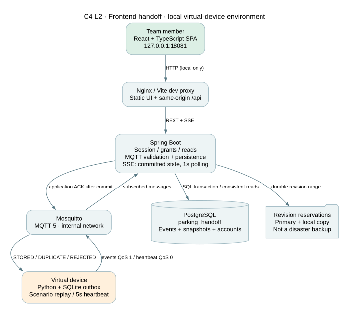

# 프론트 인계 설명서

2026-11-14 · 전달 브랜치 `feat/frontend-handoff` · 제품 기준 v1.43

## 무엇을 받게 되나요?

로그인 → 구역 현황 → 사건 목록·상세 → 로그아웃까지 연결된 React 앱입니다. 화면의 데이터는 가상 장치가 MQTT로 보낸 메시지를 Spring Boot가 PostgreSQL에 저장한 결과입니다. 정적인 예제 화면이나 별도 가짜 API가 아닙니다.



| 포함 | 이번 인계에 포함하지 않음 |
|---|---|
| 세션 로그인·CSRF·구역 권한, 실제 조회 API, 전체 상태 SSE, 재접속 | 실물 보드 AI·LED/스피커·실차 검증 |
| 관측 전·통신 지연·오류·빈 이력·권한 제한 표시 | 법적 단속 결과, 영상 스트리밍, 지도·내 차 찾기 |
| 가상 사건 발행, 영속 순번·재전송·저장 ACK, 독립 실행 환경 | 미구현 수동 제어·정책 변경·사진 파일 버튼 |

**전달 기준:** [작업표](frontend-handoff-checklist.md)와 [검증 기록](../validation/frontend-handoff-2026-11-14.json)을 확인합니다. 로컬 실행판과 공개 HTTPS 완료는 별개입니다. 현재 공개 URL·배포 서버·DNS가 지정되지 않았습니다.

## 1. 처음 실행하기

필요한 것은 GitHub 저장소 접근 권한, Git, Python 3.10 이상, 실행 중인 Docker Desktop/Engine과 Compose v2입니다. Linux/macOS 기준입니다. Windows는 WSL2를 사용합니다. 첫 실행은 이미지·의존성을 내려받습니다. 프론트 코드를 수정하려면 Node.js 24도 필요합니다.

```sh
git clone --branch feat/frontend-handoff https://github.com/yh4752/parking-system.git
cd parking-system
python3 tools/handoff.py prepare
```

`prepare`는 저장소에 포함된 실행 도구입니다. Docker 자체 명령은 아닙니다. 별도 `parking-handoff` 프로젝트에 빈 DB·브로커·서버·화면을 만들고 구역·정책·조회 계정을 준비합니다. 기존 `parking-local`의 8080/11883/15432와 DB를 변경하지 않습니다. 이미 초기화한 인계 DB는 보존하며, 기존 데이터가 있는 DB를 초기화하려는 요청은 거부합니다.

- 주소: <http://127.0.0.1:18081>
- 아이디: `handoff-viewer`
- 비밀번호: 실행한 PC의 `.local-state/handoff/web-password` 파일을 직접 열어 확인합니다. 실행 시 무작위 생성하며 Git에 넣지 않습니다.
- 최초 화면은 **첫 관측을 기다립니다**입니다. 아직 사건을 만들지 않았으므로 정상입니다.

공유할 때는 비밀번호 파일/`.env`를 저장소나 공개 메신저 자료에 첨부하지 않습니다. 상대 PC의 `prepare`는 그 PC용 계정을 생성합니다.

## 2. 화면과 실제 저장을 함께 확인하기

저장소 최상위의 별도 터미널에서:

```sh
python3 tools/handoff.py simulate
```

가상 ‘이동 안내 완료’ 사건과 5초 간격 heartbeat가 전송됩니다. 화면이 연결됨으로 바뀌고 사건 상세에서 수신 메시지를 볼 수 있습니다. 5분 4초는 **가상으로 재생한 정차 보고값**입니다. 5분을 실제 측정하거나 AI가 영상을 분석한 시험이 아닙니다.

```sh
python3 tools/handoff.py pause-simulator
```

마지막 유효 heartbeat로부터 15초 초과 시 응답 지연, 30초 초과 시 연결 미확인으로 바뀝니다. 서버가 약 1초마다 판정하므로 경계 직후 약 1초가 더 걸릴 수 있습니다. 차량 상태는 마지막 관측으로 남습니다. 통신 단절이 차량 출차를 뜻하지 않습니다.

```sh
python3 tools/handoff.py status
python3 tools/handoff.py logs
python3 tools/handoff.py stop
python3 tools/handoff.py start
```

`stop`은 이 인계 환경만 중지하고 데이터는 보존합니다. `start` 후 시뮬레이터는 별도 `simulate`로 시작합니다. 실행 도구는 볼륨 삭제/초기화 명령을 제공하지 않습니다.

## 3. 프론트 수정 시작점

서버·DB·브로커는 위 환경을 켜 둡니다. 프론트만 개발 서버로 실행합니다.

```sh
cd frontend
npm ci
npm run generate
PARKING_API_PROXY=http://127.0.0.1:18080 npm run dev
```

<http://127.0.0.1:5173>에서 수정 내용을 봅니다. `/api` 요청은 Vite가 Spring으로 전달합니다. 별도 CORS 허용이나 브라우저의 MQTT 연결은 필요하지 않습니다. 배포 빌드는 Nginx가 같은 출처의 API로 전달합니다.

| 수정하려는 것 | 파일/폴더 | 주의할 경계 |
|---|---|---|
| 색·간격·글자·반응형 | `frontend/src/styles/` | 상태별 경고·키보드 focus 유지 |
| 메뉴·공통 배치 | `src/components/Shell.tsx` | 로그아웃 흐름 유지 |
| 구역 카드·카메라/사건 표시 | `src/features/zones/ZonePage.tsx` | 장치 연결과 화면 연결, 최초 null 구분 |
| 목록·기간/상태 필터·상세 | `src/features/events/` | 기간은 KST 입력→UTC 변환, 서버 최초 수신 기준 |
| 로그인 화면 | `src/features/auth/LoginPage.tsx` | label·autocomplete·401/429 오류 유지 |
| 통신·인증 | `src/api/client.ts`, `features/auth/Auth.tsx` | 변경 시 백엔드 담당자와 협의 |
| 실시간 수신·revision | `features/zones/zoneStream.ts` | 오래된 응답 무시·재연결·권한 회수 처리 유지 |
| API 타입·응답 검증 | `src/api/generated/` | 직접 편집하지 않고 `npm run generate` |

React 19, TypeScript 5.9, Vite 8, React Router 7, CSS Modules입니다. 정확한 버전은 package/lockfile을 따릅니다. 처음부터 기능을 다시 만드는 대신 실행되는 화면의 디자인·사용성을 개선하면 됩니다.

## 4. 알고 바꿔야 하는 통신 규칙

| 흐름 | 화면의 책임 |
|---|---|
| 로그인/로그아웃 | 먼저 `/api/csrf`로 토큰 발급. 로그인 후 토큰 재발급. 쿠키는 브라우저 관리 |
| 현재 사용자 | `/api/auth/me`의 user_id·role 사용. 실제 구역 권한은 서버가 검사 |
| 상태 조회 | `/api/zones/{id}/status`의 8개 필드 유지. 관측 전 snapshot=null도 정상 |
| SSE | `/api/stream?zone_id=...`, `zone_snapshot`, id=view_revision, data=전체 ZoneView |
| 최초/재연결 | REST로 현재 상태를 다시 조회. 최초 revision=0 수용 후 큰 revision만 반영 |
| 사건 이력 | `/api/events`, `/api/events/{id}`를 10초 및 창 focus 때 재조회. 과거 메시지가 추가되어도 현재 구역 revision은 그대로일 수 있음 |
| SSE 오류 | REST로 인증·권한·서버 상태 확인 후 재시도. 401은 로그인, 403/404는 중단, 429는 Retry-After |
| 화면 이동/계정 변경 | 기존 요청 Abort, SSE close, 타이머 해제. 이전 계정·구역의 응답 무시 |

구역 목록 API는 이번 범위에 없습니다. 초기 구역 ID는 `VITE_DEMO_ZONE_ID`(기본 zone-01)이며 공개 설정입니다. 이 값 자체가 접근 권한을 부여하지 않습니다. 브라우저 저장소에 비밀번호·세션·CSRF 토큰을 저장하지 않습니다.

서버는 1초마다 **커밋된 전체 상태**를 읽어 새 revision만 전달합니다. SSE는 모든 중간 사건을 한 건씩 전송하는 감사 로그가 아닙니다. 세션당 3개/전체 50개 연결 상한, 느린 연결 종료와 권한 재검사를 적용합니다. [결정 근거](adr/008-frontend-handoff-realtime.md)를 참고합니다.

## 5. 수정 후 확인

```sh
# frontend/에서
npm run generate
npm test
npm run build
```

실제 브라우저 자동 시험은 **빈 별도 인계 환경**에서 실행합니다. 기존 개발 데이터가 있는 환경에 실행하면 ‘첫 관측 전’ 검사가 실패하도록 되어 있습니다. 데이터를 지워서 통과시키지 말고 새 클론/별도 Docker 환경을 사용합니다.

```sh
# frontend/에서, 위 prepare 완료 후
npx playwright install chromium
npm run test:e2e
```

시험은 실제 로그인, MQTT 발행·저장·조회, SSE, 목록/상세, 통신 단절/재연결, 15/30초 표시, 모바일 폭, 로그아웃/재로그인을 검사합니다. CI는 깨끗한 체크아웃과 독립 Docker 볼륨에서 실행합니다. 성공 여부·커밋은 검증 기록을 기준으로 판단합니다.

## 6. 잘 안 될 때

| 증상 | 먼저 확인할 것 |
|---|---|
| Docker daemon 연결 오류 | Docker Desktop/Engine 실행 후 같은 명령 재실행 |
| GitHub clone 거부 | 비공개 저장소 협업자 초대 수락·Git 인증 |
| 18080/18081/5173 사용 중 | 다른 프로세스인지 확인. 사용 중인 프로세스를 무작정 종료하지 않음 |
| 첫 관측 전 화면 | `simulate`를 실행했는지, 서버/브로커 로그 확인 |
| 사건만 보이고 연결 미확인 | 유효한 새 heartbeat 수신 여부 확인. 사건 수신만으로 ONLINE이 되지 않음 |
| 503 구역 상태 확인 필요 | revision 파일·DB 불일치나 recovery hold. SQL로 hold를 강제 해제하지 말고 백엔드 담당자에게 전달 |
| prepare가 기존 DB라며 거부 | 신규 초기화 보호. 로그와 `.local-state/handoff/initialized` 존재 여부를 확인하고 기존 DB 보존 |
| 로그인을 반복해도 401 | 해당 PC에서 생성한 계정/비밀번호인지 확인. 429는 대기 후 재시도 |

## 7. 인계할 때 함께 전달할 것

1. GitHub 브랜치/PR와 이 문서 링크.
2. 상대방의 저장소 접근 권한(협업자 초대는 별도).
3. 로컬 실행판인지 공개 HTTPS 운영판인지.
4. 검증된 커밋·검사 기록·남은 제한.

공개 HTTPS 주소는 아직 없습니다. 서버 위치·접근 권한·도메인/DNS와 외부 접속 검증이 필요합니다. 이 로컬 Compose는 외부 공개용 구성이 아니며, 내부 브로커/DB를 외부에 열어 대신하지 않습니다. 실제 서버의 비밀값·백업 저장소·TLS·복원 검증은 배포 단계에서 별도 확인합니다.
