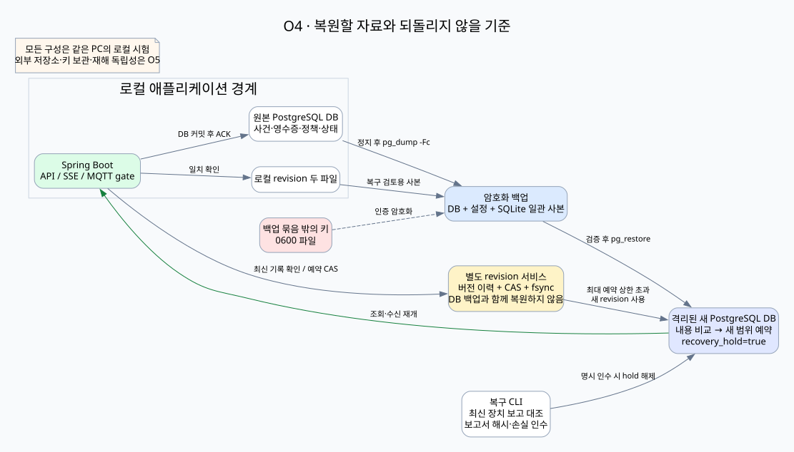

# O4: 백업을 실제로 복원해 보기

O4는 **로컬 복원 훈련**이다. 기존 O2·O3 데이터와 분리한 `parking-backup`에서 PostgreSQL 백업, 암호화, 독립 revision 기록, 복구 보류와 명시 인수를 연결한다. 실제 외부 배포·외부 저장소 연결은 하지 않는다. 실행 결과는 [현재 상태](status.md)와 [O4 검증 기록](../validation/local-backup-2026-11-16.json)에 구분한다.

## 왜 DB 백업과 독립 revision 기록이 둘 다 필요한가요?

**DB 백업은 데이터를 되찾는 자료이고, 독립 revision 기록은 과거 상태를 최신 상태로 오인하지 않게 하는 기준이다.**

| 자료 | 담는 내용 | 할 수 없는 일 |
|---|---|---|
| DB 백업 | 그 시점의 사건·중복 처리 영수증·정책·계정·구역 상태 | 백업 이후 저장된 사건까지 복원 |
| 로컬 revision 두 파일 | 서버가 이미 예약한 번호 범위와 최초 초기화 기록 | DB와 두 파일을 함께 과거로 되돌린 사실의 독립 증명 |
| 독립 revision 기록 | 예약 범위·초기화 claim·복구 인수 기록의 버전 이력 | 사건 본문·사진 등 업무 데이터 복원 |
| 암호화 키 | 백업을 복호화하고 변조를 검사할 권한 | 키를 잃었을 때 백업을 되살리는 우회 방법 |

`view_revision`은 화면이 상태의 신구를 비교하는 번호다. 예를 들어 백업에 revision 120이 있고, 그 뒤 서버가 300까지 사용했다고 하자. DB만 120으로 돌려놓고 121부터 다시 사용하면 화면이 새 응답을 오래된 응답으로 버릴 수 있다. 백업과 두 파일까지 같이 되돌리면 로컬 검사끼리는 서로 맞아 보여도 같은 문제가 생긴다.

이를 막기 위해 번호를 백만 개 단위로 **사용 전에 예약**한다. 독립 기록의 상한이 1,999,999라면 복구 후에는 최소 2,000,000부터 새 범위를 쓴다. 남은 번호는 재사용하지 않는다. 백업 완료 직후에도 새 범위로 옮기므로 같은 실행 중에 만든 백업으로 돌아가도 경계가 드러난다. 임의의 비공식 DB 사본을 같은 범위 안에서 몰래 되돌리는 모든 경우를 탐지하는 사건별 원장은 아니다. 복원은 반드시 이 도구를 통한다.

독립 기록은 CAS(Compare And Set)로 갱신한다. “내가 읽은 버전과 해시가 아직 최신일 때만 새 기록을 추가”하는 방식이다. 다른 작업이 먼저 갱신했거나 기록을 읽지 못하면 멈춘다. 버전을 삭제하는 HTTP 기능은 제공하지 않는다.



## 백업 성공은 어디까지 확인하나요?

1. 이 환경의 웹·백엔드·가상 장치를 멈춰 세션/SSE와 쓰기를 정리한다.
2. 읽기 전용 `parking_backup`으로 `pg_dump -Fc`를 실행한다. PostgreSQL의 일관된 논리 백업을 사용한다. 계정 같은 클러스터 전역 객체는 단일 DB 덤프에 포함되지 않으므로 역할 생성·권한 스크립트를 함께 보관한다. [PostgreSQL 공식 설명](https://www.postgresql.org/docs/17/app-pgdump.html)
3. 두 revision 파일, 이미지 ID·소스/설정 해시, 암호화할 설정·자격증명, 역할 스크립트를 모은다. 가상 장치 SQLite는 backup API로 일관 사본을 얻는다. WAL 사용 중 파일 하나만 복사하지 않는다. [SQLite backup API](https://docs.python.org/3/library/sqlite3.html#sqlite3.Connection.backup)
4. 별도 키로 전체 묶음을 Fernet 인증 암호화한다. 잘못된 키·바이트 변조는 파일을 사용하기 전에 거부한다. 키 자체는 묶음에 넣지 않는다. [Fernet 공식 설명](https://cryptography.io/en/latest/fernet/)
5. 방금 암호화한 내용을 다시 복호화해 **새 임시 DB**에 `pg_restore --exit-on-error --single-transaction`으로 복원한다. 모든 public 테이블의 행 수와 정렬한 행 내용 해시를 원본과 비교한다. [PostgreSQL 복원 도구](https://www.postgresql.org/docs/17/app-pgrestore.html)
6. 독립 기록 → 로컬 기본 파일 → 로컬 사본 → DB 순서로 새 revision 범위를 확정한다. 어느 단계에서 끊겨도 불일치를 자동으로 고치거나 번호를 재사용하지 않는다.
7. 암호화 산출물과 검증 기록을 남긴 뒤 서비스를 재개한다. 이때만 Prometheus의 마지막 검증 시각을 갱신한다.

백업 작업 중 잠깐 서비스가 중단되는 단일 서버 방식이다. 현재 도구는 메모리에서 처리하는 **128MiB 이하 로컬 자료**에 한정한다. 대용량 운영 백업은 스트리밍 암호화·여유 공간·시간 제한을 별도로 설계한다. 브로커 persistence는 사건 DB 백업을 대신하지 않는다.

## 복원은 어떤 순서로 하나요?

| 단계 | 수행 내용 | 아직 허용하지 않는 동작 |
|---|---|---|
| 무결성 검사 | 암호화 파일 checksum·인증·저장소 identity 확인 | 잘못된 백업으로 기존 서비스 중지 |
| 중지·격리 복원 | 기존 프로세스 중지, 새로운 `parking_restore_*` DB 생성, 권한 재적용·내용 비교 | 원본 DB 덮어쓰기 |
| 복구 보류 | 새 DB의 `recovery_hold=true`, 독립 최신 기록과 DB/두 파일의 최대 상한보다 큰 범위 예약 | 보호된 API·SSE·일반 사건/heartbeat·중복 ACK·정리 작업 |
| 장치 대조 | 기존 Schema·등록·정책·순서 규칙으로 더 최신 장치 보고를 별도 CLI에서 검증·커밋, 대조 증거를 audit에 기록 | 이 CLI의 응용 ACK 발행·명령 자동 재발행 |
| 보고서 확인 | DB 전체 지문·독립 버전·구역별 revision·장치 보고 해시 확인 | 오래된 보고서·대조 증거 없는 보고서로 개방 |
| 명시 인수 | 보고서 SHA-256와 백업 이후 ACK 자료의 손실 가능성을 지정해 인수 | 단순 재시작으로 hold 해제 |
| 재개 | 새 revision으로 API/SSE·일반 수신 재개, 남은 outbox 재전송 | 이미 삭제된 outbox 사건이 모두 돌아온다는 가정 |

복원된 snapshot은 과거 관측이다. 연결 상태는 OFFLINE으로 되돌리고 heartbeat 시각과 측정값을 비운다. 차량이 나갔다고 추정하지 않는다. 실제 명령·server outbox 자료가 있는 DB는 현재 로컬 인수 도구가 개방을 거부한다. 그 기능의 복구 정책은 별도 검토가 필요하다.

**ACK 이후 손실 예:** 10시에 백업하고 10시 5분 사건을 DB에 저장한 뒤 성공 ACK를 보냈다면, 장치는 그 사건을 outbox에서 지울 수 있다. 10시 백업으로 복원하면 10시 5분 사건은 사라지며 장치도 재전송할 원문이 없을 수 있다. 독립 revision 기록은 새 번호를 안전하게 정할 뿐 이 사건을 복구하지 않는다. 더 촘촘한 백업이나 WAL/PITR는 향후 별도 선택이다.

RPO는 허용 가능한 데이터 손실 구간, RTO는 서비스 복구에 걸리는 시간이다. 최초 로컬 설계 목표는 각각 24시간·60분이었다. 현재 운영 목표는 [2026-11-17 승인 정책](backup-recovery-policy.md)의 DB 24시간 손실·전체 서비스 2시간 복구이며 아직 실제 외부 인수하지 않았다. 이번 검증은 실제 백업 시각부터 장애까지의 경과, ACK 후 백업에 없는 사건 수, 복원 시작부터 HTTPS 재개까지를 기록한다. 작은 가상 자료에서의 실측을 실제 서버 SLA로 확대하지 않는다.

## 직접 실행하기

저장소 루트에서 실행한다. Docker가 켜져 있어야 한다. 암호는 화면에 출력하지 않고 파일로 관리한다.

```sh
python3 -m venv .local-state/backup-python
.local-state/backup-python/bin/pip install -r tools/production/requirements-backup.txt
.local-state/backup-python/bin/python tools/production/local_backup.py prepare
.local-state/backup-python/bin/python tools/production/local_backup.py simulate
.local-state/backup-python/bin/python tools/production/local_backup.py backup
```

제품 주소는 <https://localhost:20443>, Grafana는 <http://localhost:23000/d/parking-backup>이다. 제품 계정 `https-viewer`의 암호는 `.local-state/backup-demo/accounts/https-viewer.password`, Grafana 계정 `monitoring-admin`의 암호는 `.local-state/backup-demo/secrets/grafana-password`에 있다. 시험 CA는 `.local-state/backup-demo/pki/ca.crt`다. 운영체제 신뢰 저장소는 변경하지 않는다. 필요하면 `node tools/production/open_https.mjs --state .local-state/backup-demo`로 이 시험 인증서만 허용한 학습 브라우저를 연다.

백업 명령이 출력한 파일을 선택한다. 아래 `선택한-백업.fernet`과 `보고서-SHA256`을 실제 출력으로 바꾼다.

```sh
.local-state/backup-python/bin/python tools/production/local_backup.py restore .local-state/backup-demo/backups/선택한-백업.fernet
# 이 시점에는 로그인해도 구역/API/SSE는 503이며 일반 MQTT 성공 ACK도 없다.
.local-state/backup-python/bin/python tools/production/local_backup.py capture
.local-state/backup-python/bin/python tools/production/local_backup.py reconcile .local-state/backup-demo/device-report.json
cat .local-state/backup-demo/recovery/report.json
# 대조 결과와 데이터 손실 가능성을 확인한 뒤, reconcile이 출력한 SHA-256을 지정한다.
.local-state/backup-python/bin/python tools/production/local_backup.py accept 보고서-SHA256
.local-state/backup-python/bin/python tools/production/local_backup.py simulate
```

`capture`는 **가상 장치의 새 보고**를 만들고 outbox에 넣는 학습 명령이다. 실제 장치의 현장 대조를 대신하지 않는다. 복원 때 살아 있는 장치의 SQLite를 과거 사본으로 덮어쓰지 않는다. 저장된 SQLite 사본은 별도 복구 검토 자료다. 실제 장치의 순번까지 유실되었다면 임의로 번호를 추측하지 않고 장치 identity·순번 복구 절차를 정해야 한다.

`prepare` 재실행은 기존 데이터를 보존한다. 중지는 `local_backup.py stop`, 재개는 `local_backup.py up`이다. O4 환경은 O4 도구로 조작한다. O2/O3 도구로 overlay를 생략해 기동하지 않는다. 설정 변경·누락된 secret·독립 저장소 유실은 자동 재생성하지 않는다. 복구 실패 때는 원인과 보고서를 확인하고 `prepare` 복구 단계를 새로 수행해 미완료 예약 범위를 건너뛴다. 정상 기동이나 초기화 명령으로 우회하지 않는다.

기존 자료 인수는 오프라인 `RecoveryCli adopt`가 담당한다. 최초 도입 시에만 빈 독립 저장소와 일치하는 두 로컬 파일·DB를 요구하고 새 범위와 hold를 만든다. 과거의 유실된 독립 기록을 새로 만들기 위한 명령이 아니다. O1/O2/O3의 현재 학습 DB는 이번 작업에서 인수하거나 변환하지 않았다.

원장 컨테이너는 호스트 원장 폴더의 소유자 UID:GID로 실행한다. 폴더 권한 `0700`과 `cap_drop: ALL`은 유지한다. Linux에서는 권한을 제거한 root도 다른 사용자의 비공개 폴더를 열지 못하므로 실행 계정을 맞춰야 한다. 이전 구성으로 만든 학습 환경은 설정 해시 변경으로 재개가 차단될 수 있다. 기존 원장·키·DB를 삭제하거나 manifest 해시만 고치지 않고, 아래 격리 인수 명령으로 새 환경을 검증한다. 기존 자료를 새 구성으로 옮기는 마이그레이션은 이번 수정에 포함하지 않았다.

## 대시보드에서 볼 것

O3의 [운영 지표](local-monitoring.md)에 O4 전용 대시보드 3개 패널을 추가한다.

| 지표 | 의미·확인할 일 |
|---|---|
| 마지막 검증 백업 이후 경과 | dump 생성 시각이 아니라 복호화·실제 복원·내용 비교·범위 예약을 모두 통과한 시점. 24시간을 넘으면 경고 |
| 백업 검증 기록 유효 | 0이면 미실행·누락·손상·미래 시각 등으로 기록을 신뢰할 수 없음. 1분 지속 시 경고 |
| 복원 후 조회 준비 | hold 또는 독립 기록 불일치면 0. DB health가 살아 있어도 조회 준비는 별개 |

지표는 실제 검증 기록을 읽는다. 파일이 없는데 성공을 기본값으로 만들지 않는다. Grafana에서 정상으로 보여도 외부 백업 저장소·암호화 키가 재해 후 살아 있는지까지 증명하지 않는다. O4 경보는 내부 규칙이며 외부로 알림을 발송하지 않는다.

## 저장 위치와 남은 운영 조건

| 로컬 위치 | 내용 |
|---|---|
| `.local-state/backup-demo/backups/` | 암호화 묶음·공개 가능한 checksum/검증 요약 |
| `.local-state/backup-keys/<ID>.key` | 0600 암호화 키. 백업 묶음 밖에서 관리 |
| `.local-state/revision-ledgers/<ID>/` | 별도 서비스의 append-only SQLite 버전 기록. DB 백업에 넣거나 되돌리지 않음 |
| `.local-state/backup-demo/recovery/report.json` | 가장 최근 복구 점검/인수 보고서 |

모두 같은 PC에 있으므로 디스크나 PC가 통째로 사라지면 함께 잃을 수 있다. **로컬의 저장 경계 분리와 실제 재해 독립성은 별도다.** O5에서는 외부 저장소의 최신성·조건부 갱신·버전 보존·삭제 권한·TLS·비용, 독립 백업 위치, 키 보관과 복구 담당자를 실제 공급자에서 검증해야 한다. 저장소 관리자 탈취나 독립 원장 자체의 과거 복원까지 자동 방어한다고 주장하지 않는다.

현재 승인 목표는 매일 03:00 KST·배포/DB 변경 전·운영 종료 전 백업, 성공 일별 7세대·변경 직전/최종본 별도 보호다. 증거·revision·키의 별도 보관 기간과 회수 목표는 [승인 정책](backup-recovery-policy.md)을 따른다. 이번 로컬 작업은 자동 스케줄이나 자동 삭제를 설치하지 않는다. 새 원격 저장소의 보존 정책과 백업 실패 알림을 검증한 후 운영 서버에서 설정한다. 실패한 백업도 최근 성공 시각을 갱신하지 않아야 한다.

## 검증 재현

```sh
.local-state/backup-python/bin/python -m unittest discover -s tools/production -p 'test_*.py' -v
.local-state/backup-python/bin/python tools/production/verify_o4.py
```

두 번째 명령은 임시 `parking-o4-*`와 별도 DB/파일/키를 만들고 종료 시 그 자원만 정리한다. 최종 성공 문구는 `O4_ACCEPTANCE_PASSED`다. 기존 `parking-local`, O2/O3, 다른 프로젝트 데이터는 건드리지 않는다. 전체 검증 중 Docker 메모리가 부족하면 먼저 자신이 실행한 학습 환경을 데이터 보존 상태로 중지한다.

## 가상 장치 시작이 시간 초과될 때

2026-11-17에 앞선 로컬 실패를 조사하고 위 명령과 같은 전체 인수를 별도 환경에서 완료했다. 실패는 DB 복원 전 첫 `simulate(4)`의 Docker 명령이 **34초** 제한을 넘은 것이었다. `--seconds 4`는 장치 루프의 실행 시간이며 컨테이너 생성·Python 시작·연결까지 포함한 전체 프로세스 시간이 아니다. 당시 Docker 기록에 같은 시간대의 OOM 보고가 있었고, 조사 시점에도 약 7.75GiB Docker 런타임에서 swap이 거의 가득 찬 메모리 압박을 관측했다. 어느 프로세스가 직접 멈췄는지는 기존 도구가 부분 출력을 버려 확인할 수 없다.

이번에는 자신이 실행한 `parking-https`·`parking-monitoring`의 실행 중 컨테이너 ID 12개를 기록하고, 그 ID만 `stop`한 뒤 O4를 단독 실행했다. 기존 O4는 정지 상태로 두고 볼륨·원장·키의 전후 해시를 대조했다. 시험이 끝난 뒤 임시 O4 자원만 정리하고 기록한 12개를 `start`해 복구했다. 다른 프로젝트 중지, 볼륨 삭제, Docker 전역 메모리 설정 변경은 하지 않았다. 병렬 인수 시험이 필요하면 기존 네트워크·메모리 여유부터 확인한다. 중지된 컨테이너의 네트워크도 그대로 보존되므로 `stop`만으로 네트워크 주소 풀이 늘어나는 것은 아니다.

동일한 34초 제한에서 가상 장치 실행 5회는 각각 약 **4.73~5.43초**에 끝났고, 전체 인수 중 OOM 증가는 **0**이었다. 실행 이미지 ID는 다르지만 이전 실패 시 보존된 이미지와 root filesystem 계층·실행 설정은 모두 같았다. 이것은 자원 경합을 해소한 검증 결과이며 서비스 처리 성능 향상률은 아니다. 앞으로 시간 초과가 나면 명령의 제한 시간과 **비밀값을 가린 부분 출력 최대 8,000자**를 함께 남긴다. 제한 시간을 일괄 늘리거나 실패를 무시하지 않는다.

근거: [재검증 요약](../validation/o4-local-recheck-2026-11-17/summary.json), [실제 단계 로그](../validation/o4-local-recheck-2026-11-17/acceptance.log), [원본 자료 보존 검사](../validation/o4-local-recheck-2026-11-17/preservation.json). 메모리 압박 지표의 해석은 [Linux PSI 문서](https://docs.kernel.org/accounting/psi.html), 공유 메모리 부족과 OOM의 운영 조건은 [Docker 문서](https://docs.docker.com/engine/containers/resource_constraints/)를 참고한다.
