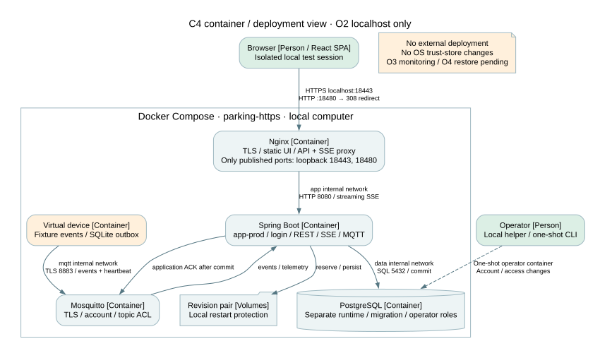

# 로컬 HTTPS를 실행하고 이해하기

2026-11-16 · O2 · 외부 배포 없음 · 제품 계약 v1.43 유지

이 문서는 **내 컴퓨터에서 HTTPS 로그인과 실시간 상태 갱신이 어떻게 이어지는지** 직접 확인하는 안내다. 먼저 아래 그림과 실행 순서를 읽고, 설정을 수정할 때 [상세 계획](design/local-https-plan.md)과 [운영 설정 안내](../infra/deploy/README.md)를 참고한다. 실제 실행 증거와 미검증 범위는 [현재 상태](status.md)에 기록한다.

## 1. 요청이 지나가는 길



브라우저는 `https://localhost:18443` 한 주소만 사용한다. Nginx가 인증서를 제시하고 암호화된 HTTPS 연결을 받는다. 화면 파일 요청은 Nginx가 직접 응답하고, `/api/` 요청은 Docker 내부의 Spring 서버에 전달한다. Spring이 로그인·권한을 검사하고 DB에서 읽는다. 브라우저가 DB나 MQTT에 직접 접속하는 경로는 없다.

가상 장치는 별도의 길로 움직인다. TLS로 Mosquitto에 사건을 보내면 Spring이 검증하고 DB에 저장한다. 커밋 후 장치에는 응용 ACK를 보내고, 화면에는 SSE로 새 상태를 전한다. **화면이 열림 → 로그인됨 → 사건이 저장됨 → 실시간 화면이 갱신됨**은 각각 따로 확인해야 한다.

| 개념 | 이 프로젝트에서 하는 일 | 구별할 것 |
|---|---|---|
| Docker Compose | 컨테이너·네트워크·볼륨·파일 secret을 함께 구성 | HTTPS 암호화 자체는 Nginx가 담당 |
| Nginx | HTTPS 입구, React 파일 제공, Spring으로 API/SSE 전달 | 사용자 권한 판단은 Spring 담당 |
| 인증서 | 접속한 서버 이름과 공개키를 검증하고 TLS 연결에 사용 | 웹 아이디·비밀번호와 별개 |
| 세션 쿠키 | 로그인한 브라우저를 서버가 식별 | `Secure`는 HTTPS 전송, `HttpOnly`는 JS 접근 제한 |
| CSRF 토큰 | 로그인·로그아웃 같은 변경 요청의 출처를 보호 | HTTPS만 켜도 자동으로 해결되는 문제가 아님 |
| SSE | 열린 HTTP 응답을 통해 서버가 화면에 변경을 전송 | MQTT는 장치와 서버 사이의 통신 |

## 2. 준비와 실행

모든 명령은 저장소 루트 `illegal-parking-detection`에서 실행한다. 실행 중인 Docker/Compose, Python 3.10 이상, OpenSSL, Node.js 24가 필요하다. 기존 `parking-local`·`parking-handoff`와 다른 컨테이너·볼륨·쿠키를 사용한다.

```sh
python3 tools/production/local_https.py prepare
```

처음에는 이미지를 빌드하고 로컬 CA·암호를 생성한 다음, 새 DB에 역할·스키마·가상 장치·조회 계정을 준비한다. 최초 약 5~15분, 빌드 캐시가 있으면 약 1~3분이 걸린다. 끝에 `LOCAL_HTTPS_READY https://localhost:18443`이 나와야 한다. 이미 준비된 환경에서는 기존 DB·비밀값·이미지를 재사용한다. 준비 중 실패한 DB를 자동으로 지우거나 다시 초기화하지 않는다.

학습용 브라우저의 의존성이 없다면 한 번 설치한다.

```sh
npm --prefix frontend ci
cd frontend
npx playwright install chromium
cd ..
```

그다음 별도 Chromium 창을 연다. 창을 닫을 때까지 이 터미널은 실행 상태로 남는다.

```sh
node tools/production/open_https.mjs
```

- 아이디: `https-viewer`
- 비밀번호: 로컬 파일 `.local-state/https-demo/accounts/https-viewer.password`를 편집기로 열어 확인한다. 값은 문서·로그·Git에 복사하지 않는다.
- 접속 주소: `https://localhost:18443`

이 브라우저는 이번 시험 인증서의 **공개키 하나만** 허용한다. OS·일상 브라우저의 인증서 신뢰 저장소는 바꾸지 않는다. 일반 브라우저는 이 CA를 모르므로 인증서 경고가 정상이다. 이를 공인 인증서 검증 성공으로 해석하지 않는다. 자동 인수에서는 별도로 CA 체인·호스트 이름을 엄격히 검사하고, 틀린 CA·이름은 실패하는지 확인한다. `127.0.0.1`이 아닌 인증서의 이름 `localhost`로 접속한다.

## 3. 화면에서 한 번 따라 해 보기

1. 로그인하고 **화면 연결 · 연결됨**을 찾는다. 아직 장치가 송신하지 않았다면 데이터가 없거나 장치가 오프라인인 것이 정상이다.
2. 두 번째 터미널에서 아래 명령을 실행한다. 약 8초간 가상 사건과 heartbeat를 보낸다.

```sh
python3 tools/production/local_https.py simulate
```

3. 터미널의 `"status": "STORED"`는 DB 커밋 뒤 응용 ACK를 받았다는 뜻이다. 화면의 **이동 안내 완료**와 해당 사건 링크를 확인한다. 화면 갱신은 SSE가 전달한 결과다.
4. 브라우저 개발자 도구의 Network에서 `/api/stream`을 찾는다. 응답이 계속 열려 있는 것이 정상이다. 스트림을 화면의 일반 API 요청과 비교해 본다.
5. 로그아웃한다. 로그인 화면으로 돌아가고 기존 SSE와 세션이 종료된다.

가상 송신이 끝난 뒤 heartbeat가 끊겨 장치가 지연·오프라인으로 바뀌는 것은 HTTPS 장애가 아니다. **화면 연결 상태, 장치 생존 상태, 사건 상태**를 따로 읽는다. 재시작 뒤에는 메모리 세션이 없어져 재로그인이 필요하지만 DB 사건은 남는다.

## 4. 설정과 관찰 결과 연결하기

| 설정 위치 | 왜 필요한가 | 직접 관찰할 결과 |
|---|---|---|
| [Compose](../infra/deploy/compose.yaml)의 web `127.0.0.1` 포트 | 내 컴퓨터에서만 시험 | 18443/18480만 호스트에 연결, DB·MQTT·Spring은 호스트 포트 없음 |
| `app`·`data`·`mqtt` 내부 네트워크 | 통신이 필요한 컨테이너만 같은 망에 배치 | web은 DB/MQTT 망에 없음 |
| [Nginx](../infra/deploy/nginx/default.conf.template)의 고정 HTTP redirect | HTTP 요청을 정해진 HTTPS 주소로 이동 | `http://localhost:18480` → HTTPS 주소, HTTP 308 |
| `location /api/` | 화면과 API를 같은 출처로 제공 | 브라우저 요청은 모두 같은 HTTPS 주소 |
| `proxy_buffering off` | SSE 응답을 모아 두지 않고 바로 전달 | 사건 커밋 뒤 새로고침 없이 화면 변경 |
| Docker DNS `resolver`·upstream `resolve` | 컨테이너 재생성으로 IP가 바뀌어도 재조회 | Nginx를 재시작하지 않고 Spring 재접속 |
| 파일 secrets | 컨테이너마다 필요한 비밀번호만 제공 | runtime에 관리자·migrator 암호를 마운트하지 않음 |
| 관리 경로 404 | 관리 화면/API를 공개 입구에서 숨김 | `/actuator/health`, `/grafana` 등은 404 |

Docker의 이미지 `EXPOSE` 표시는 호스트에 포트를 연 것과 다르다. `status` 출력의 `127.0.0.1:18443->443/tcp`가 실제 호스트 연결이며, `5432/tcp` 같은 단독 표시는 호스트 공개가 아니다. 실제 외부 방화벽 검증은 O5에서 별도로 한다.

```sh
python3 tools/production/local_https.py status
python3 tools/production/local_https.py logs
```

Nginx 접근 로그에는 경로·상태 코드·소요 시간만 남기고 query·쿠키·본문·Authorization을 넣지 않는다. Nginx의 일반 오류 로그는 원본 요청 query를 포함할 수 있어 이 구성에서는 `/dev/null`로 보낸다. 502는 정제된 접근 로그와 backend 로그로, 설정 문제는 `nginx -t`로 진단한다. 상세 Nginx 오류 로그를 포기한 선택이며, 운영 관찰 확장은 O3에서 다룬다.

Compose secrets는 호스트 파일을 암호화하지 않는다. 이 로컬 도구는 상태 디렉터리를 `0700`으로 제한하고, 여러 컨테이너 UID가 읽어야 하는 개별 파일은 `0644`로 둔다. 실제 Linux 배포에는 호스트 소유자·컨테이너 UID·백업 암호화를 맞추는 별도 인수가 필요하다. [Compose secrets 공식 설명](https://docs.docker.com/reference/compose-file/secrets/)

## 5. 중지·재시작·인증서 갱신

```sh
python3 tools/production/local_https.py stop
python3 tools/production/local_https.py up
```

`stop`은 `STOPPED_DATA_PRESERVED`를 출력하고 DB·revision·장치 outbox 볼륨과 파일 암호를 보존한다. `up`은 기록된 이미지 ID와 설정 해시를 검사한 뒤 같은 환경을 실행한다. 소스 코드를 수정했다고 기존 이미지가 자동으로 교체되지는 않는다. 설정 해시가 달라지면 실행을 거부한다. 데이터 보존을 위해 자동 reset 명령을 제공하지 않는다.

인증서는 로컬 CA 7일·서버 인증서 3일의 짧은 시험용이다. CA가 유효한 동안 web 인증서를 갱신하려면 다음을 실행한다.

```sh
python3 tools/production/local_https.py rotate-certificate
```

같은 키로 새 serial의 인증서를 발급하고 CA 검증 → 파일 교체 → `nginx -t` → reload 순서로 적용한다. 성공 표시는 `LOCAL_CERTIFICATE_RELOADED`다. 새 TLS 연결은 새 인증서를 사용하며 기존 웹 세션은 유지된다. 이것은 **로컬 web 인증서 갱신 시험**이다. MQTT 인증서·CA 교체, ACME 자동 발급·갱신은 포함하지 않는다. 만료된 CA/브로커 인증서는 기존 데이터를 지우는 대신 별도 갱신 작업으로 처리해야 한다.

추가 조회 계정은 별도 DB operator 권한으로 만든다.

```sh
python3 tools/production/local_https.py account create-user --username=teammate --role=VIEWER --zone-id=zone-01
```

성공 JSON의 `user_id`를 기록한다. 암호는 `.local-state/https-demo/accounts/teammate.password`에 생긴다. 같은 이름은 덮어쓰지 않는다. 권한 회수·계정 정지는 아래 `<user_id>`를 실제 값으로 바꿔 실행한다.

```sh
python3 tools/production/local_https.py account revoke-zone --user-id=<user_id> --zone-id=zone-01
python3 tools/production/local_https.py account disable-user --user-id=<user_id>
```

구역 권한 회수는 그 구역의 SSE를 종료하고 조회를 403으로 거부한다. 계정 정지는 세션도 무효화한다. DB operator 계정과 웹 사용자 역할은 서로 다른 권한이다.

## 6. 문제가 생기면 어디부터 볼까

| 관찰 | 먼저 확인할 지점 |
|---|---|
| 인증서 오류 | 별도 학습 브라우저인지, URL이 localhost인지, 인증서/CA 유효기간 |
| 연결 거부 | Docker 실행 여부와 `status`의 web 상태·호스트 포트 |
| 502 | Nginx는 응답했으나 Spring 연결 실패. backend 로그·DB 기동·파일 secrets 확인 |
| 504 | Spring 연결/응답 시간 초과. 정지 직후 이전 Docker IP를 재조회하는 동안에도 발생 가능 |
| 401 | 로그인 전이거나 세션 만료/서버 재시작. 재로그인 |
| 403 | 로그인 변경 요청의 CSRF 또는 사용자 구역 권한 확인 |
| 503 | backend 복구/준비 상태 확인. 포트가 열렸다는 것만으로 저장 가능 상태는 아님 |
| 화면은 연결됨, 장치는 OFFLINE | 가상 장치 송신을 다시 실행하고 MQTT/장치 로그 확인 |
| `configuration_changed...` | 기록한 설정과 작업 파일이 달라짐. 변경을 검토하고 새 격리 환경에서 검증 |
| `incomplete_preparation...` | 초기 준비 실패 기록. 원인과 해당 프로젝트 자원부터 확인, 기존 DB 자동 초기화 금지 |

## 7. 자동 검증과 다음 단계

```sh
python3 -m unittest discover -s tools/production -p 'test_*.py' -v
python3 tools/production/verify_o2.py
```

두 번째 명령은 임의 이름 `parking-o2-*`와 비어 있는 localhost 포트로 별도 환경을 만든다. 캐시가 있으면 약 2~4분, 최초 빌드·다운로드는 더 걸린다. 실제 TLS/로그인/CSRF/쿠키/SSE/권한 회수, 인증서 reload, backend 중단의 502/504와 **다른 IP로 재생성 후 DNS 복구**, 세션 무효화와 이력 보존을 검사한다. 중단 후 502로 바뀌는 시간을 강제하지 않으며 실제 응답 코드를 결과에 기록한다. 마지막에는 실제 Chromium에서 로그인·MQTT 갱신·오프라인/재접속·로그아웃을 확인한다. 성공 표시는 `O2_ACCEPTANCE_PASSED`다. 시험 프로젝트의 컨테이너·볼륨만 정리하며 학습용 환경은 유지한다.

로컬 `release.json`에는 커밋·미커밋 소스 해시·설정 해시·실제로 실행한 이미지 ID가 있다. 로컬 이미지 ID는 레지스트리에 게시한 배포 digest가 아니다. O2 인수는 HTTPS 경로를 검증하며 모니터링·백업 복원은 각각 [O3](local-monitoring.md)·[O4](local-backup.md)의 별도 로컬 인수로 완료했다. 실제 서버·도메인·공인 인증서·외부 접속은 [O5 준비](deployment-readiness.md) 이후 남은 작업이다.

설정 근거: [Nginx proxy buffering](https://nginx.org/en/docs/http/ngx_http_proxy_module.html#proxy_buffering), [Nginx TLS](https://nginx.org/en/docs/http/ngx_http_ssl_module.html), [Docker 내부 네트워크](https://docs.docker.com/reference/compose-file/networks/#internal). HTTP/MQTT 제품 계약은 [계약 안내](contracts.md)를 따른다.

다음으로 [O3 로컬 모니터링](local-monitoring.md)에서 HTTPS 요청 경로를 숫자와 그래프로 확인한다.
