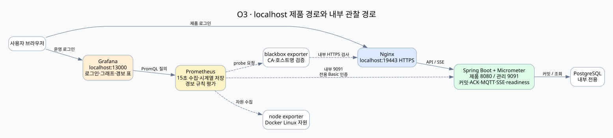

# O3: 숫자로 읽는 로컬 모니터링

2026-11-16 · 외부 배포 없음 · [HTTPS 먼저 이해하기](local-https.md) · [현재 검증 상태](status.md)

## 1. Prometheus와 Grafana가 각각 하는 일

**Prometheus는 숫자를 주기적으로 모아 시간과 함께 저장하고, Grafana는 그 숫자를 사람이 읽는 화면으로 보여 준다.** 예를 들어 서버가 `저장 성공 12회`를 노출하면 Prometheus가 15초마다 값을 가져온다. Grafana는 Prometheus에 “최근 5분 동안 얼마나 늘었는가?”를 물어 그래프로 그린다. 화면을 닫아도 수집은 계속된다.

숫자를 만드는 쪽은 백엔드의 **Micrometer**다. 코드에서 DB 커밋이 반환된 지점과 ACK 발행이 끝난 지점을 각각 센다. Prometheus가 DB 내용을 해석하거나 Grafana가 사건을 저장하는 것은 아니다. Spring Boot의 기본 JVM·커넥션 풀 지표도 함께 사용한다. [Spring Boot metrics](https://docs.spring.io/spring-boot/3.5/reference/actuator/metrics.html)



제품 화면은 `https://localhost:19443`, 운영 화면은 `http://localhost:13000`이다. 두 주소 모두 내 컴퓨터에서만 접근한다. 제품 로그인 계정과 Grafana 계정은 별개다. Grafana의 HTTP는 로컬 실습용이며 실제 외부 접속 구성이 아니다.

## 2. 대시보드를 읽는 순서

| 먼저 던질 질문 | 보는 지표 | 왜 보는가 / 이상할 때 해석 |
|---|---|---|
| 서버에서 숫자를 가져오는가? | `up{job="parking"}` | 1은 수집 성공. 서버가 죽으면 0. 1이어도 DB 쓰기나 ACK 성공을 보장하지 않음 |
| 저장된 기록을 읽을 수 있는가? | `parking_readiness_ready`, `parking_database_available`, `parking_revision_ready` | DB와 revision 복구 조건을 분리. 복구 보류 중이면 DB가 살아도 조회를 열지 않음 |
| 새 사건이 저장되는가? | `parking_ingest_total{outcome}`, `parking_commit_failures_total` | `stored`는 새 저장, `duplicate`는 재전송 재확인. DB 실패가 늘면 장치 outbox가 비워지지 않을 수 있음 |
| 저장 결과를 브로커가 받아들였는가? | `parking_ack_publish_total{result}` | DB 성공 뒤에도 ACK 권한 거부·연결 장애가 발생할 수 있음. success는 장치의 처리 완료까지 뜻하지 않음 |
| MQTT 세 연결이 살아 있는가? | `parking_mqtt_connected{channel}` | 사건 수신·ACK 발행·telemetry를 따로 관찰. 브로커가 끊겨도 기존 DB 조회는 유지해야 함 |
| 처리가 느려지고 있는가? | `parking_ingest_commit_seconds`, Hikari 사용/대기 | 수신 처리 시작부터 DB 커밋 반환까지 측정. ACK 대기 시간은 제외. 풀 대기가 증가하면 DB 병목을 의심 |
| 실시간 화면 연결이 쌓이는가? | `parking_sse_active`, `parking_sse_rejected_total`, `parking_sse_slow_closed_total` | 연결 제한 거부와 느린 연결 정리를 확인. 재접속 폭주와 전송 정체를 구분 |
| 공간·메모리가 모자라는가? | JVM heap/GC, CPU·메모리, 디스크 사용률·inode 잔량 | 디스크에 용량이 남아도 inode가 고갈되면 파일을 못 만듦. JVM heap과 전체 Linux 메모리는 서로 다름 |
| HTTPS 경로와 인증서가 정상인가? | `probe_success`, `probe_ssl_earliest_cert_expiry` | 내부에서 Nginx의 `/api/csrf`를 CA·호스트명 검증과 함께 요청. 로그인 성공이나 외부 인터넷 접속 시험은 별도 |

읽기 readiness는 5초마다 DB와 revision 상태를 읽고 최근 결과를 사용한다. 지표를 수집할 때마다 DB를 다시 조회하지 않는다. DB가 끊겨도 프로세스가 살아 있으면 liveness는 UP이다. 이를 분리해야 DB 장애가 불필요한 서버 재시작으로 이어지는 것을 막을 수 있다. [Spring Boot management](https://docs.spring.io/spring-boot/3.5/reference/actuator/monitoring.html)

### 숫자 세 종류를 구분하기

- **Counter — 지금까지 몇 번?** 저장·실패·거부 횟수다. 재시작하면 0부터 다시 시작할 수 있으므로 최근 변화는 `increase(...[5m])`, 초당 속도는 `rate(...[5m])`로 읽는다. 누적 실패 10은 지금도 계속 실패한다는 뜻이 아니다.
- **Gauge — 지금 어떤 상태?** 연결 여부 0/1, 현재 SSE 연결 수, 메모리 사용량이다. 늘기도 하고 줄기도 한다.
- **Histogram — 시간이 어떻게 분포하는가?** 처리 시간을 구간별로 센다. p95 1초는 관측된 처리 중 약 95%가 1초 이내라는 추정이다. 사건이 너무 적으면 의미가 약하므로 최근 5분에 20회 이상일 때만 p95와 지연 경보를 보여 준다. 대시보드의 `표본 부족`(`No data`)은 0초가 아니다. [Micrometer timers](https://docs.micrometer.io/micrometer/reference/concepts/timers.html)

### 저장과 ACK를 따로 보는 이유

`장치 전송 → 서버 커밋 → 응용 ACK 발행 → 브로커 수락 → 장치 ACK 처리`는 각각 다른 단계다. MQTT 자체의 PUBACK와 제품의 `STORED`/`DUPLICATE` 응용 ACK도 다르다.

로컬 시험에서 ACK 토픽 쓰기 권한을 제거했더니, DB에는 저장됐지만 장치는 응용 ACK를 받지 못했다. 사용 중인 클라이언트는 MQTT 5의 거부 PUBACK에도 대기 함수를 정상 반환했다. 이제 응답 reason code까지 확인해 0(성공), 16(일치 구독자 없음)만 브로커 수락으로 센다. 16도 장치 수신 증거는 아니다. 거부는 failure이며 장치 재전송 시 DB receipt로 `DUPLICATE` 응답을 복구한다.

## 3. 직접 확인하는 5분 실습

저장소 루트에서 실행한다. Docker Desktop/Engine, Python 3, OpenSSL, Node 24와 기존 frontend 의존성이 필요하다. 최초 이미지 준비는 네트워크와 캐시에 따라 약 5~15분, 캐시가 있으면 짧아진다. 다른 Docker 서비스가 많으면 메모리 여유를 확인하고 준비 작업을 동시에 실행하지 않는다.

```bash
python3 tools/production/local_monitoring.py prepare
```

성공 출력은 `LOCAL_MONITORING_READY http://localhost:13000`이다. 기존 학습 환경이면 데이터와 비밀번호를 다시 만들지 않고 기동한다. 설정이 바뀌어 manifest와 다르면 자동 덮어쓰기 대신 중단한다. `.local-state/monitoring/release.json`은 실제 이미지 ID·설정 해시를 기록하며 비밀값은 저장하지 않는다.

1. `http://localhost:13000/d/parking-operations`를 연다.
2. Grafana 사용자 이름은 `monitoring-admin`. 비밀번호는 `.local-state/monitoring/secrets/grafana-password` 파일에서 확인한다. 파일 내용을 채팅이나 Git에 올리지 않는다.
3. 상단 수집·조회·MQTT·HTTPS 상태를 읽는다. 아래 명령으로 가상 사건을 한 번 보낸다.

```bash
python3 tools/production/local_monitoring.py simulate
```

`APPLICATION_ACK`와 `"status": "STORED"`를 확인한다. 15~30초 뒤 수신 결과·ACK 그래프가 변한다. 시뮬레이터는 정상 종료까지 약 8초가 걸린다. 그래프는 최근 15분 범위이며 수집 주기 때문에 즉시 변하지 않을 수 있다.

원래 누적값이 궁금하면 다음 명령을 사용한다. 첫 사건 이후 값이 0보다 큰지 본다.

```bash
python3 tools/production/local_monitoring.py query 'parking_ingest_total{outcome="stored"}'
python3 tools/production/local_monitoring.py query 'increase(parking_ack_publish_total{result="failure"}[5m])'
```

제품 화면도 같이 보고 싶다면 다음 명령으로 해당 시험 인증서의 공개키만 허용하는 격리 Chromium을 연다. 운영체제 신뢰 저장소를 수정하지 않는다. 제품 계정은 `https-viewer`, 비밀번호는 `.local-state/monitoring/accounts/https-viewer.password`다.

```bash
node tools/production/open_https.mjs --state .local-state/monitoring
```

### 중지·재시작·문제 확인

```bash
python3 tools/production/local_monitoring.py status
python3 tools/production/local_monitoring.py logs
python3 tools/production/local_monitoring.py stop
python3 tools/production/local_monitoring.py up
```

`stop`은 컨테이너만 멈춘다. PostgreSQL·Prometheus·Grafana의 데이터는 보존한다. `up`은 동일 이미지와 설정을 확인하고 기동한다. Grafana 초기 기동은 수십 초 걸릴 수 있다. 로그 명령은 현재 환경의 비밀 파일 값을 가려서 출력한다.

웹 시험 인증서는 3일, 시험 CA는 7일이다. CA가 유효한 동안 웹 인증서를 다시 발급하고 Nginx에 반영하는 명령은 다음과 같다. MQTT 인증서나 CA 만료까지 해결하는 명령은 아니다.

```bash
python3 tools/production/local_monitoring.py rotate-certificate
```

## 4. 경보가 말하는 것과 말하지 않는 것

13개 규칙을 Prometheus에서 평가하고 Grafana 마지막 표에서 `firing` 상태를 읽는다. 외부 이메일·메신저 전송은 연결하지 않았다. Grafana의 별도 Alerting 관리 화면에 규칙을 중복 생성하지 않았다. 이 프로젝트의 경보 기준 파일은 `infra/monitoring/prometheus/alerts.yml`이다. `for: 1m`은 조건이 1분간 연속 유지돼야 발생한다는 뜻이다. [Prometheus alerting rules](https://prometheus.io/docs/prometheus/latest/configuration/alerting_rules/)

| 경보 | 초기 기준 | 확인할 것 |
|---|---|---|
| 서버 지표 중단 / 읽기 불가 | 수집 0이 1분 / readiness 0 | 프로세스·관리 인증·DB·복구 보류 |
| MQTT 단절 | 연결 0이 30초 | 브로커·TLS·계정. 끊김 감지는 keepalive만큼 늦을 수 있음 |
| DB 저장 / ACK 실패 | 최근 5분 실패 증가 | DB 권한·공간 / 브로커 ACK 토픽 권한 |
| 거부 비율 / 처리 지연 | 20건 이상에서 거부 >20% / p95 >1초, 1분 유지 | 사건 계약·DB 병목. 적은 표본으로 경보를 만들지 않음 |
| SSE 압력 | 연결 40개 이상 또는 최근 거부·느린 연결 종료 | 운영 기본 제한 50개에 대한 기준. 로컬 시험은 세션별 3개 제한으로 거부 경로 검증 |
| 디스크 / inode | 사용 ≥80% 경고, ≥90% 위험 / inode 여유 <10%, 1분 | 해당 마운트의 로그·DB·보존 정책 확인 |
| 내부 HTTPS / 인증서 | 실패 30초 / 남은 기간 <14일 | Nginx·backend·인증서. 3일짜리 시험 인증서는 경고가 정상 |

장애를 고친 직후에도 “최근 5분 실패 증가” 경보는 그 실패가 시간창에서 빠질 때까지 남을 수 있다. 현재 연결·readiness와 최근 실패 경보를 함께 읽는다. 경보가 남아 있다는 이유만으로 DB 복구가 실패했다고 단정하지 않는다.

Prometheus는 7일 또는 약 1GB 중 먼저 도달하는 보존 정책을 사용한다. WAL·진행 중인 블록 등 추가 공간이 필요하므로 전체 디스크 사용량의 엄격한 1GB 제한은 아니다. 각 서비스 컨테이너 로그도 10MB × 3개로 회전한다.

Grafana 13.2부터 Prometheus 데이터 소스는 별도 플러그인으로 제공된다. 이 구성은 13.2.6 플러그인의 공식 SHA-256을 검사해 Grafana 이미지에 포함하고, 시작 시 자동 설치·갱신을 끈다. 실행할 때 내려받은 추가 기능 때문에 검증한 구성이 달라지지 않게 한다. [Grafana Prometheus 데이터 소스](https://grafana.com/docs/grafana/latest/datasources/prometheus/)

대시보드와 데이터 소스는 파일로 자동 등록한다. 웹에서 임시 변경한 것을 배포 설정으로 착각하지 않도록 UI 편집 저장을 제한했다. 수정 원본은 `infra/monitoring/grafana`다. [Grafana provisioning](https://grafana.com/docs/grafana/latest/administration/provisioning/)

## 5. 실제 검증의 범위

재현 명령은 다음과 같다. 새 `parking-o3-*` 프로젝트와 임의 localhost 포트를 사용한다. DB 쓰기 거부, ACK 권한 거부, 브로커·DB·backend 중단을 실제 발생시키며 복귀·경보를 검사한다. 마지막으로 실제 Chromium에서 Grafana 로그인·대시보드·데이터 응답을 확인한다. 완료 후 그 임시 프로젝트와 볼륨만 정리한다. 기존 O2/O3 학습 DB에는 장애를 주지 않는다. 예상 시간은 이미지 캐시가 있으면 약 6~10분이다.

```bash
python3 tools/production/verify_o3.py
```

전체 성공 표시는 `O3_ACCEPTANCE_PASSED`다. 규칙의 임계값·대기 시간·counter reset·표본 수 조건은 `promtool`의 합성 시계열 19개로 별도 확인한다. 디스크와 메모리를 실제로 고갈시키는 시험은 하지 않는다. 실제 실행 결과는 [현재 상태](status.md)와 `validation/local-monitoring-2026-11-16.json`에 구분해서 남긴다.

**이번 자원 지표의 범위는 Docker가 사용하는 Linux runtime과 exporter가 보는 루트 파일시스템이다.** macOS 전체 자원·모든 DB/백업 마운트의 용량을 뜻하지 않는다. Docker socket·privileged·호스트 루트 마운트는 사용하지 않는다. Linux 실서버의 마운트 범위 확정과 별도 관측 위치에서 서버 전체 장애를 탐지하는 시험은 O5에 남긴다. [node exporter 안내](https://prometheus.io/docs/guides/node-exporter/)

백업 성공 시각·복구 결과 지표는 이후 [O4 로컬 백업·복원](local-backup.md)에서 실제 작업과 연결하고 인수했다. O3 기본 대시보드와 별도로 O4는 3개 패널·2개 경보를 제공한다. 현재 남은 단계는 [O5 외부 저장소·키 복구·배포 인수](deployment-readiness.md)이며, O5는 준비 문서까지 작성했다. 학습 질문과 공개 가능한 캡처는 [학습·증거 모음](operations-learning-evidence.md)에 있다.
