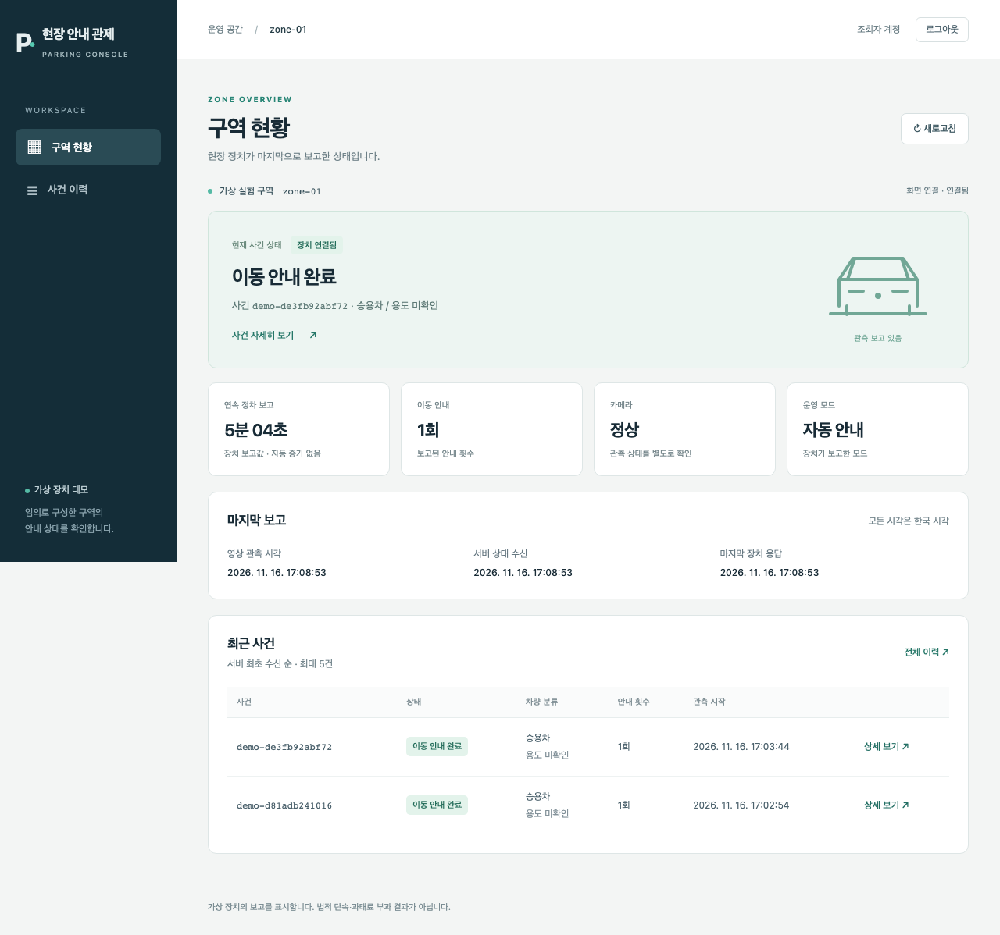
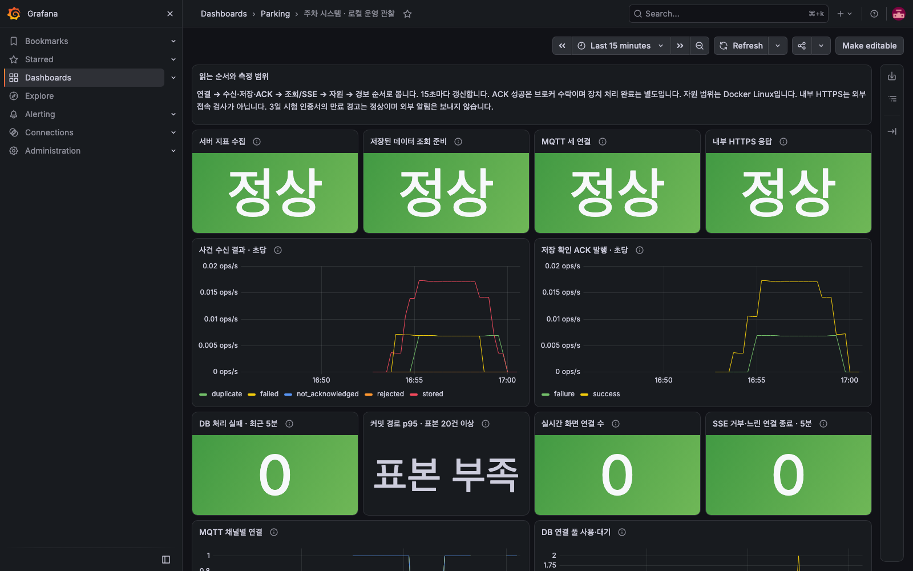
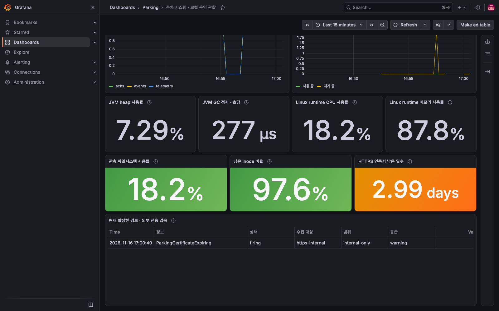
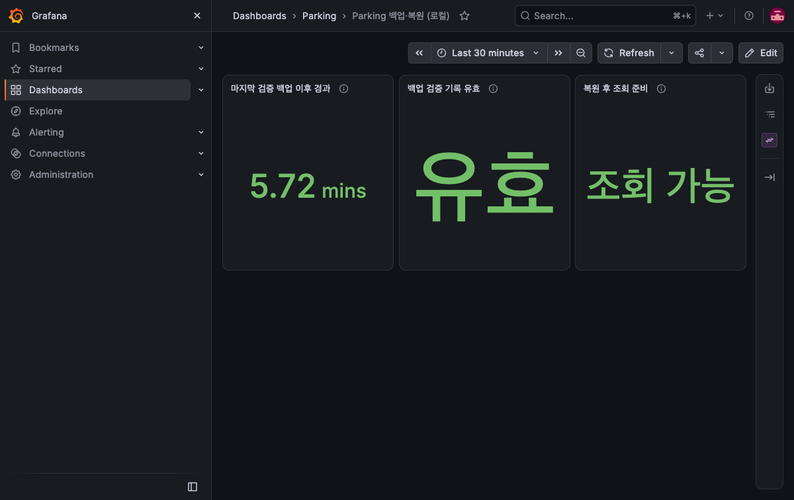

# 운영 작업 학습·블로그 근거 모음

2026-11-16~17 · O1~O4 로컬 구현·인수, O5 준비 문서·CI 보완 · 외부 배포 없음

이 문서는 완성된 블로그나 학습자의 회고를 대신하지 않는다. **실제로 남아 있는 문제·선택·검증을 찾아서 자기 설명으로 연결하기 위한 자료 지도**다. 구현·시험·문서 작성에는 Codex의 도움을 받았으며, 학습자의 직접 실습·이해·선택 이유에 대한 답변은 아직 수집하지 않았다. 과거 로그를 이번 보존 작업에서 새로 실행한 결과로 표시하지 않는다.

## 1. 읽는 순서와 설명할 수 있어야 하는 것

| 순서 | 읽을 자료 | 자기 말로 설명할 질문 |
|---|---|---|
| O1 | [운영 기반 개념](production-basics.md) | TLS·계정·ACL·DB 역할이 각각 어떤 실수를 막는가? |
| O2 | [HTTPS 실습](local-https.md) | Nginx가 응답하는데도 DB 저장이나 SSE가 실패할 수 있는 이유는? |
| O3 | [모니터링](local-monitoring.md) | up=1, readiness=1, 저장 성공, ACK 성공은 무엇이 다른가? |
| O4 | [백업·복원](local-backup.md) | DB 백업·독립 revision·키 중 하나가 없으면 어떤 문제가 생기는가? |
| O5 | [배포 준비](deployment-readiness.md) | 비용표에서 확인한 단가와 가정한 사용량·환율은 각각 무엇인가? |

O1의 자세한 질문은 해당 문서 끝에 있다. 나머지는 다음 상황을 먼저 예측하고 문서·코드에서 확인한다.

- **O2:** backend 컨테이너 IP가 바뀌면 Nginx는 어떻게 다시 찾는가? `Secure` 쿠키와 CSRF는 각각 무엇을 막는가? 로그를 줄이면 진단에서 무엇을 잃는가?
- **O3:** DB 저장 뒤 ACK 토픽 쓰기가 거부되면 어떤 지표가 달라져야 하는가? p95의 `표본 부족`을 0초로 읽으면 왜 틀리는가? 장애를 고쳤는데 최근 5분 실패 경보가 남을 수 있는가?
- **O4:** 10시 백업 뒤 10시 5분 사건에 ACK했다가 10시로 복원하면 무엇을 잃는가? DB와 revision 파일 두 개가 서로 일치해도 왜 틀릴 수 있는가? 서버를 재시작하는 것만으로 hold를 풀면 왜 위험한가?
- **O5:** 서버와 백업을 다른 계정에 두는 이점과 남는 장애 범위는 무엇인가? 키가 백업 파일과 같은 곳에만 있으면 어떤 복구 문제가 생기는가?

개인 메모 형식은 `내 예상 → 관찰/근거 → 처음 생각과 달랐던 점 → 아직 모르는 점`이면 충분하다. 면접용 완성 답안이나 “내가 해결했다”는 회고는 본인의 답과 검토 범위를 확인한 뒤 작성한다.

## 2. 글로 발전시킬 만한 결정과 실제 근거

| 주제 | 문제·비교한 선택 | 채택한 방식과 비용 | 찾아볼 증거 |
|---|---|---|---|
| 권한을 낮췄는데 왜 관리자 로그인이 남아 있었나 | 관리자 로그인 후 역할만 낮추는 시험 / 제한 계정으로 직접 로그인하는 시험 | session_user·current_user 모두 검사. 역할·파일 자격 관리가 늘어남 | [O1 review_fixes](../validation/production-boundaries-2026-11-16.json), [실제 DB 로그인 검사](../backend/src/main/kotlin/kr/ac/sejong/parking/configuration/RevisionConfiguration.kt) |
| Nginx가 다시 연결됐다는 시험은 충분했나 | 컨테이너 재시작만 확인 / IP를 실제로 바꾼 뒤 확인 | 다른 IP로 강제 재생성해 DNS 복구 검증. 시험 준비가 복잡해짐 | [O2 review_fixes](../validation/local-https-2026-11-16.json), [인수 코드](../tools/production/verify_o2.py) |
| 자세한 오류 로그와 비밀값 노출 사이의 선택 | 기본 요청 오류 로그 유지 / 정제된 접근 로그·backend 로그로 진단 | Nginx 원본 오류 로그를 포기. query 누출을 줄이지만 진단 정보 감소 | [O2 설정 설명](local-https.md), [Nginx 원본](../infra/deploy/nginx/default.conf.template) |
| 정상 반환한 MQTT 발행을 왜 실패로 분류했나 | 대기 함수의 정상 종료만 확인 / MQTT 5 reason code까지 확인 | 거부 PUBACK을 failure로 계측. 브로커 수락도 장치 처리 완료와 구별 | [O3 review_fixes](../validation/local-monitoring-2026-11-16.json), [ConfirmedAckPublisher](../backend/src/main/kotlin/kr/ac/sejong/parking/device/adapter/mqtt/ConfirmedAckPublisher.kt) |
| DB 백업을 복원했는데 번호를 왜 건너뛰나 | 로컬 두 파일만 대조 / 별도 최신 예약 기준과 대조 | 독립 기록→로컬 파일→DB로 예약, 복원은 hold 후 명시 인수. 번호 공백과 저장소 의존성 발생 | [O4 검증](../validation/local-backup-2026-11-16.json), [RevisionReservations](../backend/src/main/kotlin/kr/ac/sejong/parking/device/adapter/jdbc/RevisionReservations.kt) |
| ACK된 사건은 항상 복구할 수 있을까 | dump 생성만 확인 / ACK 이후 사건을 넣고 과거 백업으로 실제 복원 | 백업 이후 ACK 자료 손실을 확인. 주기·PITR는 별도 결정 | [O4 단계 로그](../validation/blog-evidence/2026-11-16/parking-o4-acceptance.txt), [측정 원본 연결](../validation/blog-evidence/2026-11-16/measurements.json) |
| 작은 원장 파일도 왜 비용을 따져야 하나 | 저장 용량만 계산 / 반복 조회 요청까지 계산 | 단가·환율·요청 수를 분리. 실제 외부 어댑터 요청량은 미측정 | [예산 산식](../infra/deploy/budget.example.json), [O5 준비](deployment-readiness.md) |

위 표는 최종 코드와 검토 기록에서 확인한 의사결정이다. 모든 초기 실패의 원본 화면·로그가 남아 있는 것은 아니다. `review_fixes`에만 남은 내용은 “검토 기록에 따르면”으로 구분하고, 없는 실패 로그나 시행착오의 대화를 재구성하지 않는다.

## 3. 블로그에 인용할 수 있는 수치

| 값 | 출처·조건 | 주장할 수 없는 것 |
|---|---|---|
| 복원~준비 **85.651179초** | O4 한 번의 작은 가상 장치 시나리오. 수신 중단 뒤 새 DB 복원 시작부터 명시 인수와 HTTPS/모니터링 준비까지 | 서버 확보·사전 검사·중지·외부 다운로드·키 회수를 포함한 전체 RTO, 반복 평균·p95 |
| 백업 나이 **72.810888초** | 선택 백업 시작부터 복원 시작까지의 경과 | 72초 RPO 보장 또는 백업 주기 |
| ACK된 사건 **1건** 부재 | 선택 백업 이후 저장·ACK한 사건이 과거 복원본에 없음 | 전체 사건 손실률·독립 원장으로 사건 본문 복구 |
| 일반 **169개**, DB **85개**, 실패/오류 **0** | O4 후 보관된 JUnit XML에서 이름·개수·원본 해시 추출 | 앞 단계 154·166개와 더한 누적 고유 시험 수, 커버리지 비율 |
| O3 **21개 패널·13개 규칙·19개 규칙 시계열** | O3 구현 규모와 합성 규칙 시험. O4 별도 대시보드는 3개 패널·경보 2개 | 실제 장애 예방률·성능 향상률 |
| 월 **약 54,883 / 87,883원** | O5 단가+가정 환율·사용량·도메인 월 환산 | 실제 청구액·사용자 확정 예산 |

시간의 원래 소수값·계산식·제외 구간은 [measurements.json](../validation/blog-evidence/2026-11-16/measurements.json)에 있다. [test-summary.json](../validation/blog-evidence/2026-11-16/test-summary.json)은 환경변수·system-out을 제외한 시험 목록이다. 일반 시험과 DB 시험의 로그는 [일반 로그](../validation/blog-evidence/2026-11-16/parking-o4-general.txt), [DB 로그](../validation/blog-evidence/2026-11-16/parking-o4-database.txt)로 보존했다. Gradle의 실행 시간은 캐시가 포함된 빌드 시간이며 서비스 성능 수치가 아니다.

## 4. 캡처와 읽는 방법

아래 이미지는 기존 로컬 실행 때의 원본 캡처다. 새 결과를 만들거나 값을 수정하지 않았다. 캡처의 숫자 하나만 떼어 운영 성능으로 쓰지 않는다.



가상 장치의 상태가 제품 화면에 반영된 모습이다. 브라우저 주소 표시줄·TLS 검사 결과는 이미지에 없으므로 HTTPS 검증의 근거는 O2 자동 시험 기록과 함께 제시한다. 실차·실보드 결과가 아니다.



정상 상태와 저장/ACK의 다른 그래프를 함께 읽는다. p95는 `표본 부족`이므로 처리 지연 수치를 주장하지 않는다.



약 3일짜리 시험 인증서가 14일 경보 기준에 걸린 상태다. 외부 알림 발송을 뜻하지 않는다. CPU·메모리는 다른 컨테이너도 있는 Docker Linux runtime 관측값으로, 프로젝트 단독 자원 사용량이나 운영 서버 크기 선정 근거로 쓰지 않는다.



`5.72 mins`는 캡처 당시 마지막 검증 백업 이후 경과이며 복원 소요 시간 85.65초와 다른 값이다. `조회 가능`도 외부 저장소·키의 재해 독립성을 보장하지 않는다.

## 5. 보관과 다시 검증하는 방법

[증거 manifest](../validation/blog-evidence/2026-11-16/manifest.json)에 각 보존 파일의 SHA-256, 원본 출처와 변환 범위를 기록했다. 로그는 공개 전에 검토했고 필요한 경우 호스트 경로·자격증명 대입 부분을 가리는 규칙을 적용하고 행 끝 공백을 제거했다. 원본 로그 해시와 보존본 해시를 따로 남겼다. PNG는 수정 없이 복사했다. 실제 DB 덤프·백업 암호문·개인키·비밀번호·세션/trace는 포함하지 않는다.

원래 실행 환경은 같은 PC의 Docker Desktop·Linux ARM64였다. 기존 검증 JSON의 소스 해시는 그 시험 시점의 기록이며 이후 문서가 바뀌었다고 과거 해시를 덮어쓰지 않는다. 당시 미커밋 상태였던 구현은 이번 PR에서 함께 보존한다. 원격 CI의 실행 여부와 결과는 [현재 상태](status.md)와 PR의 Checks에서 별도로 확인한다.

보존 파일 검사는 저장소 루트에서 다음 명령으로 재현할 수 있다. 파일 읽기만 하며 컨테이너를 만들지 않는다.

```sh
python3 - <<'PY'
import hashlib, json
from pathlib import Path
root = Path('validation/blog-evidence/2026-11-16')
manifest = json.loads((root / 'manifest.json').read_text())
for record in manifest['assets']:
    actual = hashlib.sha256((root / record['file']).read_bytes()).hexdigest()
    assert actual == record['sha256'], record['file']
for record in manifest['source_records']:
    actual = hashlib.sha256(Path(record['file']).read_bytes()).hexdigest()
    assert actual == record['sha256'], record['file']
print('BLOG_EVIDENCE_HASHES_VERIFIED')
PY
```

이 검사는 보존 사본이 변하지 않았다는 뜻이며 서비스 시험의 재실행은 아니다. 실제 인수 재현 명령과 실행 조건은 O1~O4 안내를 따른다. 원격 CI는 O4 요약 JSON만 아티팩트로 올리고 숨김 폴더 전체는 올리지 않는다.

## 6. Linux CI에서 확인한 환경 차이

첫 게시 커밋 `3654f91`의 [CI 실행](https://github.com/yh4752/parking-system/actions/runs/43885948091)은 8개 작업 중 6개가 통과했고 O2·O4가 실패했다. 아래 두 사례는 실제 실패 로그와 재현 자료가 남아 있다. 원래 O1~O4 보존 기록을 수정 후 결과로 덮어쓰지 않는다.

| 관찰 | 원인과 수정 | 유지한 검증 |
|---|---|---|
| O2: 서버 중단 뒤 504가 반복되고 `No 502` 실패 | Docker DNS/연결 상태에 따라 gateway 오류가 504로 남을 수 있는데 15초 안의 502 전환을 요구했다. 502/504를 허용하고 실제 코드를 기록 | 실제 다른 IP로 backend 재생성, 재접속, 세션 무효화, 이력·SSE·query 로그 비노출 |
| O4: SQLite 초기화에서 `ledger_corrupt_or_unavailable` | 호스트 사용자 소유 `0700` 폴더에 권한을 제거한 root로 접근했다. 폴더 소유자의 UID:GID를 Compose 실행 계정에 고정하고 재개 시 대조 | `0700`, read-only root filesystem, `cap_drop: ALL`, 내부망·토큰 인증. 폴더를 전체 공개하거나 권한 우회 capability를 추가하지 않음 |
| 후속 O2: IP 예약용 컨테이너의 `--ip`를 Linux Docker가 거부 | 자동 생성 subnet에서는 특정 IP 지정이 제한됐다. 임시 컨테이너가 주소를 자동 할당받게 변경 | 새 backend IP가 이전과 다르다는 명시 검사. 같으면 실패하며 DNS 복구 성공으로 세지 않음 |

실패 발췌는 [O2](../validation/blog-evidence/2026-11-16/ci-linux/o2-failure-excerpt.txt)·[O4](../validation/blog-evidence/2026-11-16/ci-linux/o4-failure-excerpt.txt)에 있다. checkout 경로만 가리고 필요한 구간을 골랐다. O4 권한 원인은 Linux named volume에서 폴더 소유자를 `1001:1001`, 권한을 `0700`으로 만든 뒤 실행 계정 하나만 바꿔 재현했다. root는 종료 코드 **1**, 소유자 계정은 **0 / LEDGER_INITIALIZED**였다. [재현 스크립트](../validation/blog-evidence/2026-11-16/ci-linux/ledger-permissions-probe.py)와 [실제 결과](../validation/blog-evidence/2026-11-16/ci-linux/ledger-permissions-result.json)를 보존했다. 이 작은 재현은 권한 가설만 검증하며 전체 복원 성공을 뜻하지 않는다.

재현 스크립트는 이미 빌드한 원장 이미지의 ID/태그를 `--image`에 받고 임시 volume만 만든 뒤 삭제한다. 예: `python3 validation/blog-evidence/2026-11-16/ci-linux/ledger-permissions-probe.py --image parking-revision-ledger:parking-backup`. 새 결과가 필요하면 기존 보존 JSON을 덮어쓰지 않고 다른 파일로 저장한다. [별도 manifest](../validation/blog-evidence/2026-11-16/ci-linux/manifest.json)는 이 추가 자료의 해시와 출처를 기록한다.

학습 질문: “root면 모든 파일을 읽을 수 있다”는 예상은 어떤 조건을 빠뜨렸는가? Mac에서 성공한 시험이 Linux에서도 성공한다는 근거가 될까? 502만 요구하는 조건을 바꿀 때 어떤 실제 복구 검사를 남겨야 검증이 약해지지 않을까? 직접 답한 뒤 원본 설정·로그·수정 diff와 비교한다. 최종 CI 결과는 특정 커밋의 PR Checks에서 확인하고, 실패가 있었다는 사실도 글에 함께 남긴다.

후속 커밋 `25d6fdc`에서는 O1·O3·O4를 포함한 7개 작업이 통과했다. O2의 첫 시도는 Maven Central의 HTTP 429로 빌드가 중단됐고, 재시도에서 [IP 지정 제한](../validation/blog-evidence/2026-11-16/ci-linux/o2-ip-allocation-failure.txt)을 발견했다. 다운로드 제한과 기능 시험 실패를 구분했다. 로컬 O2는 통과했지만 추가 로컬 O4 실행은 네트워크 공간 부족·Docker 명령 시간 초과로 끝났으므로 새 성공으로 세지 않는다. 수정된 O4의 전체 복원 성공은 Linux CI의 `O4_ACCEPTANCE_PASSED`로 확인했다.

`71b12c6`의 Linux CI에서는 O2가 통과했고 O3의 초기 지표 검사에서 [None과 숫자의 비교 오류](../validation/blog-evidence/2026-11-16/ci-linux/o3-initial-metric-failure.txt)가 나왔다. 원본 로그만으로 어느 지표였는지는 확인할 수 없다. 조회 도구는 시계열이 없거나 여러 개면 단일 수치를 반환하지 않는다. 또 `min(up)=1`만으로는 아직 첫 수집이 없는 대상을 발견하지 못한다. 네 대상의 수집 결과를 확인하고, 각 양수 지표는 최대 90초 동안 실제 단일 값이 나오는지 기다리도록 보강했다. 계속 없거나 여러 시계열이면 지표 이름을 포함해 실패하며 0으로 위조하지 않는다. 초기 미수집→0→양수, 끝까지 미수집인 두 fixture 회귀 시험을 추가해 현재 운영 Python 검사는 **32개**다. 과거 30개 기록과 합산하지 않는다.
