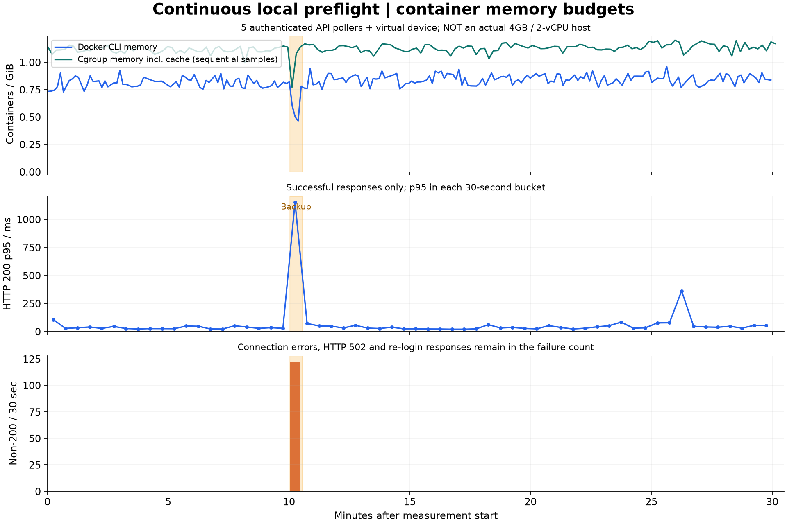

# 4GB 사전 자원 시험과 백업 중 접속 상태

2026-11-18 · 30분 연속 로컬 시나리오 완료 · 외부 서버 생성·구매·배포 없음

## 무엇을 확인하는 시험인가요?

서로 다른 장소의 팀원이 통합할 서버를 준비하면서, 작은 서버에서 앱·DB·모니터링·백업을 함께 운영할 수 있을지 먼저 관찰한다. 실제 Lightsail 4GB 서버를 만든 시험은 아니다. 공유 Docker VM은 약 7.75GiB·10 CPU·ARM이며 다른 프로젝트도 실행 중이다. 전역 설정은 변경하지 않고 시험 컨테이너마다 메모리 한도를 적용했다. 기존 학습 스택은 임시로 중지하고 시험 종료 후 원래 컨테이너를 재시작한다. 기존 볼륨을 삭제하거나 시험 DB로 재사용하지 않는다.

따라서 이번 결과는 **4GB 후보의 자원 배분과 문제를 찾는 근거**다. 실제 4GB Linux·2 vCPU·amd64 서버에서 운영체제, Docker, 외부 저장소 지연까지 포함한 인수를 대신하지 않는다. 특히 CPU를 2개로 제한한 시험이 아니므로 응답·기동 시간을 클라우드 보장값으로 쓰면 안 된다.

## 시험 조건

- 총 30분: 정상 10분 → 백업 작업을 포함한 10분 → 회복 관찰 10분.
- 같은 조회 계정의 독립 로그인 세션 5개가 HTTPS 구역 상태 API를 각각 초당 최대 1회 호출한다. 응답을 기다린 뒤 다음 요청을 보낸다. 실제 브라우저 5개의 렌더링 시험이 아니다.
- 가상 장치 하나가 사건을 생성하고 DB 커밋 후 응용 ACK를 받는다. 시뮬레이터를 반복 기동하므로 실제 장치의 연속 연결·재접속 폭주 시험과는 다르다.
- O4 백업은 web/backend/simulator를 멈춘 뒤 dump·암호화·별도 DB 복원 비교·revision 예약·재기동을 수행한다. 이번에는 장치 생성도 백업과 겹치지 않게 직렬화했다. 백업 중 원격 장치의 outbox 축적·재전송은 별도 인수 항목이다.
- Docker 메모리·CPU와 컨테이너 상태를 반복 수집한다. 캐시 포함 cgroup 표본과 Grafana 지표 조회·SSE 단발 확인은 시작 직후부터 보조 관측으로 수집했다. 주 API 부하와 보조 확인의 주기를 구분한다.
- 이미지 빌드·초기 설치는 측정 앞의 준비 단계이며 4GB 서버에서 직접 빌드할 때의 메모리 검증이 아니다.
- TLS 검증을 생략하지 않고 시험용 CA를 신뢰한다. 공개 주소·외부 포트는 만들지 않는다.

| 서비스 | 메모리 한도 |
|---|---:|
| Spring Boot | 1,024MiB |
| PostgreSQL | 512MiB |
| Grafana | 512MiB |
| Prometheus | 384MiB |
| MQTT·Nginx·node-exporter·blackbox·revision 참조 서비스 | 각각 64MiB |
| 상시 서비스 합계 | 2,752MiB |
| 가상 장치 / 복구 도구 | 128MiB / 384MiB |

상시 서비스와 두 보조 도구 한도를 모두 더하면 3,264MiB다. 한도는 예약량이나 실측 사용량이 아니다. OS·Docker·호스트에서 수행하는 암호화 Python 프로세스는 이 합계에 포함되지 않으며, 현재 공유 VM의 남은 메모리를 4GB 서버 여유로 환산하지 않는다. 컨테이너 메모리+스왑 한도는 메모리 한도와 같게 해 컨테이너 스왑에 의존하지 않도록 했다.

## 측정 결과

**사용자가 재개한 새 실행에서 30분 연속 로컬 시나리오를 완료했다.** 정상10분·백업포함10분·회복10분을 수행했고, 두 시계의 최대 차이는 0.004831초였다. 부하 종료 후 최종 확인을 포함한 기록 구간은 약1,812초다. 실제 4GB VM·2 vCPU 서버를 검증한 것은 아니므로 클라우드 용량 확정과 외부 인수는 남아 있다.

| 구간 | 요청 수 | HTTP200 | 실패 | 성공 응답 p95 | 성공 응답 최대 |
|---|---:|---:|---:|---:|---:|
| 정상10분 | 2,991 | 2,991 | 0 | 34.183ms | 3111.013ms |
| 백업포함10분 | 2,989 | 2,867 | 122 | 35.107ms | 3154.611ms |
| 회복10분 | 2,990 | 2,990 | 0 | 53.870ms | 998.285ms |

총8,970건을 관측했다. 실패122건은 연결 오류92건·HTTP502 25건·재로그인401 5건이며 백업 구간에 집중됐다. 최초 로그인·재로그인 시간이 일부 요청 표본에 포함된다. API 서버 내부 처리 시간이나 브라우저 화면 렌더링 시간만을 잰 값이 아니다.

| 자원·백업·데이터 확인 | 관측값 | 해석 |
|---|---:|---|
| Docker 표시 메모리 합계 최고 표본 | 986.615MiB | 일부 캐시 제외 |
| 캐시 포함 cgroup 합계 최고 표본 | 1,228.680MiB ≈ 1.20GiB | 순차 수집, 전체 서버 메모리가 아님 |
| 호스트 측 계측·암호화 Python RSS 최고 표본 | 25.422MiB | 다른 명령·관측 프로세스나 OS 전체를 포함하지 않음 |
| 복구 도구의 관측 peak | 268.629MiB | 설정 한도384MiB. 짧은 피크를 전부 포착했다는 뜻은 아님 |
| 관측 OOM kill / 자동 재시작 | 0 / 0 | 백업에 따른 의도한 중지·재기동은 별도 |
| 검증 포함 백업 작업 | 31.528초 | dump·암호화·격리 복원 비교·revision fence·재기동 |
| 실패 시작~마지막 실패 뒤 성공 | 25.606초 | 재로그인까지 포함한 요청 관측 구간 |
| 백업 내용 비교 | public테이블20개, 당시 사건50건 | dump77,561B·암호화 파일251,852B인 작은 데이터 |
| 최종 사건 대조 | 생성147 = DB147 = STORED ACK147, pending0 | 종료 확인용 추가 사건1건 포함 |
| 상태 번호 역행 | 0건 | 백업 전후 조회에서 확인 |

주황색 구간이 실제 백업 작업이다. 메모리가 줄어드는 것은 앱을 멈추기 때문이며 온라인 백업의 낮은 메모리 비용을 입증하지 않는다. 가운데 그래프는 **30초 묶음의 성공 응답 p95**, 위 표는 **10분 구간 p95**다. 성공 응답이 빠르더라도 아래 실패 막대를 함께 봐야 한다.

주 메모리 표본211개 중 별도로 수집 실패33회를 기록했고 최대 표본 간격은15.259초였다. cgroup 보조 수집은 시작 약0.99초부터170개 표본을 수집했고 개별 읽기 누락은4건이었다. `unknown` 서비스로 남은 Docker 표본은 해당 컨테이너가 사라져 서비스 라벨을 확인하지 못한 경우이며 합계에서 숨기지 않았다. 컨테이너 CPU 합계 최고 표본은155.03%지만 CPU를2개로 제한하지 않았고 준비 단계의 빌드·기동 피크도 포함하지 않으므로 실제2 vCPU 성능의 증거로 쓰지 않는다.

Grafana를 통한 지표 질의1,281회와 SSE 단발 확인61회가 성공했다. **SSE 확인에서 실패가0이었다고 무중단을 뜻하지 않는다.** 30초 간격의 짧은 확인이 약25.6초의 실패 구간을 놓쳤다. 1초 간격 API 요청은122건의 실패를 기록했고, Prometheus의 backend `up`과 내부 HTTPS 검사도0으로 바뀌었다. “값 없음”, “0”, “마지막 값1”을 구분해 본다.

[새 판정과 원본 근거](../validation/preflight-4gb-continuous-2026-11-18/README.md)에 실행 환경·소스 해시·원본 표본·그래프·백업 범위·기존 환경 대조를 보존했다. 이번 실행은 기존 컨테이너78개(중지된 이전 시험 포함)의 ID·볼륨 연결·실행 상태를 확인했고, 학습 컨테이너12개를 재시작했다. 새 시험 환경은 중지했다. DB 내용의 바이트 동일성 검사나 독립 저장소 회수 검증은 아니다.

앞선 [절전 포함 실행](../validation/preflight-4gb-interrupted-2026-11-18/README.md)과 [자동 중단된 재시험](../validation/preflight-4gb-retry-paused-2026-11-18/README.md), [당시 보류 판정](../validation/preflight-4gb-2026-11-18/README.md)은 그대로 남겼다. 이번 결과와 합산하거나 성능 개선 배수로 비교하지 않는다.

## 숫자를 읽는 방법

**응답 p95**는 성공한 응답 100개 중 약 95개가 해당 시간 안에 끝났다는 뜻이다. 평균보다 느린 쪽을 보기 좋지만, 실패한 요청을 성공 응답 시간에 섞으면 의미가 달라진다. 그래서 성공 p95와 전체 요청의 실패 건수를 함께 제시한다. 백업 중 연결 실패와 재로그인에 따른 401도 삭제하지 않는다. 초기 로그인 시간이 포함된 첫 요청이나 재로그인 직후 요청은 순수 서버 처리 시간과 다르다.

**Docker 화면의 메모리**는 Linux에서 일부 파일 캐시를 뺀 수치다. 컨테이너가 실제로 한도에 걸리는지는 캐시를 포함한 cgroup 사용량·한도 도달·OOM 기록도 확인해야 한다. 개별 서비스 최고치를 서로 더하면 서로 다른 시점의 값을 더하게 되므로 전체 최고치는 같은 표본에서 합산한다. cgroup 수집은 각 컨테이너를 순서대로 읽으므로 엄밀한 동시 표본이 아니다. 짧은 피크를 놓칠 수 있다. [Docker 공식 설명](https://docs.docker.com/reference/cli/docker/container/stats/)

**백업 파일 생성 성공과 복원 성공은 다르다.** 이번 O4 경로는 암호화 파일을 다시 해독하고 별도 DB에 실제 복원해 모든 public 테이블의 행 수·정렬된 행 해시를 비교한다. 다만 이 시간은 작은 로컬 DB의 검증 포함 백업 시간이다. 서버 유실 후 새 서버 준비·키 회수·최신 revision 대조·장치 조정·사용자 인수를 포함한 전체 RTO가 아니다.

**Prometheus는 수치의 시간 기록, Grafana는 그 수치를 보는 화면**이다. 사건 수신·저장·ACK를 구분해야 “브로커에 도착했지만 저장에 실패한 상태”를 찾을 수 있다. 이번 측정에서는 지표 조회 성공과 업무 API 성공도 별개로 센다. 같은 서버가 통째로 꺼지면 둘 다 관측하지 못하므로 외부 접속 검사·실제 알림 전달은 여전히 필요하다.

## 준비 중 발견한 문제

1. 공유 Docker의 자동 네트워크 주소 풀이 소진됐다. 기존 네트워크를 지우지 않고 시험 전용의 겹치지 않는 주소 범위를 지정했다. 이는 4GB 용량 실패가 아니다.
2. 초기 Grafana 384MiB 한도에서 cgroup 한도 도달이 반복되고 준비 확인이 90초 안에 끝나지 않았다. OOM 강제 종료 기록은 없었다. 512MiB로 조정하자 정상 준비가 확인됐고, 새 시험 환경을 만들어 다시 측정했다. 전체 서버를 곧바로 8GB로 바꾸는 대신 서비스별 배분 문제를 먼저 확인한 사례다.
3. 주 수집기에서 일부 표본이 실패했고, 같은 경로를 별도로 실행해 `docker stats`의 `EOF` 오류를 재현했다. 단명 컨테이너 종료와의 경합은 가능한 원인이지만 직접 원인으로 확정하지 않는다. 실패 횟수·최대 표본 간격을 결과에 남기고, 컨테이너별 읽기 실패가 전체 표본을 버리지 않는 cgroup 보조 수집기로 비교한다. 누락을 정상 메모리 0으로 채우지 않는다.

4. 앞선 두 실행에서 Mac 잠자기가 끼었다. 실제 시계와 측정용 시계의 차이를 검사하도록 보강했고, 이번에는 단절 없이 완료했다. 과거 실패 기록을 새 성공값으로 바꾸지 않았다.

## 같은 시험을 다시 실행할 때

노트북 덮개를 열고 깨어 있는 상태를 약 35분 이상 유지한 뒤, [실행 도구 안내](../infra/preflight/README.md)에 따라 새 환경으로 시작한다. 준비 시간이 더 길면 30분 측정은 그 뒤에 시작된다. `caffeinate -i`는 실행 동안의 유휴 절전 방지이며 덮개 잠자기를 막지 못한다. 시간 단절을 감지한 실행의 성능 그래프·통과 판정을 만들지 않는다.

정상 10분·백업 포함 10분·회복 10분을 끝내고 시간 연속성, 오류·OOM, 표본 누락, 사건/ACK/DB/pending, 백업 내용 비교와 기존 환경 복구를 다시 확인한다. 현행 백업은 파일 내용 합계 128MiB 제한과 메모리 기반 암호화를 사용하는 로컬 도구이므로 실제 데이터 규모의 백업은 별도 확인이 필요하다.

## 다음 배포 단계

[팀 통합 배포 준비](team-integration-preparation.md)의 차이 표를 따른다. 총 5만 원·Lightsail 4GB 조건부·12월 11일까지 운영 방향을 유지하되, 실제 CPU·메모리 여유와 백업 중단을 포함한 외부 인수는 남아 있다. 실제 외부 revision 저장소 어댑터, 외부 백업 회수, 도메인 인증서·장치별 ACL·제한된 MQTT TLS 공개 설정도 완료된 것으로 표시하지 않는다.

## 이해 확인

1. 컨테이너 메모리 합계가 4GB보다 작으면 곧바로 4GB 서버에서 안전하다고 할 수 있을까? → OS·Docker·암호화 프로세스·캐시·실제 CPU와 피크를 함께 확인해야 한다.
2. 성공 요청 p95가 빠른데도 팀원이 접속 장애를 겪을 수 있을까? → 백업 중 실패 요청이 별도로 존재할 수 있다. 성공 지연과 실패율을 함께 봐야 한다.
3. 백업 파일이 만들어졌으면 2시간 RTO도 통과한 것일까? → 아니다. 파일 검증과 원본 서버 없는 전체 서비스 복구는 다른 시험이다.
4. 가상 사건을 다시 만들 수 있는데 revision과 발표 증거도 버려도 될까? → revision은 복원 뒤 상태 순서의 안전성에 필요하고, 로그·캡처·원본 수치는 재현으로 대체할 수 없는 발표·블로그 근거다.
