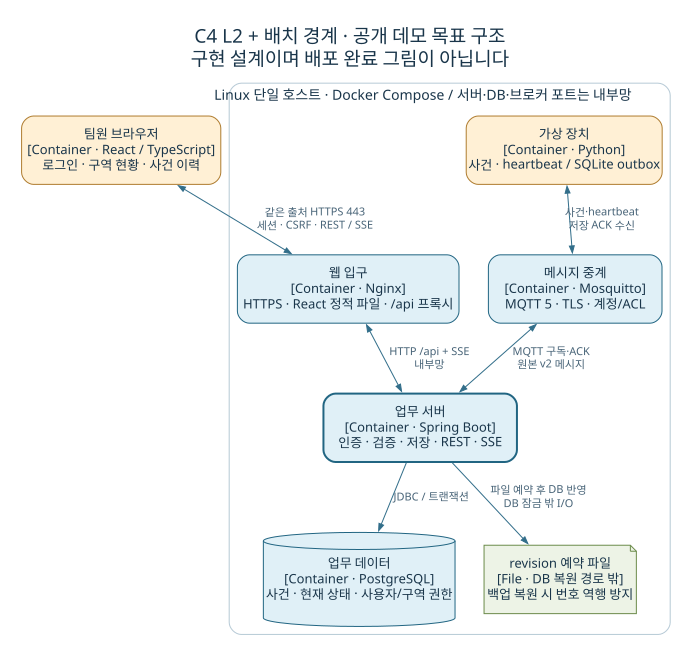

# 다음 구현: 웹에서 확인하고 프론트 담당자에게 넘기기

설계 2026-11-13 · 진행 갱신 2026-11-14 · M1 API 구현, 화면·배포 전

**학습을 잠시 뒤로 미루고, MQTT 수신부터 로그인한 웹 화면까지 먼저 완성합니다.** 지금까지 만든 저장 코드를 그대로 사용합니다. 완성 후 실제 파일과 실행 흐름을 따라 학습합니다.

## 완성되면 이렇게 사용합니다

1. 팀원이 HTTPS 주소로 접속해 로그인합니다.
2. 가상 장치가 보고한 구역 상태·차량 분류·안내 횟수·카메라 상태를 확인합니다.
3. 사건을 눌러 이력과 상세 내용을 봅니다.
4. 장치 송신을 멈추면 연결 지연/끊김이 표시됩니다. 웹 연결이 끊겼다가 돌아와도 최신 상태로 복구됩니다.
5. 프론트 담당자는 저장소를 받아 같은 화면을 실행하고 UI를 개선합니다.

화면은 **로그인 / 구역 현황 / 사건 목록·상세** 3종입니다. ‘가상 장치 데모’를 표시하고 실제 차량을 감지한 것처럼 표현하지 않습니다.

## 무엇을 만들까요?

| 현재 확인한 것 | 이번에 완성할 것 | 다음 범위 |
|---|---|---|
| MQTT 사건 수신·검증·DB 저장 | 로그인·구역별 조회 권한 | 실제 보드·AI·현장 출력 |
| 정상/중복/충돌/역순 처리 | 상태·사건 조회 API | 관리자 명령·정책 변경·review 작성 |
| DB 커밋 후 저장 완료 ACK | heartbeat·실시간 화면 갱신 | 사진 업로드·조회 |
| 자동 시험과 실제 MQTT/SQL 확인 | React·가상 장치·HTTPS 배포·인계 | 현장 성능·대규모 운영 |

‘이번에 완성’은 **조회 가능한 첫 인계판 전체**입니다. v1.43의 모든 제품 기능을 구현 완료했다는 뜻은 아닙니다. 공개 URL에는 팀원 로그인이 필요하며 GitHub 비공개 저장소를 public으로 바꾸지 않습니다.

## 구현 순서

2026-11-14 당일 인계 우선순위: M1이 완료되어 **M3의 REST 화면부터 착수**합니다. M2 전체 완료를 기다리지 않습니다. 이후 M2와 화면을 결합하고 통합·배포를 진행합니다. [당일 체크리스트](frontend-handoff-checklist.md)에서 현재 상태와 공개/로컬 인계 기준을 확인합니다.

| 순서 | 결과 |
|---|---|
| M0. 계약·DB 준비 | 빠진 웹 오류 코드, 구역 권한 테이블, 초기화/복구 기준 |
| M1. 로그인·조회 | **구현·시험 완료**. [7개 경로·계정·실행 안내](authenticated-read.md) |
| M2. 실시간 연동 | heartbeat, 15초 초과 STALE / 30초 초과 OFFLINE, SSE |
| M3. React 화면 | 실제 API 연결, 빈 상태·오류·재로그인·재연결 처리 |
| M4. 자동 시나리오 | 가상 장치로 정상·장애·재전송을 재현하는 통합 시험 |
| M5. 운영 준비 | Docker 배포, HTTPS, 비밀값·포트 관리, 복원 시험 |
| M6. 외부 확인·인계 | 외부 주소 접속 검증, 실행 안내, 프론트 수정 경계와 학습 지도 |

터미널 명령을 하나씩 따라 하는 실습을 매 단계의 선행 조건으로 두지 않습니다. 구현과 검증을 진행한 뒤 완료 내용·실패한 점·남은 일을 보고합니다.

## 지금 정한 것과 나중에 필요한 정보

Spring Boot·PostgreSQL·Mosquitto를 유지합니다. 프론트는 **React + TypeScript + Vite**, 실시간 갱신은 **SSE**, 배포는 **단일 Linux 서버 + Docker Compose + Nginx**로 정합니다. 서버와 브라우저는 같은 HTTPS 주소를 사용합니다.

실제 공개 직전에는 사용할 서버·예산, 도메인/DNS 권한, 팀원 계정 전달 대상, 백업과 revision 기록의 보관 위치가 필요합니다. 코드·자동 시험·로컬 배포 구성은 이 정보 없이도 먼저 만들 수 있습니다. 카메라와 실험 장소 확정은 이번 웹 구현의 선행 조건이 아닙니다.

## 상세 자료

- [구현 설계서](design/public-demo-plan.md): API·세션·DB·실시간·배포의 구현 기준
- [결정 기록 ADR-005](adr/005-public-demo-boundary.md): v1.43에서 구체화하거나 보완한 부분
- [설계 검토서](design/public-demo-review.md): 발견한 빈틈과 인수 시험
- [작업·인수 조건 JSON](design/public-demo-workplan.json): 다음 개발 AI가 실행할 순서와 완료 조건

이 문서는 전체 목표와 순서입니다. 실제 기능의 작성·시험·공개 여부는 [현재 상태](status.md)에서 따로 관리합니다.
